# README.PLUGINS

How the **RedAmon plugin system** works, end to end: the architecture, the design, and
the mechanics of installing, updating and uninstalling a plugin.

This document explains the **platform**, not any individual plugin. It is written for
two audiences:

- **Platform developers** working in this (base) repo, who build and maintain the
  machinery that hosts plugins.
- **Plugin authors** working in the separate **`redamon-plugins`** repo, who need to know
  the contract a plugin must satisfy.

What a specific plugin does (for example the first one, **`skiller`**) is documented in
that plugin's own folder in `redamon-plugins`, never here. This file describes the host;
the plugins are its guests.

> **Status: built, plugin platform 1.0.0, part of every RedAmon install** (it needs Docker
> Engine 28.0.0 or newer, §5.4). The plugin tables and stores, the Plugin Manager and the
> Plugins page, the catalog signature check, the Gateway, the UI host
> ([`webapp/src/lib/plugins/`](../../webapp/src/lib/plugins/)) and the Runner
> ([`services/plugin_runner/`](../../services/plugin_runner/)) all exist. The plugin repository is
> public at [`samugit83/redamon-plugins`](https://github.com/samugit83/redamon-plugins) with a
> signed catalog, and its first plugin, Skiller 1.0.0 (§6.5), installs from that catalog or from
> files (§9.7). The plugin author's contract is [README.PLUGIN_SDK.md](README.PLUGIN_SDK.md).
> Where the build differs from the first design, this document describes the build; §13 lists
> the differences. Links to code are real.
>
> **Diagram convention.** Every diagram sets its own colours on its first line, so it reads
> the same in light and dark themes whatever the viewer's default. When you add a diagram,
> copy that line from an existing one, and wrap sequence-diagram messages in the light
> `rect` panel the others use.

---

## 1. The problem, in one paragraph

RedAmon keeps growing. Every feature ships to everyone who clones the repo, together with
the Docker images and models it brings, whether or not a given user wants it. We want
optional features that stay **out of the base repo entirely**, that an administrator
**downloads and installs on demand**, that are **updated independently of RedAmon
releases**, and whose removal returns the product to exactly its factory behaviour. The
plugin system provides this. It follows the model of VS Code extensions and browser
extensions: a small, stable **platform** lives in the base product, and the features live
outside it and plug in through a fixed, versioned contract.

---

## 2. The core model: two repos and a catalog

There are two repositories and one index that connects them.

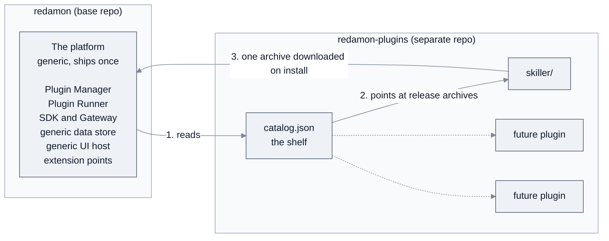

- **`redamon` (this repo)** contains the **platform**: everything needed to *host* plugins.
  It contains **no plugin code** and does not know what any plugin does.
- **`redamon-plugins`** is a **monorepo of plugins**: many plugins side by side (`skiller`
  first, others later) plus a top-level **`catalog.json`** that lists them. Each plugin is
  versioned and released **independently**, even though they share one repo (§6.2).
- **The catalog** is the bridge: a signed JSON index that tells the platform which plugins
  exist, their versions, download URLs, checksums and requested permissions.

Nobody clones `redamon-plugins` to use a plugin. The platform downloads a single plugin's
release archive at install time into a persistent folder, and runs it from there.

That folder is a Docker volume (§9.2), never the `redamon` git checkout: installing,
updating or uninstalling a plugin changes no file in the base repository. The
`redamon-plugins/` path that [`.gitignore`](../../.gitignore#L249) ignores at the root of the
checkout is only where a developer may keep a clone of the plugin repository to write
plugins; RedAmon never reads it at runtime.

### 2.1 The life of a plugin, in one picture

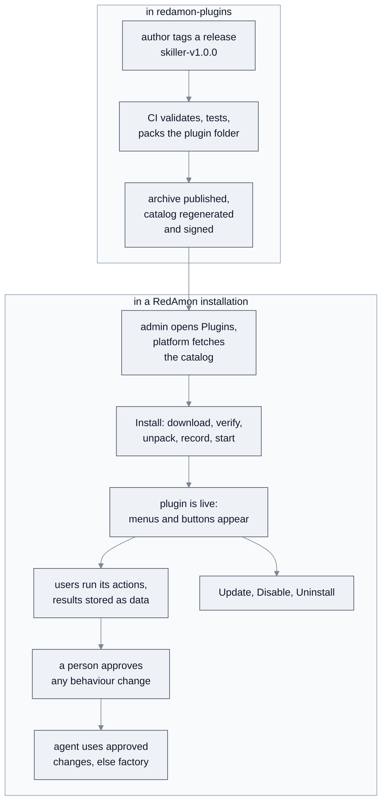

The rest of this document zooms into each box.

---

## 3. Design principles (the invariants)

Everything below exists to preserve six rules. A change that breaks one of them is wrong.

1. **The base product always works without any plugin.** Plugins are purely additive.
   Disable or uninstall every plugin and RedAmon behaves exactly as it does today. The core
   never *waits* on plugin code on a hot path (§8.2).
2. **Plugins contribute only at declared extension points.** A plugin cannot patch
   arbitrary core code; it can only register at named slots the platform deliberately
   opened (§7.6). This is what stops plugins tangling into the core and into each other,
   the problem that motivated the system.
3. **Data, not schema; descriptions, not compiled screens.** Installing a plugin never
   changes the database schema and never rebuilds an image. Plugin state lives in a generic
   store (§7.4); plugin UI is *described* and drawn by a generic host (§7.5).
4. **Plugin code is untrusted and runs isolated.** It runs in a separate **Plugin Runner**
   (§5) with no database credentials, no LLM keys and no internet access, and reaches the
   system only through the **Gateway**, which enforces the permissions an administrator
   approved (§10).
5. **A person approves every change to agent behaviour.** No plugin output changes what
   the agent does until a person has reviewed it as a before/after comparison and approved
   it, in core UI the plugin does not control (§7.6).
6. **The platform API is a public contract.** Once plugins depend on an SDK call, an
   extension point or a UI primitive, it is versioned and cannot change silently (§11).

---

## 4. The platform, at a glance

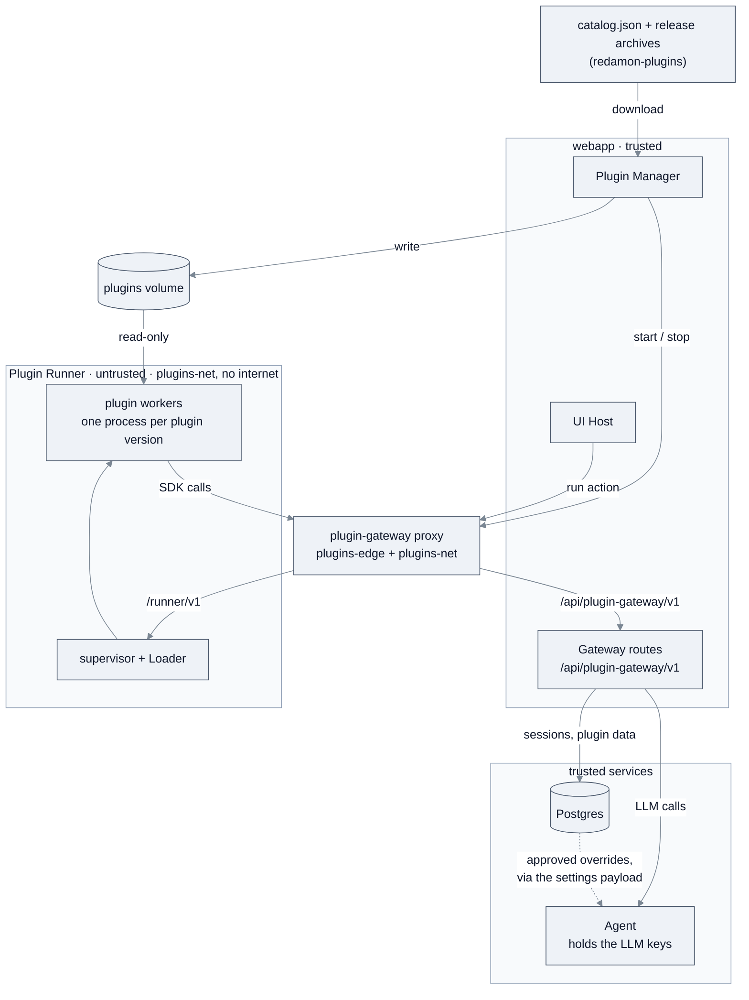

The six platform components (§7) are all **generic**: none contains logic for `skiller` or
any other plugin. The Runner sits alone on `plugins-net`, an internal network with no route out.
The only way between it and the webapp is the `plugin-gateway` proxy, a small container on
`plugins-net` and `plugins-edge` (which the webapp joins through the overlay of §5.4) that passes
plugin code's calls to the Gateway routes and the run list, and the webapp's calls to the
supervisor, and nothing else. Neither network publishes a host port, and the proxy is not on the
`redamon` network where Postgres, Neo4j and the agent listen. The dashed line is the only way plugin output can change core behaviour:
approved overrides are **data** the agent reads at each turn (§8.2). The agent never calls
plugin code.

---

## 5. The Plugin Runner

### 5.1 Why a separate container

The agent is baked into the `redamon-agent` image and sits on the critical path of every
session. Running downloaded third-party code inside that process would let a slow or
crashing plugin take the agent down, and would put plugin code next to the LLM API keys.
So plugin code runs in its **own container, the Plugin Runner**:

- **Isolated failure.** A broken plugin cannot crash the agent or the webapp.
- **Isolated secrets.** The Runner holds no database credentials and no LLM keys. When a
  plugin needs an LLM it asks the Gateway, and the **agent** makes the call with the user's
  key. The agent's master-key endpoint `POST /plugins/llm/invoke`
  ([plugin_api.py](../../agentic/plugin_api.py#L196)) builds the model the user chose for the
  plugin with the helper every per-feature model choice uses
  ([`_build_feature_llm`](../../agentic/api.py#L488)). The key never enters the Runner, which
  keeps the credential boundary RedAmon already enforces.
- **Code loaded at runtime, no rebuild.** Plugin code lives on a persistent volume that the
  Runner reads. The idea extends an existing precedent: community skills are Markdown files
  bind-mounted read-only into the agent and picked up without a rebuild
  ([docker-compose.yml:906](../../docker-compose.yml#L906)). Plugins apply the same idea to
  code, in a container built for it. A new plugin needs **no image rebuild**, as long as it
  only uses libraries the Runner image provides (§11.3).

### 5.2 Inside the Runner: one supervisor, one worker per plugin version

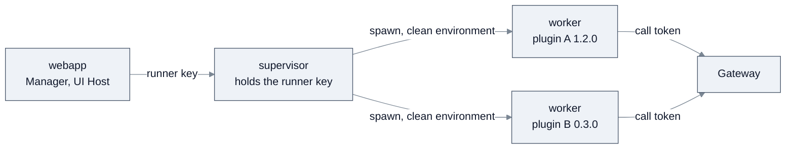

Python cannot reliably unload a module or kill a running thread, and every plugin has a
top-level `engine/` package that would collide in a shared interpreter. So the Runner never
loads plugin code into its own process:

- A **supervisor** process receives requests from the webapp and manages workers.
- Each **(plugin, version)** gets its own **worker subprocess**, with
  `sys.path = [platform SDK, plugin root, plugin vendor folder]`. Two versions of one
  plugin (old and new during an update) are simply two workers.
- **Unload** means terminating the worker, **reload** means starting a new one, and a
  **timeout** means killing it. Each action's timeout is therefore actually enforceable.
- Each worker runs under its **own UID** with memory, CPU and process limits, and starts with
  a **clean environment**. Call tokens arrive with each request, not through the environment.

### 5.3 Authentication

- **Webapp to Runner.** A dedicated `PLUGIN_RUNNER_KEY`, held only by the webapp and the
  supervisor. The check is auth-only and **fails closed**: no key configured means no
  requests accepted. It deliberately does not reuse the agent's
  [`require_internal_auth`](../../agentic/llm_guard.py#L186), which accepts every request when
  no key is set and applies the per-user LLM spending cap. The auth-only shape of
  [`require_internal_auth_only`](../../agentic/llm_guard.py#L249) is the model to follow.
- **Workers to Gateway.** Only the per-call token described in §7.3. Workers never see the
  runner key.

### 5.4 How it runs, and what happens when it is down

The Runner is a service of every RedAmon stack. Its two services, `plugin-runner` and the
`plugin-gateway` proxy (one image, `redamon-plugin-runner`), are in the `plugins` compose
profile, and the webapp's plugin wiring (the `plugins-edge` network and the plugins volume) is
in the `docker-compose.plugins.yml` overlay. `./redamon.sh install`, `update`, `up` and `up dev`
load the overlay, and only they start the profile, once the core services are up
(`plugins_converge`, which also recreates both services after a runner rebuild). `install`
builds the image, `update` rebuilds it when its sources or a compose file changed, and `up`
builds it when it is missing; a build that fails stops the command. A plain `docker compose up
-d` starts neither service and does not load the overlay: the webapp then has no plugin network
or volume, and every plugin action fails until `./redamon.sh up`. `update` recreates the running
webapp when it is not on `redamon-plugins-edge` or the overlay changed. Only
`./redamon.sh purge` removes the plugins volume.

RedAmon needs **Docker Engine 28.0.0 or newer**, because both plugin networks use
`gateway_mode_ipv4: isolated` (without it a worker reaches the host itself). `install`,
`update` (before its `git pull`), `up` and `up dev` check the engine before building anything
and stop on an older one. After the secrets are generated and before any core service is
created, a preflight checks that this host can run the platform: `INTERNAL_API_KEY`,
`PLUGIN_RUNNER_KEY` and `PLUGIN_CALL_TOKEN_SECRET` set and not `changeme`; the token secret at
least 32 characters and different from `AUTH_SECRET`, `PLUGIN_RUNNER_KEY`, `INTERNAL_API_KEY`
and `AGENT_WS_TICKET_SECRET`; the engine; the runner image; and Docker accepting the plugin
networks, volume and containers. A failure stops the command with `The plugin platform cannot
run on this host: <reason>.`, and `./redamon.sh status` prints the same reason. The memory gate
always budgets the runner, so a host too small for it gets the ordinary memory refusal. When
the core is up but the two plugin services do not start, the command stops with `The plugin
services did not start` and prints no ready banner. An update that stops after its `git pull`
leaves `.update-pending` (gitignored) holding the commit it started from: fix the cause and run
`./redamon.sh update` again, which diffs from that commit ("Finishing the update that started
at ...") and so rebuilds everything the release changed. Until then `./redamon.sh up` still
starts the stack but warns that some images may be older than the code.

The Runner is small, and idle when no plugin is installed. It has container limits
(`mem_limit` sized by the memory governor, `pids_limit`, `cpus`), a healthcheck, and `json-file`
log rotation (10 MB × 3). The proxy has the same healthcheck and rotation and a fixed 128 MB
limit.

**No other service depends on it.** If it is stopped or missing, the stack runs normally:
plugin actions return `503 runner_unavailable`, the Plugins page shows the Runner as down, and
**overrides that were already approved keep applying**, because they are data in Postgres, not
plugin code (§8.2).

---

## 6. Anatomy of a plugin (in `redamon-plugins`)

### 6.1 Repo layout

```
redamon-plugins/
├── catalog.json                 # written by the release, revoke and re-sign workflows, never by hand
├── catalog.json.sig             # detached signature over catalog.json
├── .github/workflows/           # ci.yml, release.yml, revoke.yml, catalog-resign.yml, listings.yml
├── .platform-sdk/<version>/     # unedited copy of the platform SDK and schemas, per platform version
├── tools/                       # validate, pack, catalog, sign, gen_key, semver, sync_sdk, run_tests
├── skiller/
│   ├── plugin.json              # the manifest: the whole contract with the platform
│   ├── engine/                  # Python actions, executed by a worker
│   ├── vendor/                  # optional bundled pure-Python dependencies
│   ├── ui/                      # screen descriptions (JSON), drawn by the UI host
│   ├── migrations/              # data migrations: 0002_up.py, 0002_down.py, ... (§9.5)
│   ├── tests/                   # never packed
│   ├── listing.json             # optional, never packed: the card's icon and documentation link (§6.2)
│   ├── icon.jpg                 # optional, never packed: that icon (JPEG, PNG or WebP, square, at most 256 KiB)
│   ├── CHANGELOG.md
│   └── README.md                # what skiller does is documented HERE, not in base
├── <next-plugin>/
└── <another-plugin>/
```

Each top-level folder is one plugin and is fully self-contained. Plugins never import from
each other; anything two plugins share belongs in the platform SDK. A plugin id must match
`^[a-z][a-z0-9-]{1,39}$` and must not be a reserved name (such as `staging`), because it
becomes a folder name on the plugins volume.

### 6.2 Releases and the catalog

Plugins share a repo but are released one at a time. A release is a git tag of the form
`<pluginId>-v<version>` (for example `skiller-v1.0.0`). For that tag, CI:

1. validates `plugin.json` and every screen description against the platform schemas,
2. runs that plugin's tests against the **lowest** platform version in its declared range,
3. packs **only that plugin's folder** into `<pluginId>-<version>.tar.gz`,
4. computes its SHA-256 and attaches the archive to a GitHub release,
5. regenerates `catalog.json`, increments its `serial`, and writes a detached signature.

The GitHub release (step 4) and the catalog (step 5) are published only after a reviewer
approves the protected `release` environment, and every job that signs runs in one CI
concurrency group, `catalog`, so two never race on the catalog. GitHub keeps one waiting run per
group: a third run cancels the one still waiting, which is then re-run by hand.
The signing key lives in that environment; release tags are protected. CODEOWNERS names an owner
for every plugin folder and for the tools, but it is enforced only through pull-request review,
which the `master` ruleset does not require (one maintainer pushes directly), so the reviewer of
the `release` environment is the gate that matters: one key signs every plugin in the repo.
§6.4 covers the keys, the workflows and the one-time repository setup. Who may add or change a
plugin, and how, differs for an administrator with write access and an outside author working
through a pull request: §6.6.

**Why one repository carries independent versions.** A tag marks one commit, and CI packs
only the tagged plugin's folder as it was at that commit. `skiller-v1.0.0` and
`echo-v0.3.1` can point at different commits; later changes on `master` never alter an
archive already published, whose bytes the catalog pins by sha256. The catalog keeps every
release of every plugin, so an installation on an older platform still finds a release
whose range includes it.

```jsonc
{
  "catalogVersion": 1,
  "serial": 42,                             // only ever increases
  "plugins": [
    {
      "id": "skiller",
      "displayName": "Skiller",
      "description": "…",
      "icon": {                             // optional, from listing.json
        "url": "https://raw.githubusercontent.com/<owner>/redamon-plugins/master/skiller/icon.jpg",
        "sha256": "…", "size": 43586, "type": "image/jpeg"
      },
      "docsUrl": "https://github.com/samugit83/redamon/wiki/Plugin-Skiller",   // optional
      "releases": [
        {
          "version": "1.0.0",
          "platform": ">=1.0.0 <2.0.0",
          "dataVersion": 1,
          "url": "https://github.com/<owner>/redamon-plugins/releases/download/skiller-v1.0.0/skiller-1.0.0.tar.gz",
          "sha256": "…",
          "permissions": ["…"]
        }
      ]
    }
  ],
  "revoked": [ { "id": "…", "version": "…", "reason": "…" } ]
}
```

- **Signature.** `catalog.json.sig` is a detached signature over the exact bytes of
  `catalog.json`. The base repo ships a **keyring** of trusted public keys with key IDs, so a
  key can be rotated by publishing the next key in a platform release before it is used.
- **Freshness.** The platform remembers the highest `serial` it has accepted and never goes
  back to an older catalog, so an attacker cannot serve an installation an old catalog that
  still lists a since-revoked version. Refusing an older catalog is not an error: the platform
  keeps using the last catalog it accepted, stored with its signature in `PluginPlatformState`,
  because the raw GitHub CDN can serve the previous `catalog.json` for up to 5 minutes after a
  release (`cache-control: max-age=300`, measured on the first release).
- **No expiry.** A catalog never expires (the owner's decision of 2026-10-11), so nobody has
  to re-sign it on a schedule, and installs and updates never pause because a date passed. An
  `expires` field left by older CI (the catalog of `skiller-v1.0.0` has one) is ignored. The
  accepted limit: the serial stops a *rollback* (an older catalog after a newer one), not a
  *freeze*. Whoever controls an installation's connection to GitHub (an attacker able to tamper
  with HTTPS there, or an admin who points `PLUGINS_CATALOG_URL` elsewhere) can keep serving it
  the last catalog it saw, or a new installation any older genuine catalog, for as long as that
  control lasts, hiding later releases and revocations.
- **One mark per trust scope.** The highest serial is kept once for all the official keys, so
  a rotated-out key cannot replay below a newer key's serial, and once per extra trusted key,
  so a custom or development catalog never holds the official one back.
- **Revocation.** An installed version that appears in `revoked` stops at the next
  reconcile (every `PLUGIN_RECONCILE_INTERVAL`, 5 minutes by default) that reads the new
  catalog: after the raw CDN serves it (up to 5 minutes) and RedAmon's 60-second catalog cache,
  so about 11 minutes at worst. Its actions and worker, its menu items and the skill versions
  it proposed stop (the agent uses the built-in text), the admin's `enabled` is left as it
  is, and the card shows the reason. A revoked version is never offered for install; an admin
  brings the plugin back with **Update** to a release that is not revoked (the card offers
  it), or uninstalls it. The plugin repository publishes a revocation with its hand-run
  `revoke.yml` (`tools/catalog.py revoke`), approved like a release, and lifts it with
  `unrevoke`.
- **Release choice.** The platform installs the newest release whose `platform` range
  includes the running platform version, not simply the newest release.
- **Download hosts.** Archive URLs must be `https` on an allowlisted host (GitHub release
  assets by default), so a catalog entry can never make the webapp fetch an internal address.
  The check applies to **every redirect hop**, because a GitHub release URL redirects to a
  separate storage host, and to the address actually connected to, which must be public, so
  DNS rebinding cannot reach the internal network either. Downloads are streamed to disk
  under a size cap and a timeout.
- **Consent first.** Permissions are listed per release, so the Plugins page can show the
  consent prompt *before* anything is downloaded.
- **Listing.** `icon` and `docsUrl` are presentation only. They come from the plugin folder's
  `listing.json`, not from the manifest, so they are not part of the plugin's contract: a
  catalog that carries them still installs on a platform that predates them, which ignores the
  fields. Release CI writes them with each release, and the hand-run `listings.yml`
  (`tools/catalog.py listings`) refreshes them without one. The icon URL is a file on a branch,
  which can change after signing, so the webapp shows it only when the bytes it fetched match
  the signed `sha256` and their magic bytes match `type`. It fetches the icon through the same
  download guard as an archive (at most 256 KiB) and serves it from its own origin, because the
  CSP of the plugin pages allows no other image source. `docsUrl` must be `https`, because it
  becomes a link on the card.

### 6.3 The manifest (`plugin.json`)

The manifest is the whole contract between a plugin and the platform: identity,
compatibility, permissions and contributions. The example below is a generic illustration,
not a real plugin.

```jsonc
{
  "id": "example-plugin",
  "version": "1.0.0",
  "displayName": "Example Plugin",
  "description": "…",
  "platform": ">=1.0.0 <2.0.0",           // platform API range it targets (§11)
  "dataVersion": 1,                       // shape of its stored data (§9.5)

  "permissions": [                        // approved by the admin at install (§10)
    "session:read",
    "llm:invoke",
    "override:skill.text"
  ],
  "llmFeature": { "description": "…" },   // required with llm:invoke: its tile in Models by feature

  "actions": [                            // entry points a worker can execute (§7.7)
    { "id": "run", "entry": "engine/main.py:run", "timeoutSeconds": 120 }
  ],

  "contributes": {                        // extension points it uses (§7.6)
    "nav": { "label": "Example", "icon": "puzzle", "screen": "ui/home.json" },
    "chat.session.actions": [ { "label": "Run example", "action": "run" } ]
  },
  "screens": ["ui/home.json"]              // every screen file it uses
}
```

The platform decides what a plugin may do from its manifest alone and never inspects its
Python for that. A capability missing from the manifest is a capability the plugin does not
have. `timeoutSeconds` is capped by a platform maximum (`PLUGIN_ACTION_MAX_TIMEOUT`). The
manifest is strict: an unknown key is refused, not ignored. Every field, with its limits, is in
[README.PLUGIN_SDK.md](README.PLUGIN_SDK.md) §3.

### 6.4 Catalog signing: keys, CI and trust

The signature is what makes a downloaded catalog trustworthy and, through the sha256 values it
lists, every archive. The verifying side is built
([`keyring.ts`](../../webapp/src/lib/plugins/keyring.ts),
[`catalog.ts`](../../webapp/src/lib/plugins/catalog.ts)); the signing side is `tools/sign.py`
and the release workflow of `redamon-plugins`, which signed the first official catalog (serial 1,
for `skiller-v1.0.0`).

**The official key today.** One key, id `ee4a2df9065d36b1` (public key
`RfUjPbeO+6ftsMNGkM5CnM46XIwQs+yRcPy4m5msyFg=`), is the only entry of `OFFICIAL_KEYS` in
[`keyring.ts`](../../webapp/src/lib/plugins/keyring.ts); `keyring.test.ts` fails if any other key,
a development key included, is added without updating its list. The catalog is served from
`https://raw.githubusercontent.com/samugit83/redamon-plugins/master/catalog.json` (the default
`PLUGINS_CATALOG_URL`) and its archives from GitHub release assets, which redirect once to
`release-assets.githubusercontent.com` (in the default `PLUGINS_DOWNLOAD_HOSTS`).
`catalog.live.test.ts` checks all of this against GitHub when run with `PLUGINS_LIVE=1`.

**How the signature works.** Signing uses an **Ed25519** key pair. The private key signs; the
public key can only verify, so publishing it is safe, and the private key cannot be derived
from it. `sign(private key, bytes)` gives a 64-byte signature and `verify(public key, bytes,
signature)` answers yes or no. One changed byte in the catalog, or a signature taken from
another catalog, fails verification.

**Why the signature is detached.** `catalog.json.sig` is a separate file, the JSON
`{"keyId": "…", "sig": "<base64>"}`, over the exact bytes of `catalog.json`. A signature
inside the JSON would have to cover a file that contains it: the verifier would remove the
field and re-serialize, and re-serialized JSON rarely has the same bytes (spacing, key
order) unless both sides implement a canonical form. A detached file is checked against the
bytes exactly as downloaded. For the official key, the id is the first 16 hex characters of the
SHA-256 of the raw public key.

**Where the keys live.**

| Key | Where | Used by |
|---|---|---|
| Production private key | generated outside both repositories; stored only as the secret `CATALOG_SIGNING_KEY` (with `CATALOG_SIGNING_KEY_ID`) of the GitHub environment `release` in `redamon-plugins`, plus an offline backup kept by the owner | the release, revoke and re-sign workflows, after a reviewer approves the job |
| Official public keys, the **keyring** | `webapp/src/lib/plugins/keyring.ts` in the base repository, compiled into the webapp image | the Plugin Manager, to verify catalogs |
| Extra trusted keys | `PLUGINS_EXTRA_TRUSTED_KEYS` in `.env`: an admin opt-in that the Plugins page warns about | custom catalogs, and the dev key during local tests |
| Dev key | generated by `tools/gen_key.py` outside both repositories | local tests only; never in the official keyring (a test fails if its id appears there) |

A private key is never in a repository, an image or an installation's `.env`, and the
`.gitignore` of `redamon-plugins` refuses `*.pem`. An installation holds public keys only, so
even a fully compromised RedAmon server cannot sign a catalog that other installations accept.

The keyring is code, not data, on purpose. A key stored in the database or in `.env` could be
added by anyone able to write there, and would then validate their own catalogs. Compiled
into the image, trusting a key is the same decision as trusting the RedAmon release that ships
it: that release is the **root of trust**. Adding or removing an official key is therefore a
RedAmon release, applied by `./redamon.sh update`.

**Verification, in order**, with Node's built-in `crypto.verify(null, bytes, key, sig)` (no new
dependency):

1. Download `catalog.json` as raw bytes, without parsing it, and `catalog.json.sig`.
2. Look up the signature's `keyId` in the keyring. An unknown key refuses the catalog.
3. Verify the signature over those bytes. A failure refuses the catalog, and nothing in it is
   used.
4. Only then parse **the same bytes** as JSON and validate them against the catalog schema:
   never a second download, and never bytes re-encoded from a decoded string, which can
   silently replace invalid characters.
5. Check `serial`, read from inside the signed bytes (§6.2), and store the accepted catalog
   with its signature.

```mermaid
%%{init: {"theme": "base", "themeVariables": {"primaryColor": "#EEF2F7", "primaryTextColor": "#0F172A", "primaryBorderColor": "#475569", "secondaryColor": "#E2E8F0", "tertiaryColor": "#F8FAFC", "lineColor": "#7B8794", "textColor": "#0F172A", "clusterBkg": "#F8FAFC", "clusterBorder": "#94A3B8", "titleColor": "#0F172A", "edgeLabelBackground": "#FFFFFF", "relationLabelBackground": "#FFFFFF", "relationLabelColor": "#0F172A", "attributeBackgroundColorOdd": "#FFFFFF", "attributeBackgroundColorEven": "#F8FAFC", "actorBkg": "#EEF2F7", "actorBorder": "#475569", "actorTextColor": "#0F172A", "actorLineColor": "#7B8794", "signalColor": "#7B8794", "signalTextColor": "#0F172A", "labelBoxBkgColor": "#E2E8F0", "labelBoxBorderColor": "#475569", "labelTextColor": "#0F172A", "loopTextColor": "#0F172A", "noteBkgColor": "#FFF7D6", "noteTextColor": "#0F172A", "noteBorderColor": "#B7A24A", "sequenceNumberColor": "#FFFFFF"}}}%%
flowchart LR
    K["keyring<br/>public keys compiled<br/>into the webapp image"] -- "verifies" --> S["catalog.json.sig"]
    S -- "covers the exact bytes of" --> C["catalog.json"]
    C -- "pins the sha256 of" --> A["skiller-1.0.0.tar.gz"]
```

Every link must hold before an install goes ahead, so no transport has to be trusted: not
GitHub's servers, a CDN, a proxy or DNS. HTTPS is still required, for privacy and for the
host allowlist, but integrity does not rest on it. This is also why an offline install (§9.7)
is as safe as a download.

A signature proves who published the bytes and that they are unchanged. It does not prove that
the catalog is the newest one (the serial does, for an installation that has seen a newer one,
§6.2), nor that the plugin code is good (review in `redamon-plugins` and the Runner's
isolation, §5, do).

**The CI of `redamon-plugins`.**

| Workflow | Runs on | Does |
|---|---|---|
| `ci.yml` | every push and pull request | validates and tests every plugin and the tools |
| `release.yml` | a tag `<pluginId>-v<version>` | the five steps of §6.2; signs in the `release` environment and commits the catalog and its signature to `master`; one concurrency group, `catalog` |
| `revoke.yml` | by hand | lists a released version in the catalog's `revoked` with a reason, or lifts it, then signs and commits the catalog; one concurrency group, `catalog` |
| `catalog-resign.yml` | by hand | signs the unchanged catalog again with `serial` + 1, after a key rotation |

Python tools in `tools/` do the work (in the digest-pinned `python:3.11-slim` container for
the CI and build jobs, with `setup-python` 3.11 on the runner for the jobs that sign):
`validate.py`, `pack.py`, `catalog.py`, `sign.py` (which reads the PEM key from
`CATALOG_SIGNING_KEY`) and `gen_key.py`. `pack.py` writes a deterministic ustar archive (sorted
entries, zero timestamps and owners, no links), so two packs of one folder are byte-identical.
Actions are pinned to commit SHAs.

Every release, revocation and re-sign waits for the reviewer's approval of the `release`
environment. Nothing runs on a schedule: a catalog never expires, so there is no routine
re-signing to approve.

**One-time setup of the plugin repository**, by its owner (none of it can be done from
RedAmon):

1. Create `redamon-plugins` as a **public** repository: installations download release
   assets without credentials.
2. Generate the production key outside both repositories with `tools/gen_key.py`, and keep its
   public key and key id for the keyring.
3. Settings → Environments: create `release` with the owner as required reviewer, and add the
   secrets `CATALOG_SIGNING_KEY` (the PEM content) and `CATALOG_SIGNING_KEY_ID`. Then delete the
   local private key file, keeping only the offline backup.
4. Leave Actions → Workflow permissions at its read-only default: each workflow declares its
   own permissions, and only the jobs that commit the catalog ask for `contents: write`. A
   `master` ruleset may block deletions and force pushes, but not require pull requests: the
   release workflow pushes the catalog to `master` directly.
5. Add a tag ruleset protecting `*-v*`, and CODEOWNERS for every plugin folder and for `tools/`,
   `.github/` and `catalog.json*`.
6. In the base repository, in one RedAmon release: add the public key to the keyring and set
   the default catalog URL,
   `https://raw.githubusercontent.com/<owner>/redamon-plugins/master/catalog.json`.

**Rotating a key.**

1. Generate the new key outside both repositories (`tools/gen_key.py --out <dir>`), and keep its
   private file only until step 3.
2. A RedAmon release adds the new public key to `OFFICIAL_KEYS` next to the old one (and its id
   to the list in `keyring.test.ts`). CI still signs with the old key.
3. Once installations have updated, the owner replaces the `release` environment's
   `CATALOG_SIGNING_KEY` and `CATALOG_SIGNING_KEY_ID` with the new key, deletes the local private
   file, and runs **Catalog re-sign** (`catalog-resign.yml`) by hand, so the catalog is signed
   with the new key at once. The `keyId` in each signature tells the verifier which key to use,
   so both keys work during the switch.
4. A later RedAmon release removes the old key, or gives it a `notAfter` date after which it is
   no longer trusted.

An installation older than step 2 does not know the new key: after step 3 it refuses every new
catalog and sees no plugin updates until RedAmon itself is updated. That is why a new key ships
well before it is used.

**A leaked private key** is the worst case: whoever holds it can sign any catalog. The fix is a
RedAmon release that removes the key from the keyring, followed by catalogs signed with a new
key. The recovery must also handle a forged catalog with a very high `serial`: an installation
that accepted it would refuse every genuine catalog below it. The platform handles it: a stored
mark counts only while the key that set it is still in the keyring
([`catalog.ts`](../../webapp/src/lib/plugins/catalog.ts)), so the release that removes the
leaked key also discards any serial that key set.

### 6.5 First plugin: Skiller

Skiller reads one finished chat session and proposes a better, session-agnostic version of the
built-in skill the agent used, for a person to approve in the core review window (§7.6). What
it does, what it reads and stores (nothing of the session), its checks and its limits are
documented where its code lives: `skiller/README.md` in `redamon-plugins`, with its evaluation
harness in `skiller/eval/`. It uses only generic platform surfaces: `session:read`,
`llm:invoke`, `override:skill.text`, two items in the chat's gear menu, and the core versions
window. The base repository holds it only as test data: the `pluginsSkiller.spec.ts` flows
and their fixtures.

### 6.6 Adding a plugin: administrators and outside contributors

A plugin reaches the repository by one of two paths, and reaches users through one gate. The
gate is the **release**, not the merge: one key signs every plugin in the catalog, and only an
administrator can create a release tag or approve the `release` environment that holds it.

| | Administrator (write access to `redamon-plugins`) | Outside contributor (no write access) |
|---|---|---|
| Where the code goes | Pushes to `master` directly: the `master` ruleset requires no pull request, because the release bot commits the catalog there | Works in a fork and opens a pull request against `master` |
| CI (`ci.yml`) | Runs on the push | Runs on the pull request, with a read-only token and no secrets; GitHub may hold a first-time contributor's run until an administrator starts it |
| Review and merge | The administrator's own | An administrator reviews, may ask for changes, and is the only one who can merge |
| Release tag `<id>-v<x.y.z>` | Creates it (ruleset `release tags` lets only an admin) | Cannot |
| Catalog signature | Approves the `release` deployment (its required reviewer is the owner) | Cannot |
| Procedure | `redamon-plugins` README: "Adding a plugin (maintainers)", "Releasing a new version of a plugin", "Merging a contributed plugin (maintainers)" | `redamon-plugins` [CONTRIBUTING.md](https://github.com/samugit83/redamon-plugins/blob/master/CONTRIBUTING.md); for users, the wiki page [Building a Plugin](https://github.com/samugit83/redamon/wiki/Building-a-Plugin) |

```mermaid
%%{init: {"theme": "base", "themeVariables": {"primaryColor": "#EEF2F7", "primaryTextColor": "#0F172A", "primaryBorderColor": "#475569", "secondaryColor": "#E2E8F0", "tertiaryColor": "#F8FAFC", "lineColor": "#7B8794", "textColor": "#0F172A", "clusterBkg": "#F8FAFC", "clusterBorder": "#94A3B8", "titleColor": "#0F172A", "edgeLabelBackground": "#FFFFFF", "relationLabelBackground": "#FFFFFF", "relationLabelColor": "#0F172A", "attributeBackgroundColorOdd": "#FFFFFF", "attributeBackgroundColorEven": "#F8FAFC", "actorBkg": "#EEF2F7", "actorBorder": "#475569", "actorTextColor": "#0F172A", "actorLineColor": "#7B8794", "signalColor": "#7B8794", "signalTextColor": "#0F172A", "labelBoxBkgColor": "#E2E8F0", "labelBoxBorderColor": "#475569", "labelTextColor": "#0F172A", "loopTextColor": "#0F172A", "noteBkgColor": "#FFF7D6", "noteTextColor": "#0F172A", "noteBorderColor": "#B7A24A", "sequenceNumberColor": "#FFFFFF"}}}%%
flowchart LR
    subgraph EXT["outside contributor"]
        F["fork + branch<br/>build, tools/run.sh validate,<br/>tools/run_tests.sh"] --> PR["pull request<br/>to master"]
    end
    subgraph ADM["administrator (write access)"]
        OWN["own plugin:<br/>push to master"]
        REV["review the diff,<br/>run it, ask for changes"] --> MRG["merge"]
        TAG["tag &lt;id&gt;-v&lt;x.y.z&gt;<br/>on a reviewed commit"] --> APR["approve the<br/>release environment"]
    end
    PR -- "CI: no secrets" --> REV
    MRG --> TAG
    OWN -- "CI green" --> TAG
    APR --> CAT["archive published,<br/>catalog signed"]
    CAT --> RA["every RedAmon: the release<br/>appears on the Plugins page;<br/>each admin installs it"]
```

**Outside contributor, step by step** (the commands are in CONTRIBUTING.md):

1. Optional, recommended for anything larger than a fix: open an issue in `redamon-plugins`
   describing the plugin, its permissions and where it appears. A plugin that needs a platform
   capability that does not exist yet (an extension point, an SDK call, a screen primitive)
   starts as an issue in this repository instead (§11.4).
2. Fork `samugit83/redamon-plugins` and create `<id>/` (§6.1, the manifest of §6.3,
   [README.PLUGIN_SDK.md](README.PLUGIN_SDK.md)): version `1.0.0`, `dataVersion` 1, the fewest
   permissions that work, tests against the SDK's fakes, a README that says what it reads, stores
   and proposes, and a `CHANGELOG.md`.
3. Check it with `tools/run.sh validate <id>` and `tools/run_tests.sh <id>`, both in the pinned
   tools image; optionally install it on a local RedAmon from a catalog signed with a development
   key (`PLUGINS_EXTRA_TRUSTED_KEYS`, **Install from file**, §9.7).
4. Add `/<id>/ @samugit83` to `CODEOWNERS` and the plugin's block to the README; touch nothing
   else (not the catalog, `tools/`, the workflows, `.platform-sdk/` or another plugin).
5. Open the pull request, then **wait for an administrator**: the review, any requested changes,
   and the merge are theirs.
6. After the merge an administrator releases it; the contributor has no step left. The release
   appears on every installation's Plugins page within about six minutes, as **Not installed**.

A new version of a contributed plugin takes the same path, with `version` raised and a
`CHANGELOG.md` section. A contributor is never given write access for their plugin:
`CODEOWNERS` names an administrator for every folder.

**Administrator, own plugin:** create the folder on `master` with the same files and checks,
push, wait for CI, then tag `<id>-v<x.y.z>`, push the tag and approve the `release` deployment.

**Administrator, merging a contributed plugin:** read the whole diff before starting a held CI
run (it has no secrets, but it runs the contributor's code); check the permissions, that the code
is readable and `vendor/` is pure Python with its licences, that no real target data is in the
tests or fixtures, that nothing writes transcripts to the log, and that the pull request touches
only its plugin's folder, `CODEOWNERS` line and README block. Run it yourself
(`gh pr checkout <n>`, the two commands above, and a local install when the plugin changes what
the agent reads). Merge, then release from your own clone with the tag on the merge commit.
**Never tag a commit whose plugin folder you have not reviewed**: `CODEOWNERS` is advisory here
(§6.2), so the tag and the approval are the review that counts.

---

## 7. The platform components

### 7.1 Plugin Manager

The Plugins page and the logic behind it, inside the webapp. It fetches and verifies the
catalog, shows available and installed plugins, displays the consent prompt, and runs the
whole lifecycle of §9, including **reconciliation and crash recovery** (§9.7). It is the
**only writer** of the plugins volume. It is reached from one **Plugins** button in the top
bar ([GlobalHeader.tsx](../../webapp/src/components/layout/GlobalHeader/GlobalHeader.tsx))
and a page under `webapp/src/app/plugins/`.

- **Always served.** The Plugins page, every plugin route and the Plugins entry in the top bar
  exist on every install. Until an admin installs a plugin, the product behaves exactly as
  without one; a runner that is down is a state the page shows, not a reason to hide it.
- **Who can do what.** Installing, updating, enabling, disabling and uninstalling are
  **instance-wide, admin-only** actions, because they put code on the host. The lifecycle
  routes read the admin role from the database on every request
  ([lifecycleRoutes.ts](../../webapp/src/lib/plugins/lifecycleRoutes.ts)), because the role
  inside a login token outlives a demotion by up to seven days. An admin acting as another
  user keeps these rights and is recorded as the actor.
  Every signed-in user sees the contributions of enabled plugins; only admins see the
  management controls.
- **Audit.** Every lifecycle operation, every override proposal, approval and reset, and
  every permission grant is recorded with the existing
  [`writeAudit`](../../webapp/src/lib/audit.ts#L17) into the `AuditLog` table.

**One installation, many users.** There is one `PluginInstall` row per plugin for the whole
instance: `pluginId` is its primary key, and it has no user column. Therefore:

- A plugin is installed once, for everyone, at **one active version**. A user cannot install
  a plugin for themselves, and two users cannot run two versions of it.
- Any admin manages any installed plugin, not only the admin who installed it. A second
  install of an installed plugin is refused, and two admins who click Install together get
  one install and one "plugin busy" (§9.3).
- `installedBy` has no foreign key, so deleting that admin's account does not uninstall the
  plugin for everyone.
- Disabling or uninstalling applies to every user and project at once, and a purge deletes
  every user's data and overrides (§9.6).

What a plugin does with that single installation stays scoped:

| | Scoped to |
|---|---|
| What an action may read | the acting user, project and session, bound into its call token (§7.3) |
| Stored data | its owner, a user or a project (§7.4) |
| Model, provider account and LLM budget | the user who runs the action (§7.3) |
| Changes to agent instructions | a user scope or a project scope (§7.6) |

**As built (platform 1.0.0).** The modules live in
[`webapp/src/lib/plugins/`](../../webapp/src/lib/plugins/):

- [`fetchRemote.ts`](../../webapp/src/lib/plugins/fetchRemote.ts), the only outbound fetch:
  `https` on port 443, a host in `PLUGINS_DOWNLOAD_HOSTS` on every hop (at most five
  redirects, followed by hand), the address checked by the socket's own DNS lookup and refused
  unless public (so a DNS answer cannot change between the check and the connection), one
  deadline over all hops, and size caps counted while streaming.
- [`keyring.ts`](../../webapp/src/lib/plugins/keyring.ts) and
  [`catalog.ts`](../../webapp/src/lib/plugins/catalog.ts): the official keys (the production
  key `ee4a2df9065d36b1`) plus the admin's `PLUGINS_EXTRA_TRUSTED_KEYS`; the signature, the
  schema and the highest serial, kept with the bytes of that catalog (no expiry, §6.2). A
  lower serial is a replay (a CDN can lag a push): the stored catalog is used and the replay
  logged. One mark for the official keys (`catalog.serial`) and one per extra key
  (`catalog.serial:extra:<keyId>`).
- [`archive.ts`](../../webapp/src/lib/plugins/archive.ts),
  [`staging.ts`](../../webapp/src/lib/plugins/staging.ts) and
  [`installChecks.ts`](../../webapp/src/lib/plugins/installChecks.ts): a strict ustar reader
  (regular files and directories under one top folder named after the plugin, nothing else,
  at most 2,000 entries and `PLUGIN_ARCHIVE_MAX_BYTES` unpacked), the six checks of §9.3, and
  staging on the volume with fixed modes (files a webapp running as root writes are handed to
  uid 1001).
- [`lifecycle.ts`](../../webapp/src/lib/plugins/lifecycle.ts),
  [`migrations.ts`](../../webapp/src/lib/plugins/migrations.ts),
  [`reconcile.ts`](../../webapp/src/lib/plugins/reconcile.ts) and
  [`exportData.ts`](../../webapp/src/lib/plugins/exportData.ts): §9.
- Routes under `/api/plugins/`: `GET /` and `GET /[pluginId]` for every signed-in user (admins
  also see errors, versions on disk, data usage and the rollback check), and
  `GET /[pluginId]/icon` ([pluginIcon.ts](../../webapp/src/lib/plugins/pluginIcon.ts)), which
  serves the catalog's icon only when it matches the signed hash (§6.2); for admins
  `POST /[pluginId]/{install,update,rollback,enable,disable,uninstall}`,
  `GET /[pluginId]/{export,logs}` and `POST /offline-install` (at most 10 MiB, what Next passes
  through middleware); and `POST /api/internal/plugins/reconcile` for the recon orchestrator.
  A lease conflict is `409 plugin_busy`, an operation another one overtook
  `409 plugin_changed`. A rollback names the version the admin confirmed (`{toVersion}`); the
  export refuses a cross-site request, since it opens the purge gate.
- The page: one card per catalog plugin (and per installed or kept plugin the catalog does not
  list), two to a row, each with the catalog's icon beside its text (a placeholder when there is
  none), its documentation link in the header, and the actions its state allows, the consent prompt, the uninstall dialog (keep, or
  export then delete everything with the plugin id typed; the same gates for Delete kept data),
  Install from file (worded as an update for an installed plugin, with the restore question
  when one is needed), the catalog's state, a banner when the runner is down, and for admins a
  details drawer with the plugin's log.

### 7.2 Loader

The part of the Runner's supervisor that knows which plugins to run. It does not read the
database (the Runner has no credentials): on start, and whenever the Manager tells it
(`POST /runner/v1/reload`), it asks the Manager for the **run list**, the plugins that are
enabled and `ready` with their active version (`GET /api/plugin-runner/v1/run-list`, with the
runner key, through the proxy), and starts or stops workers to match. Every action is then
served through one generic endpoint of the supervisor
([app.py](../../services/plugin_runner/supervisor/app.py)):

```
POST /runner/v1/plugins/{pluginId}/actions/{actionId}     sync: 200, async: 202 {jobId}
```

### 7.3 SDK and Gateway

A plugin reaches the outside world only through the SDK, which has two halves:

- **SDK client**: a small Python library the plugin imports, running inside its worker. It
  is only a convenience wrapper over HTTP calls.
- **Gateway**: webapp routes under `/api/plugin-gateway/v1/` that actually serve those calls
  ([gateway.ts](../../webapp/src/lib/plugins/gateway.ts)). **All permission checks happen
  here**, never in the client, so a plugin that skips the SDK and makes raw requests gains
  nothing. A worker reaches them only through the `plugin-gateway` proxy, which passes
  `/api/plugin-gateway/v1/*` and the runner's run list and nothing else, so a worker cannot
  reach any other webapp route. The single-host deploy also denies these prefixes at nginx.

Each action invocation carries a short-lived **call token**, minted by the webapp and bound
to `(plugin, version, acting user, project, session)`. The session is set only when the action
was started from a session, so `sdk.session.read` can read that one session and nothing else.
A token lives no longer than its action (`403 action_ended`) or job (`403 job_ended`) and makes
at most `PLUGIN_GATEWAY_CALLS_PER_TOKEN` calls. The Gateway authorizes every call again: the
token, the plugin still serving (enabled, `ready`, not revoked, at the token's version), the
permission granted and declared, and the tenancy of the project and session.

| SDK call | Permission | What the Gateway does |
|---|---|---|
| `sdk.session.read()` | `session:read` | returns the transcript of the token's session, masked and capped (see below) |
| `sdk.llm.invoke(messages, *, max_tokens, temperature)` | `llm:invoke` | forwards to the agent, which runs the model the user chose for this plugin |
| `sdk.data.get / put / delete / query / count` | always granted | reads and writes rows of the plugin's own data, within its quotas; `query` takes `prefix`, `where` (top-level JSON equality), `order`, `limit` and `cursor`, and answers `{items, next}` (§7.4) |
| `sdk.override.get(point, target_group)` | `override:<point>` | returns the factory parts of the target with their checksums, the version that applies, if any, and the limits |
| `sdk.override.propose(point, target_group, parts, *, note, meta, scope)` | `override:<point>` | has the agent validate the snapshot and stores it as **Proposed** (§7.6) |
| `sdk.override.withdraw(change_set_id)` | `override:<point>` | withdraws one of the plugin's own pending proposals |
| `sdk.jobs.progress(message, fields)` | inside an async action | updates the job's progress window |

Every refusal is `{error, code}` with a stable code: besides the permission and token refusals,
`invalid_text` (400: U+0000 or an unpaired surrogate anywhere in a body, which Postgres cannot
store), `body_too_large` (413; 64 KB per call, 2 MB for `override.propose`, 8 MB for
`data.put`, `llm.invoke` and the runner's `jobs/complete`, with JSON nesting and container sizes
bounded too) and `factory_changed` (409: the factory text a proposal was built on changed since
the plugin read it; the SDK sends the hashes it read as `readSha256`, or those of a `get` answer
passed as `based_on=`). The full list, per call, is in
[README.PLUGIN_SDK.md](README.PLUGIN_SDK.md) §5.

Three rules shape these calls:

- **Transcripts are masked, not anonymised.** The Gateway masks credential-shaped values
  (keys, tokens, cookies, private keys) the same way the CypherFix evidence bundle does
  ([`redact_secret_shapes`](../../agentic/cypherfix_triage/evidence.py#L147)). Target
  hostnames, IPs and findings stay readable, because a transcript without them is useless and
  regex anonymisation of free text is not reliable. A value is masked together with its key,
  and a key that is itself secret-shaped is masked too. The session is read in pages of 500 rows
  and capped at `PLUGIN_TRANSCRIPT_MAX_BYTES` (2 MiB; never below 64 KiB): long strings keep
  their head and tail, an event above 64 KB becomes a preview, and three tiers (what people
  wrote, the agent's priority events, the rest) each keep a head and a sliding tail, so the middle
  of a long session is what is dropped. Phase rows that differ only in their iteration count are
  dropped, and only the latest todo and LATS snapshots are kept. The consent text for `session:read`
  therefore says plainly that **plugin code sees target data**. That is acceptable because
  plugin code comes only from the signed catalog, runs with no internet access, and cannot
  send data out through the browser (§7.5). The transcript is handed over marked as
  untrusted content.
- **The user picks the model, not the plugin.** Each plugin with `llm:invoke` gets an entry
  in the existing "models by feature" settings
  ([llmFeatures.ts](../../webapp/src/lib/llmFeatures.ts)), where the user chooses its model.
  Plugin LLM calls have their own budget, separate from the user's shared daily cap, and
  usage is attributed to the plugin, so a plugin cannot starve other LLM features.
- **Migrations get no token.** A data migration is a function the platform hands the plugin's
  rows to, one at a time; it has no call token and cannot reach the Gateway (§9.5).

The SDK package ([`services/plugin_runner/sdk/`](../../services/plugin_runner/sdk/)) is **owned
by the base repo** because it *is* the contract. `redamon-plugins` keeps an unedited copy per
platform version (`.platform-sdk/<version>/`, made by its `tools/sync_sdk.sh` from a RedAmon git
ref) and tests every plugin against the lowest version its `platform` range accepts. The wire
format is pinned by [contract_cases.json](../../services/plugin_runner/sdk/contract_cases.json),
run against both the SDK's fake Gateway and the real one.

### 7.4 Generic data store

Four platform-owned tables, created **once** when the platform itself is installed. No plugin
ever adds a table.

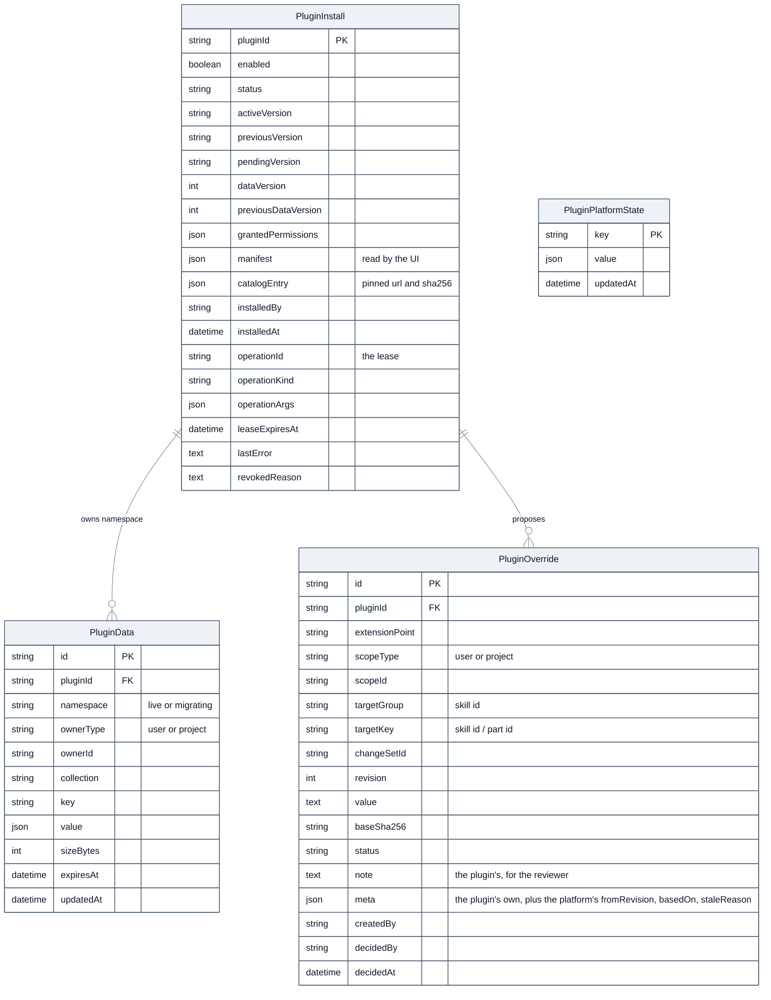

- **`PluginInstall`** is the install registry: one row per plugin on this instance. It holds
  what the admin wants (`enabled`) separately from what the platform observed (`status`,
  §9.1), plus the active and previous versions, the stored `dataVersion` and the permissions
  the admin granted. It is the **source of truth**; the volume and the Runner follow it. It
  also keeps a copy of the **manifest**, from which the UI reads contributions so that a page
  load never touches the volume; the pinned **catalog entry**, used to re-download a lost
  volume (§9.7); the **lease** of a running operation (§9.3); and `revokedReason`, set when the
  catalog revokes the installed version.
- **`PluginData`** is where plugins keep everything, as JSON, keyed by
  `(pluginId, namespace, ownerType, ownerId, collection, key)`. Because every plugin shares
  this table, install never runs a schema migration or regenerates the database client: the
  property that makes install rebuild-free (principle 3). Each plugin has a quota on rows and
  bytes. The `namespace` is `live`, or `migrating:<operationId>` for the copy a data migration
  works on (§9.5). A row can carry an expiry. When a user or project is deleted, its rows are
  deleted with it.
- **`PluginOverride`** holds values proposed at behaviour extension points, with their
  approval state (§7.6) and the checksum of the factory text they were made against. The rows
  proposed together for one skill form a **change set** and are decided together; an approved
  change set is a **version** with a revision number. Each row belongs to a **scope**, a user or
  a project (§7.6). At most one row per `(extensionPoint, scope, targetKey)` can be **Active**:
  the store enforces it, and a partial unique index is the second wall
  ([apply-plugin-constraints.mjs](../../webapp/scripts/apply-plugin-constraints.mjs)). Rows are
  deleted with their user or project.
- **`PluginPlatformState`** holds the facts the platform itself must remember: the highest
  catalog `serial` accepted, stored with that catalog's bytes and signature (§6.2), the version
  counters that never go down, and the reconciliation lease.
- **Cascade.** `PluginData` and `PluginOverride` rows reference their `PluginInstall` row with
  `ON DELETE CASCADE`, so deleting that row deletes the plugin's data and overrides with it. A
  purge deletes them explicitly with the row, in one transaction, and also removes the plugin's
  model choice from every user (§9.6).

### 7.5 Generic UI host

The webapp is compiled at build time, so a plugin cannot ship real React screens. Even if it
could, its JavaScript would run in the page with the signed-in user's session, able to call
any RedAmon route as that user, including the approval of its own proposals. It ships
**screen descriptions** in JSON, and the host draws them from a fixed set of **UI
primitives** that ship once in base: page, list, table, form, select, button, Markdown view,
before/after text comparison, badge, empty state.

```jsonc
{
  "type": "table",
  "title": "Saved items",
  "source": { "action": "list_items" },              // rows come from a plugin action
  "columns": [ { "field": "name" }, { "field": "updatedAt", "format": "date" } ],
  "rowActions": [ { "label": "Open", "screen": "ui/detail.json", "pass": ["id"] } ]
}
```

Data comes from plugin actions, buttons and forms call plugin actions, and row actions pass
the listed row fields as action input. The host never runs plugin JavaScript.

Plugin content is untrusted, so the host draws it defensively:

- Text is always escaped. The Markdown primitive renders no raw HTML and **no remote
  images**, so a screen cannot leak data to an outside server through the user's browser.
- External links open only through a confirmation page that shows the full address.
- Icons come from a fixed allowlist, and every plugin contribution carries a small plugin
  badge, so a plugin button cannot pass itself off as a core button.
- Plugin pages are served with a Content Security Policy that allows images only from the
  webapp itself, and action routes are protected against cross-site request forgery. The
  strict policy covers the `/plugins` pages only: plugin contributions also appear in the chat
  drawer and in project settings, where it would break existing pages, so there the controls
  are React's escaping and the image-free Markdown primitive.

This is the price of principle 3: plugin screens can cover list, detail, form and comparison
flows, but only with the primitives the host provides. A new primitive is a **platform**
change (§11).

**How a plugin page is served.** Next.js routes are compiled too, so the platform
ships one generic route that serves the pages of every plugin:

```
webapp/src/app/plugins/
├── page.tsx                            /plugins: the Plugins page
├── external-link/page.tsx              /plugins/external-link: the link confirmation page
└── [pluginId]/[[...screen]]/page.tsx   /plugins/<id>/…: the screens of any plugin
```

- `[pluginId]` is a dynamic segment, so one file serves every plugin, including plugins
  installed after the image was built. `[[...screen]]` is an optional catch-all for the
  screens that the main one links to.
- Next.js resolves a static folder before a dynamic one, so a plugin named after a static
  segment (`external-link`, or `status` and `jobs` under `/api/plugins/`) would be
  unreachable. Those names are reserved plugin ids
  ([ids.ts](../../webapp/src/lib/plugins/ids.ts)), and a test fails when a new static folder
  is not added there.
- The route shows the not-found screen when the plugin is not enabled and `ready`, or when the
  screen is not listed in its manifest. The status stays 200, because the root layout renders
  every page inside a Suspense boundary (a known limit). Otherwise the screen is validated again
  against the schema and drawn by the host, which fetches its data from
  `POST /api/plugins/<id>/actions/<action>`.
- Contributions reach the browser from `GET /api/plugins/contributions`, built from the
  manifest copy in `PluginInstall` for the enabled plugins. Installing a plugin makes its
  entries appear at the next fetch and disabling it removes them: nothing is compiled or
  rebuilt.
- A plugin's `nav` entry is an **Open** entry on its card on the Plugins page and at the top
  of its own pages, not an item in the top bar, which keeps a single Plugins button however
  many plugins are installed.

### 7.6 Extension points

Extension points are the named slots where a plugin may contribute. There are two kinds.

**UI points**

| Point | What a plugin contributes |
|---|---|
| `nav` | an **Open** entry on the Plugins page and the screen it opens (§7.5) |
| `chat.session.actions` | a button on a chat session; its action receives that session. With `pick: "session.skill"` (platform 1.1.0) the core first asks the person to pick one of the skills the session used, and the action receives the pick as `params.pick` |
| `project.skills.row` | a control next to each built-in skill in project settings; its action receives the project and skill |

**Behaviour point: `skill.text`**

This is the most sensitive point the platform offers, because it changes the instructions the
agent follows. It is defined precisely:

- **What it targets.** A built-in skill's text is not one string. The agent assembles it from
  several **parts**, and which parts are included depends on project toggles, the tools
  allowed in the current phase, and the Rules of Engagement
  ([`build_builtin_skill_workflow`](../../agentic/prompts/__init__.py#L174)). An override
  therefore targets **one part**: `targetKey = <skillId>/<partId>`. The agent publishes the
  list of parts that can be overridden (`GET /plugins/skill-parts`, master key; 53 parts across
  the 14 built-in skills, registered in [skill_parts.py](../../agentic/prompts/skill_parts.py)).
  Each entry gives the part's kind (**template** or **plain text**), its placeholder names and
  the SHA-256 of its factory text.
- **Where it applies.** At the exact moment the factory code appends that part, after every
  gate has decided to include it. A project toggle or RoE rule that would leave the part out
  still leaves it out. An override can change wording; it can never switch a part on.
- **How it is validated.** Python's formatting rules live in the agent, so validation runs
  there, behind the master internal key
  ([`require_master_internal_auth`](../../agentic/llm_guard.py#L215)). The Gateway calls it
  (`POST /plugins/skill-parts/validate`) on every `propose`, and the approve route calls it
  again.
  - *Template parts* are filled from project settings with Python's `str.format`. A value
    must parse with Python's format parser; it must use **exactly the same set** of
    placeholder names as the factory part; and every placeholder must be a plain name, with no
    format spec, conversion, attribute or index access. Literal braces must be written as `{{`
    and `}}`. Plugin authors must know this: a single brace breaks the template.
  - *Plain-text parts* are inserted as they are and never formatted, so braces in them are
    harmless.
  - Every part is capped (twice its factory length, or the factory length plus 20,000
    characters, whichever is larger), and the whole skill at `PLUGIN_SKILL_TEXT_MAX_GROWTH`
    (1.5) times its factory size.
  - Invisible and control characters, and text that imitates the headings placed after the
    skill text (the guardrail and Rules of Engagement sections), are refused, also when split
    around a placeholder or disguised with look-alike letters.
- **Scope.** A proposal targets a **user scope**, which applies to every project that user
  owns, or a **project scope**, which applies to one project and, for that skill, replaces the
  user-scope version as a whole, never part by part. For each skill of a project the agent
  uses the project's own version, otherwise the user-scope version of the project's
  **owner**, read from the project row and never from the caller
  ([overrides.ts](../../webapp/src/lib/plugins/overrides.ts)). A change approved in one
  user's scope therefore never reaches another user's projects. A stale project version
  leaves that skill on factory text; it does not fall back to a user version nobody chose for
  the project.
- **Approval (principle 5).** A valid proposal is stored as **Proposed** and changes nothing.
  The scope's owner, or an admin, sees it in the **core** review window, opened from the chat
  right after the plugin's action or from "N pending" in project settings, as a before/after
  comparison of every part against the version it would replace, with the plugin's note, and
  approves or rejects it.
  Text a plugin proposes may be shaped by content from the target, which is untrusted; that is
  why no proposal reaches the agent without a person's decision.
- **Staleness.** Each override stores the `baseSha256` of the factory part it was approved
  against. The agent compares it with its own factory text at every use and, on any mismatch,
  renders the factory text for the **whole skill** (all parts of a version or none). Every
  `PLUGIN_RECONCILE_INTERVAL`, reconciliation compares each active version with the agent's
  part registry and marks the whole version **Stale**: `factory_changed` when a factory text
  changed (a person may re-approve it, re-based on the new text, under the same number) or
  `part_removed` when the agent no longer has a part (it can only be deleted). A base
  improvement is never silently hidden.
- **Visibility and reset.** Core project settings show every active override as "changed by
  *plugin*", with a **Reset to factory** button. Reset works even when the plugin is disabled
  or uninstalled, because it is core UI.
- **Conflicts.** A proposal is a complete snapshot of the skill's changed parts, and approving
  it replaces the scope's whole active version of that skill, whichever plugin made it, so a
  one-part proposal never runs beside another plugin's other parts. The review warns when the
  proposal was built on another version than the active one ("approving discards the changes
  of v*m*").
- **Numbers and dormancy.** Version numbers come from a counter per scope and skill in
  `PluginPlatformState` that never goes down, so a deleted version's number is never reused.
  A version applies only while the plugin that made it is installed, enabled, serving and still
  holds `override:skill.text`; otherwise it is **dormant** (shown as "not applied") and the
  agent uses factory text, and it applies again when the plugin does. Any version but the
  active one can be deleted.

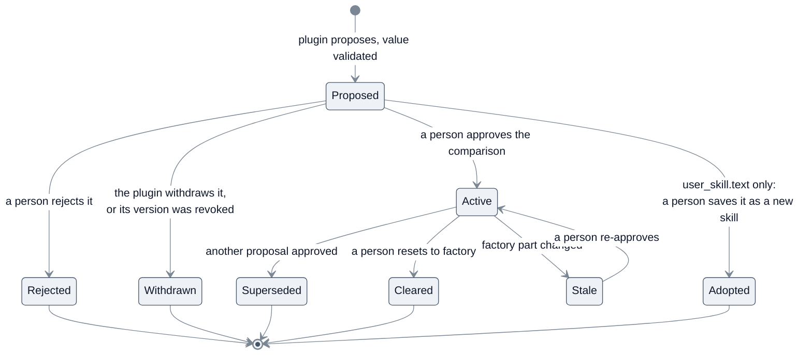

**Behaviour point: `user_skill.text`** (platform 1.1.0)

The user's own skills (the `.md` workflows of Global Settings → Agent Skills, one
`UserAttackSkill` row each) are the second behaviour point. Its difference from `skill.text`
is the whole design: **approving never changes the skill**. It saves the proposed text as a
**new user skill** of the person's, as if they had uploaded a new `.md`, and the change set ends
`adopted`.

- **What a plugin may read.** Only a user skill the call's **session** used, owned by the
  token's user, and not quarantined. "Used" is read from the session's `phase_update` rows
  ([sessionSkills.ts](../../webapp/src/lib/plugins/sessionSkills.ts)): the agent records the
  user skill it rendered (`skill_workflow: {skillId: "user_skill:<id>", kind: "user",
  contentSha256}`); older sessions count by the skill label. Every refusal is the same 404
  `invalid_target`, so a plugin cannot learn whether an id it guessed exists, and `override.get`
  outside a session is 400 `no_session`. A skill whose name, description or text holds a key or token in a
  recognised format (a private key, a JWT, a cloud or API token: `hasSecretKeyShape` in
  [redact.ts](../../webapp/src/lib/plugins/redact.ts)) is never handed to a plugin: 422
  `skill_contains_credentials`, shown in the picker as not selectable. It is not the whole rule
  set that masks transcripts, which also takes words such as "Basic authentication" for a value
  and would refuse about half of the community skills; a password written in prose is the
  person's to remove before they pick the skill. Session binding limits the **plugin**, not the person: an owner can write rows
  into their own sessions, but only ever about their own skills.
- **What `override.get` answers.** One plain part, `body` (the skill's text, used verbatim:
  no placeholders), its SHA-256, `maxChars` 512,000 (UTF-16 code units, the upload limit),
  `active: null`, the pending count, and `lineage {rootName, version}`.
- **What `override.propose` takes.** `scope: "user"` only; parts exactly `{body}`;
  `readSha256.body` **required** (the person can edit their skill at any time: 409
  `factory_changed` when it changed since the read). The agent validates the text
  (`POST /plugins/text/validate`, master key): not empty, no NUL, within the limit, different
  from the source, and no reserved marker, Rules of Engagement heading or hidden character that
  the source did not already hold (a set difference: what the person wrote stays theirs).
  The answer is `{changeSetId, fromRevision: null, proposedRevisionLabel: null}`.
- **Never active.** `adopted` is a terminal status of its own. A user-skill change set is never
  `active`, so the one-active index, delivery to the agent, reconciliation and the reinstall plan
  never see it; `approve` refuses it.
- **Saving** (the approve route's user-skill branch,
  [userSkillAdoption.ts](../../webapp/src/lib/plugins/userSkillAdoption.ts)). Body
  `{scopeOwnerId, name, description?, projectId?, enableNew, disableSource,
  acknowledgedRiskLines}`, answer `{skillId, name, version}`. One transaction holds the owner's
  user-skill lock, then the set's scope lock:
  - **the proposer gate** fails closed: the plugin must be enabled, `ready`, not revoked,
    granted `override:user_skill.text`, and at **the version that made the proposal**
    (`meta.pluginVersion`, recorded by the Gateway from the call token), else 409
    `proposer_unavailable` with the reason. A proposal from a version that was disabled,
    uninstalled, revoked or replaced is run again, not saved; Reject and Delete stay available;
  - the platform's risk flags are recomputed, and a save must acknowledge exactly as many flagged
    lines (409 `risk_not_acknowledged`);
  - the name follows the uniqueness rule of every user-skill write (409 `name_taken` with a
    `suggestion`; the default is the source's name with the next ` vN`), and the 1,000-skill
    cap applies (409 `skill_limit`);
  - the new skill records its lineage (`derivedFromId`, `lineageRootId`, `version`) and its
    origin (`originChangeSetId`, `originPluginId`, `originPluginVersion`); a source without a
    family becomes its version 1;
  - with `projectId` (a project the scope owner owns, checked strictly), the project's toggles
    become `user[new] = enableNew`, `user[source] = false` when `disableSource`, under the
    20-enabled limit (409 `too_many_enabled_skills`); `builtIn` is kept exactly as stored. The
    row is written with `update`, so `updatedAt` moves and every open form sees a stale save;
  - a database CHECK refusing `adopted` (the constraint script did not run) is 503
    `platform_not_ready`.
  Audited as `plugin.override.adopt`, `user_attack_skill.create` and, for the toggles,
  `project.update`.
- **The saved skill is the person's.** It is an ordinary user skill: listed, toggled,
  downloaded and deleted like any other, and it survives disabling, uninstalling and purging the
  plugin. A session whose label names the old skill, when that skill is off and the new one on in
  its project, renders the new one's text from its next message or resume (`supersedes` in the
  agent payload); the label, the chain graph and the phase stay as they are.
- **The kill switch reaches it.** When the verified catalog revokes a (plugin, version),
  installed or not, reconciliation withdraws that version's waiting `user_skill.text`
  proposals (`meta.withdrawReason: "revoked"`) and **quarantines** every skill whose
  `originChain` holds that version. A saved version's chain is its own `pluginId@version` plus
  its source's chain, copied when it is saved, so it reaches the skills saved from the revoked
  version's proposals and every version saved from those since, by any plugin version
  (`quarantineReason: "derived_from_revoked"`), also when a version in between was deleted.
  Quarantined skills are turned off in every project of their owner, kept out of the agent's
  payload, and refused as `true` by every writer (409 `skill_quarantined`) until the owner
  reads and releases them (`POST /api/users/[id]/attack-skills/[skillId]/release`, the owner
  only, never an admin acting for them). A release is from that revocation only
  (`releasedFor` gains the `quarantinedFor` pair): the next reconciliation, which still sees
  it, leaves the skill alone, a later revocation of another version in its chain quarantines
  it again, and a version saved from a released skill inherits its releases. No version can
  be saved from a quarantined skill (409 `skill_quarantined`), so a proposal built on it before
  the revocation cannot carry its text out. A catalog that cannot load revokes nothing; the
  proposer gate still stops new saves.
- **Deleting the source** deletes its proposals still waiting, in the same transaction; adopted
  sets stay as the provenance of the skills saved from them.

**Platform meta.** The keys the platform writes on a proposal are its own and stripped from a
plugin's `meta`: `fromRevision`, `baseFactoryText`, `basedOn`, `staleReason`,
`withdrawReason`, and, from platform 1.1.0, `pluginVersion`, `conversationId`, `jobId` (from
the call token, on every proposal), `baseText`, `sourceName` (what a user-skill proposal was
built on) and `adoptedSkillId`, `adoptedName` (what it became). The review of a user-skill
proposal is built from them, so it needs neither the session nor the source skill to exist.

New points are added deliberately, by the platform, when a real plugin needs one. The base
repo still grows, but only in **generic capability**, never in plugin logic.

**As built (platform 1.0.0, UI host and the core review screens).** Where a person meets
plugin UI, and where the skill-version decisions live:

- **Contributions** come from `GET /api/plugins/contributions` (signed-in), built from the
  manifest copy of every plugin that shows contributions (enabled,
  `ready` or `updating`, not revoked). An `updating` plugin keeps its entries, marked
  "updating". Icons are an allowlist; any other name draws the plugin mark.
- **Plugin pages** (`/plugins/<id>[/<screen>]`) draw the `nav` screen, or another screen the
  manifest lists, from the active version on the plugins volume; a URL segment uses the
  screen-path alphabet, so it cannot leave `ui/`. The middleware sets the strict
  Content-Security-Policy on `/plugins` and `/plugins/*` only (`'unsafe-eval'` outside
  production for Next.js dev). Inputs one screen passes to the next travel through
  `sessionStorage` under a key in the URL, so a crafted link carries none. Every `nav` entry is
  listed with an **Open** link above the cards on the Plugins page.
- **The screen host** re-validates a screen before drawing it and shows an error naming the
  plugin instead of crashing. Plugin text is a React text child or goes through `SafeMarkdown`
  (raw HTML skipped, no images, every link through `/plugins/external-link`, which opens only
  http(s) URLs without credentials). `textDiff` is Myers' line diff, capped at 20,000 lines
  per side and 2,000 edits; past either, both texts are shown without highlights.
- **The chat gear menu** gains one group per plugin after "Agent Skills": the plugin's name
  with the plugin badge, then its `chat.session.actions`, disabled until the first message
  creates the conversation. An `llm` action asks for a model first; an async one opens the
  job modal (progress, Cancel, Retry after a model failure).
- **The skill picker** (`SessionSkillPicker`, `GET /api/plugins/[pluginId]/session-skills`,
  platform 1.1.0) opens before the model gate for a chat item with `pick: "session.skill"`: the
  skills the session used, of the points the plugin is granted and declares, built-in and the
  person's own, with turns, the built-in version, and why a row cannot be picked (deleted,
  holds a key or token, quarantined). The action route re-derives the pick and refuses one not in the
  list (400 `invalid_pick`); the job records it, the job window names the skill, Retry replays
  it, and a start while a job already runs in the session answers that job's pick. Start waits
  while the agent runs in the session, or while RedAmon cannot confirm it stopped (`running:
  "unverified"`). An unknown plugin is 404 `plugin_not_found`, so the picker tells it from a
  session that has no conversation yet (404 `not_found`).
- **Review** (`OverrideReviewModal`, routes under `/api/plugins/overrides/change-sets/[id]`)
  is core UI. A `user_skill.text` proposal opens the save-as-new-skill review instead
  (`UserSkillReview`): the diff against the text it was built on, what changed since (source
  deleted, renamed or edited; the session ran an older text; the proposer unavailable), the
  flagged-lines acknowledgement, the name with its live check, the description, and, opened
  from a project, "use it in this project instead of the source" (on by default). The review model is built on the server from the store and the agent registry
  read without its cache, with each part's before/after, parts that revert to factory, the
  warnings (session older than the active version, outdated base, replacement, factory
  changed, not applied now) and risk flags on added lines that move data out, name a URL or
  host, or drop a scope, RoE or confirmation guard. Approve re-checks the factory hashes and
  texts and the whole-skill size with the agent, then stores the next number.
- **Versions** (`SkillVersionsModal`, `GET /api/plugins/overrides/versions`, `POST
  /api/plugins/overrides/reset`) list the factory row and every version of a skill for the
  viewer's user scope and a project they own. A version number is never reused, so the list
  can skip numbers after a deletion. Reset works whatever state the plugin is in. A project
  reset makes the project follow the owner's user-scope version, or the factory text.
- **Project settings** show, per built-in skill of a saved project, a chip naming the version
  that governs it, Versions, Reset and "N pending" (`GET /api/plugins/overrides/summary`), plus
  `project.skills.row` contributions. Reset is its own API call, never part of the project
  save.
- Who decides: the scope owner, or an admin acting as them (the audit names the admin). A
  user-scope decision carries the owner id, which must equal the effective user.
- Project export and import leave plugin rows out: the export manifest says
  `excluded: ["plugin_overrides", "plugin_data"]`, and the import never reads a plugin file.

#### 7.6.1 How a plugin appears in the app

For plugin authors and platform developers: where each UI point is drawn, by whom, and what
happens to what an action returns.

**Why a plugin ships no React.** The webapp is a standalone Next.js build compiled once into its
image, so components that arrive later cannot join it; and plugin JavaScript running in the page
would act with the signed-in user's session, approval routes included (§7.5). A plugin declares
*where* it appears in its manifest and *what* it shows as JSON; core components draw both.

**From manifest to pixels.**

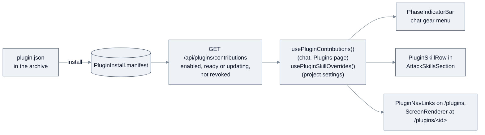

The manifest is copied into the `PluginInstall` row at install, so a page load never reads the
volume. With no plugin enabled the route returns an empty list, and the hooks then show no
plugin UI at all.

| Point | Drawn where | Drawn by |
|---|---|---|
| `chat.session.actions` | The chat's gear menu, in one group per plugin after "Agent Skills", labelled with the plugin's name and the plugin badge (never "Plugins": the Tool Matrix already speaks of "MCP Tool Plugins"). Disabled until the first message creates the conversation. | [`PhaseIndicatorBar.tsx`](../../webapp/src/app/graph/components/AIAssistantDrawer/PhaseIndicatorBar.tsx) |
| `project.skills.row` | Under each built-in skill of a **saved** project's Agent Skills settings, after the core chip, Versions, Reset and "N pending" controls, each with the plugin badge. | [`PluginSkillRow.tsx`](../../webapp/src/components/plugins/skills/PluginSkillRow.tsx) in [`AttackSkillsSection.tsx`](../../webapp/src/components/projects/ProjectForm/sections/AttackSkillsSection.tsx) |
| `nav` | An **Open** entry on the Plugins page, and the page at `/plugins/<id>` (another listed screen at `/plugins/<id>/<path>`, its file name without `ui/` and `.json`). **Not** a top-level header entry: the header has one Plugins button ([`GlobalHeader.tsx`](../../webapp/src/components/layout/GlobalHeader/GlobalHeader.tsx)). | [`PluginNavLinks.tsx`](../../webapp/src/components/plugins/PluginNavLinks.tsx), [`ScreenRenderer.tsx`](../../webapp/src/components/plugins/host/ScreenRenderer.tsx) |

**What happens to an action's result** ([`runPluginAction.ts`](../../webapp/src/components/plugins/runPluginAction.ts)):

- An action declared `llm: true` first passes the **model gate**: if the user has no model for the
  plugin in Models by feature, a core window asks for one, and cancelling it cancels the action.
- An `async` action answers a job id; the core **job window** shows its progress messages, lets
  the user cancel it, and on success treats its result like a sync one.
- A result carrying `reviewProposal` (`{extensionPoint, changeSetId}`) opens the **core review
  window** on that proposal. This is the Skiller flow: chat → job → the active version (v1, the
  factory text) beside the proposed v2 → Approve. The webapp drops the field unless the change set
  exists, is this plugin's, is in the caller's scope and names that point.
- A menu item naming `coreScreen: "skill.text.versions"` opens the **core versions window** without
  running plugin code.
- Any other result shows its `message` as a notice (or "Done"). Inside a plugin page, a form opens
  its `resultScreen` with the result as the next screen's inputs.

The review, versions and reset screens are **core code**. A plugin can open them; it cannot draw
them, change them or imitate them, and they keep working when the plugin is disabled or gone.

**A small example: a page that lists items and opens one.** The manifest declares the page and
lists both screens (only the relevant fields shown):

```json
"actions": [
  { "id": "list_items", "entry": "engine/main.py:list_items", "timeoutSeconds": 30 },
  { "id": "get_item", "entry": "engine/main.py:get_item", "timeoutSeconds": 30 }
],
"contributes": { "nav": { "label": "Saved items", "icon": "list", "screen": "ui/home.json" } },
"screens": ["ui/home.json", "ui/detail.json"]
```

`ui/home.json` is a table fed by `list_items`; its row action opens the detail screen and passes
only the row's `key`:

```json
{
  "type": "page",
  "title": "Saved items",
  "children": [
    {
      "type": "table",
      "source": { "action": "list_items" },
      "columns": [
        { "field": "name", "label": "Name" },
        { "field": "updatedAt", "label": "Updated", "format": "date" }
      ],
      "rowActions": [{ "label": "Open", "screen": "ui/detail.json", "pass": ["key"] }],
      "emptyText": "Nothing saved yet."
    }
  ]
}
```

`ui/detail.json` is a page whose `source` gets the passed `key` as its params:

```json
{
  "type": "page",
  "source": { "action": "get_item" },
  "children": [
    { "type": "badge", "content": { "field": "kind" } },
    { "type": "markdown", "content": { "field": "body" } }
  ]
}
```

The actions read the plugin's own data; a list answers `{items, next}` and "Load more" calls it
again with `cursor`:

```python
from redamon_plugin_sdk import PluginError


async def list_items(ctx, params):
    page = await ctx.sdk.data.query("items", limit=50, cursor=params.get("cursor"))
    items = [{"key": r["key"], "name": r["value"].get("name", r["key"]), "updatedAt": r["updatedAt"]}
             for r in page["items"]]
    return {"items": items, "next": page["next"]}


async def get_item(ctx, params):
    value = await ctx.sdk.data.get("items", str(params.get("key") or "-"))
    if value is None:
        raise PluginError("not_found", "This item no longer exists.")
    return {"kind": value.get("kind", "note"), "body": value.get("body", "")}
```

What the user sees: on `/plugins` the plugin's card gains **Open**; the page shows a table of the
saved items, newest first, with dates in the reader's locale; **Open** on a row shows that item's
kind as a badge and its body as Markdown (no images, links through the exit page). The example
passes `tools/validate.py` in `redamon-plugins`; a complete plugin with a form and its tests is in
[README.PLUGIN_SDK.md](README.PLUGIN_SDK.md) §14.

**The limit.** A plugin can use only the primitives of §7.5 and the points of this section. A new
primitive or extension point is a platform change shipped in a RedAmon release (§11.4), never
something a plugin adds.

### 7.7 The action contract

An action is an `async` Python function:

```python
async def run(ctx, params: dict) -> dict:
    ...
```

- **`ctx`** carries the plugin's identity, the acting user, the project, the session when
  there is one, and the SDK client bound to the call token.
- **`params`** is the input from the UI: form fields, the row fields a row action passes, a
  screen source's params, or `{}` from a menu item. The project and session reach the action as
  `ctx.project_id` and `ctx.session_id`. (In 1.0.0 a `project.skills.row` action is not told which
  skill row was clicked; see the known limits in §10.)
- **The return value** is JSON. Screens bind to it by field name.
- **Errors** are raised as `PluginError(code, message)`. The UI host shows the message; any
  other exception is reported as an internal plugin error, with details only in the plugin's
  log.
- **Long work.** An action declared with `"async": true` returns at once with a job id. The
  webapp keeps the job as a platform-reserved row of the data store (`__jobs`, kept 30 days),
  so any webapp copy can serve the poll and a Runner restart loses nothing but the run itself
  (the job then fails as `runner_restarted`). The UI polls it and can cancel it, the same
  start-and-poll pattern the webapp already uses for long scans. One job per (plugin, action,
  user, project, session) can be active; starting it again answers the running one. Every status
  change is a compare-and-swap, so a late or repeated report changes nothing. A job whose plugin
  stopped serving before it ended fails as `plugin_unavailable`, one whose project or session was
  deleted as `context_gone`; a `cancelled` report nobody asked for is recorded as `failed`, and a
  result that cannot be stored becomes `invalid_result`.

The full reference for `ctx`, results, the screen-description schema and local development is
[README.PLUGIN_SDK.md](README.PLUGIN_SDK.md).

---

## 8. Runtime: how an installed plugin participates

There are two paths, and they are designed differently on purpose.

### 8.1 The action path: user-triggered, may be slow

A user clicks a plugin button, the plugin runs, and it usually **leaves its result as data**.
This can take seconds (for example when it calls an LLM). That is acceptable because a person
started it and no core process is waiting on it.

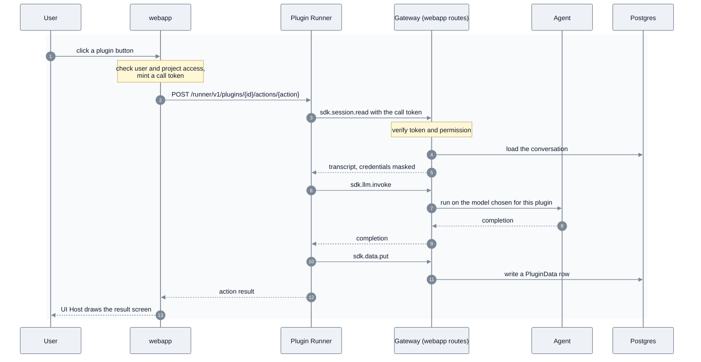

Every arrow between the webapp and the Runner, either way, passes the `plugin-gateway` proxy
(§4). If the Runner is down, step 3 fails fast with `503 runner_unavailable` and the UI says so.

### 8.2 The behaviour path: core-triggered, must never block

This path protects principle 1. When the agent assembles a built-in skill, it **does not call
any plugin**. Approved overrides reach it as data, and anything unexpected falls back to the
factory text.

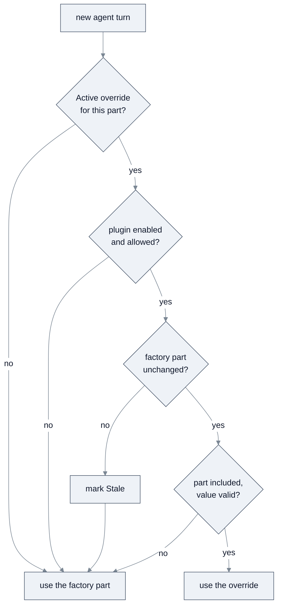

The webapp answers the first two questions while it builds the settings payload: it sends only
the active version that governs each skill, and only while its plugin qualifies. The agent
answers the last two while it assembles the prompt: it compares each part's recorded factory
hash with its own factory text and validates the text, and on any doubt renders the factory
text for the **whole skill**. Reconciliation marks such a version Stale for the review and
versions windows (§7.6, §9.7). "Allowed" means the plugin is enabled, its status is `ready` or
`updating`, it is not revoked and its `override:skill.text` permission is still granted (§9.1).
"Part included" means the factory gates (project toggles, phase tools, Rules of Engagement)
chose to include this part on this turn.

In practice:

- **Overrides arrive with the settings.** The agent reloads project settings from the webapp
  at the start of **every turn**, meaning every message and every resume
  ([`_apply_project_settings`](../../agentic/orchestrator.py#L206), called from each entry
  point). Applicable overrides come in that same payload, so the lookup is in memory. This
  mirrors how enabled user skills are resolved to their stored text today
  ([`get_enabled_user_skills`](../../agentic/project_settings.py#L1018)).
- **Changes take effect at the next turn** of every session, including sessions already open.
  A turn already running keeps the snapshot it started with.
- **A failure never breaks the settings.** If settings cannot be fetched at all, the agent falls
  back to defaults with an empty target scope. So the webapp computes overrides in their own
  `try/catch` and leaves them out on any error. Overrides are included only for the agent's
  master key, never for other internal callers of the settings endpoint.
- **One small seam.** Inside `build_builtin_skill_workflow`, at each point where a part is
  appended, the agent checks for an override of that part, re-validates it, and uses the
  factory text on any doubt. With no overrides it does nothing. A failed check logs a warning
  and never raises into the session. Every caller of the builder gets the same behaviour.

The plugin did its work earlier, on the action path, and a person approved the result. The hot
path only **reads data**. If the plugin is disabled, uninstalled, incompatible or broken, its
overrides stop qualifying and the agent uses factory text. **The agent never waits on plugin
code.**

---

## 9. The lifecycle, in depth

### 9.1 Two fields: `enabled` and `status`

`PluginInstall` keeps what the admin **wants** separate from what the platform **observed**,
so neither overwrites the other:

- **`enabled`** (true or false) is set only by an admin.
- **`status`** is set only by the platform, following this machine:

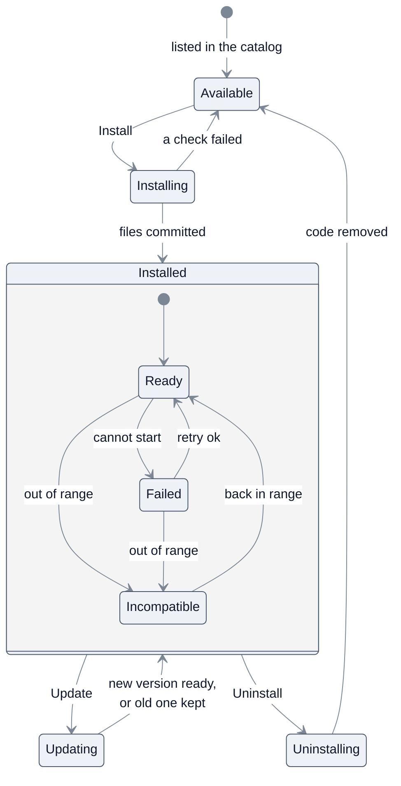

What each combination means:

| `status` | Actions served | UI contributions shown | Overrides apply |
|---|---|---|---|
| `ready`, `enabled` | yes | yes | yes |
| `ready`, not `enabled` | no | no | no |
| `updating` | no (paused) | yes, marked "updating" | yes, if `enabled` |
| `failed`, `incompatible` | no | no | no |
| `installing`, `uninstalling`, `available` | no | no | no |

Overrides keep applying during an update because they are approved data, not plugin code.
Every state change is a **compare-and-swap** on `status`
(`UPDATE … WHERE pluginId = $1 AND status = $expected`). If no row matches, another
operation is in progress and the request is refused, so two admins can never race the same
plugin. Install, update and rollback also match the versions they were planned with (active,
previous and data version): one that another operation overtook answers `plugin_changed`
instead of running a migration twice.

### 9.2 Layout of the plugins volume

```
plugins/                          # persistent volume: Manager read-write, Runner read-only
├── .staging/
│   └── <operationId>/            # one folder per operation; never loaded
└── <pluginId>/
    └── versions/
        ├── 1.0.0/                # previous version, kept for rollback
        └── 1.1.0/                # active version (PluginInstall.activeVersion)
```

- **Staging is per operation**, so concurrent installs of different plugins never share a
  folder.
- **Staging is on the same volume** as the version folders, so moving a version into place is
  a single atomic `rename`: on one filesystem a rename only changes a directory entry, so the
  folder is at the old path or at the new one, never half copied. Across filesystems a move
  is a copy and a delete, which a crash can leave half done.
- **The active version is recorded in the database**, not with a symlink, so the registry
  stays the single source of truth.
- Files are written world-readable and owned by the Manager, so workers can read them and
  cannot change them.
- **Where it is mounted**: read-write in the webapp at `/data/plugins`
  (`PLUGINS_DIR`), read-only in the Runner. It is never mounted under `/app`, where the image's
  code lives, and it is not part of the git checkout, so image rebuilds and
  `./redamon.sh update` leave installed plugins untouched.

### 9.3 Install, step by step

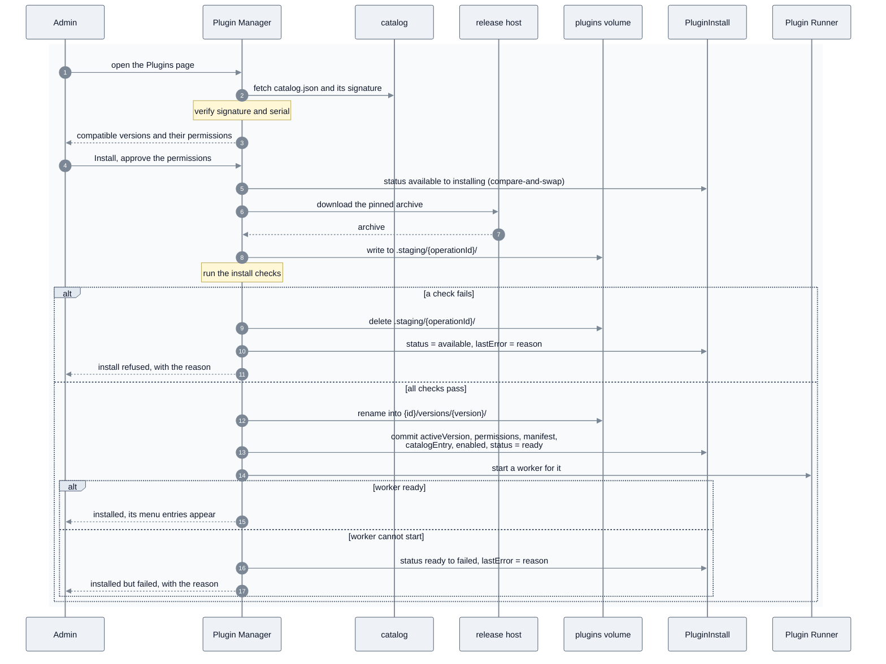

**The install checks**, all of which must pass before anything leaves staging:

1. The archive's SHA-256 matches the entry in the signed catalog.
2. The archive is safe to unpack: no absolute paths, no `..` components, no symlinks or hard
   links, and total size under the platform limit.
3. The `plugin.json` inside matches the catalog entry: same `id`, `version`, `platform` range,
   `dataVersion` and permissions.
4. The manifest and every screen description validate against the platform schemas.
5. The `platform` range includes the running platform version.
6. Every extension point and UI primitive the plugin references exists on this platform.

**Order of the checks.** All six run on the archive in memory, before anything is written: the
sha256 of the downloaded bytes first, then every entry as the archive is read, then the
`plugin.json` and screens it holds. Only an archive that passed all six is written to staging
([installChecks.ts](../../webapp/src/lib/plugins/installChecks.ts)). Check 3 is what makes the
consent binding: the admin approved the permissions listed in the signed catalog, and the
archive cannot declare others.

**The operation and its lease.** The first install of a plugin inserts its row directly in
`installing`; `pluginId` is the primary key, so a second insert is refused. A reinstall moves
an existing `available` row with a compare-and-swap. Either way the row records the operation
that owns it (`operationId`, `operationKind`, `operationArgs`) and a **lease**
(`leaseExpiresAt`, 10 minutes, extended by a heartbeat during long work)
([registry.ts](../../webapp/src/lib/plugins/registry.ts)), and the staging folder is named
after the operation id. A lease replaces a database lock because a pooled connection cannot
hold a lock across HTTP requests. If the webapp dies during the operation, nobody releases the
row; the lease expires and reconciliation takes over (§9.7).

**Status after the commit.** The status machine lets `installing` move only to `ready` or back
to `available`, so the commit lands on `ready`, and a worker that cannot start then moves the
plugin from `ready` to `failed`. The code stays installed, and the admin can retry or disable
it.

**Where the commit happens.** Moving the folder into `versions/` and writing the database row
are two steps. The **database write is the commit**: until it succeeds, the Runner, the UI and
the agent ignore the folder. If the process dies between the two steps, reconciliation finds a
folder no row references and deletes it (§9.7). The only trace a refused install leaves is the
`lastError` on its row, shown on the Plugins page.

**A crash at each stage** leaves a state reconciliation can always resolve:

| Crash during | Left behind | Recovery (§9.7) |
|---|---|---|
| catalog fetch or consent | nothing | nothing to do |
| download or checks | a row in `installing`, maybe a staging folder | once the lease expires: delete `.staging/<operationId>/`, status back to `available` |
| the rename, before the commit | a row in `installing`, a version folder no row references | status back to `available`; the folder is deleted |
| after the commit, before the worker | a row `ready` and enabled, no worker | the Loader is told to start it |

Install is **rebuild-free**: it copies files onto a volume, writes rows and starts a process.
Nothing is compiled and no schema changes.

### 9.4 Enable and disable

Disabling sets `enabled = false`. The Manager tells the Loader to stop the plugin's workers,
the UI host hides its contributions, and its overrides stop qualifying from the **next agent
turn** (§8.2). **Code and data stay**, so enabling again is instant and loses nothing. Enabling
checks the platform range first and starts the worker; if the worker cannot start, the status
becomes `failed`. Disabling is the safe off switch when a plugin misbehaves, and a disabled
plugin can still be updated.

### 9.5 Update, migration and rollback

Updates install **side by side**, never in place, so the old version keeps working until the
new one is proven.

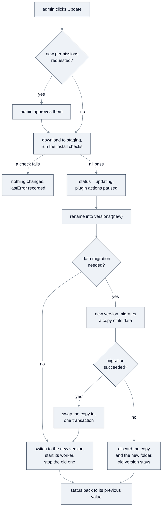

**Migrations.**

- A plugin migration is a **data** migration of the plugin's own rows, never a schema
  migration. It writes no SQL and cannot touch any other table; the database schema changes
  only with a RedAmon release (§11.5).
- Migrations are files in the plugin's `migrations/` folder: `NNNN_up.py` moves the data from
  `dataVersion` N-1 to N, and an optional `NNNN_down.py` moves it back (N from 2 to 9999). Each
  defines a plain function `migrate_row(row)` that receives one row (`collection`, `key`,
  `ownerType`, `value`) and returns its new value, or the SDK's `DELETE` sentinel to drop it.
- While a migration runs, the plugin's actions are **paused**, so nothing writes the data
  being migrated.
- The platform copies the live rows into a **copy** (the `migrating:<operationId>` namespace
  of `PluginData`), then, for each step, sends every row of the copy, **for every owner**, in
  batches to a temporary worker of the version that ships the step, and writes the answers
  back into the copy with the store's value checks, checking the quotas after each step. On
  success the copy is swapped in, together with the install row's new version, in one database
  transaction; on any failure (an exception in `migrate_row`, a bad answer, a timeout, the
  Runner down) the copy is thrown away. Either way the data is never half-migrated
  ([migrations.ts](../../webapp/src/lib/plugins/migrations.ts); copying and swapping are
  `copyNamespace` and `swapNamespace` in [dataStore.ts](../../webapp/src/lib/plugins/dataStore.ts)).
- Migration code gets **no call token** and no Gateway access: it transforms the rows it is
  handed and nothing else. This reaches every owner's rows, which a token bound to one user
  could not.

**Rollback** makes the previous version active again:

- **No data migration in the update:** the switch is immediate.
- **Data migrated forward:** the new version's down migrations run first, the same
  copy-and-swap way, back to the previous `dataVersion`.
- **No down migration:** rollback is refused (`no_down_migration`), and the Update screen warns
  about this before the admin confirms.
- **Reinstalling an older release over newer data** (its `dataVersion` lower than the data kept
  from a newer one) is refused (`data_newer_than_release`): export, then delete the kept data,
  to go back.

The platform never runs old code on data in a newer shape.

Only the active and previous versions are kept on disk.

This is the main benefit of the two-repo model: a plugin improves by publishing a new release
in `redamon-plugins`, admins update from the Plugins page, and **no RedAmon release is
involved**.

### 9.6 Uninstall and reinstall

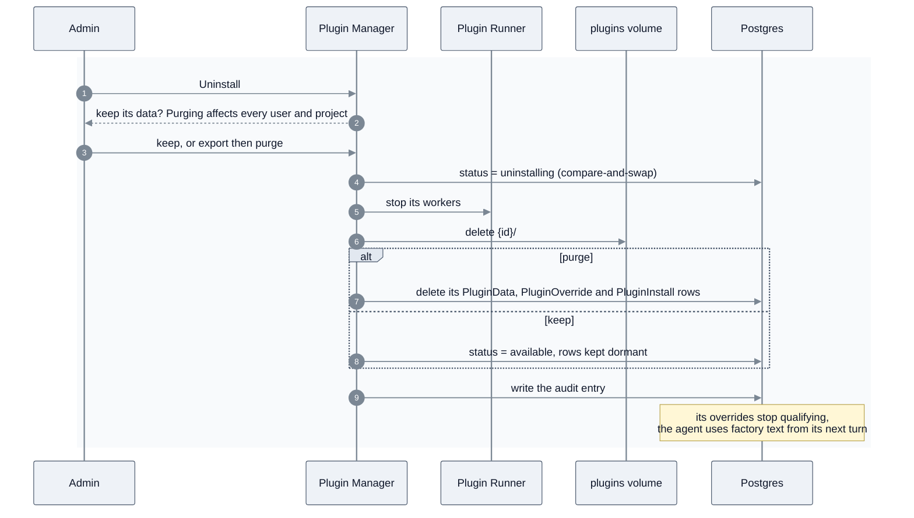

- **Uninstall removes the code** from the volume, so the plugin is again absent from the host.
- **Purge is instance-wide.** It deletes the plugin's data and overrides for **every** user and
  project, so the dialog says so and offers a JSON export first.
- **Keeping data** leaves the `PluginInstall` row in `available`, with its `PluginData` and
  `PluginOverride` rows dormant. Nothing reads data from a plugin that is not installed.
  **Delete kept data**, on the card of such a plugin, removes them later behind the same
  export and typed confirmation as a purge, in one transaction that rolls back if an install
  starts meanwhile.
- **Skills people saved from the plugin's proposals stay** whatever the choice: they are user
  skills of their own (§7.6, `user_skill.text`). A purge deletes only the proposal records.
- **Reinstall** goes through the normal install (§9.3). It finds the existing row and data and
  runs data migrations if the stored `dataVersion` is older. It then **asks the admin** whether
  to restore the plugin's previous overrides. Restored overrides whose factory part has changed
  come back as Stale and need a person's approval again.
- **Factory fallback is automatic.** The core only ever *read* the plugin's approved data, so
  once the plugin is not installed those reads stop qualifying and the product behaves as it
  does from the factory. Nothing in the core needs to be undone.

**What an uninstall removes and what it leaves.**

| | Uninstall, keep | Uninstall, purge |
|---|---|---|
| Workers | stopped | stopped |
| Code: `{id}/` on the volume, every version | deleted | deleted |
| `PluginInstall` row | kept, in `available` | deleted |
| `PluginData` rows of every user and project | kept, unread | deleted (§7.4) |
| `PluginOverride` rows | kept, not applied | deleted |
| Contributions in the UI | gone | gone |
| Agent behaviour | factory text from the next turn | factory text from the next turn |

Whatever the choice, these stay, because they belong to the platform and not to the plugin:
the platform code and its four tables, `PluginPlatformState` (the accepted catalog serial and
the version counters, so a revision number is never reused), the audit log, and the plugin's
releases in the catalog. The `redamon` git checkout is never involved. A purge deletes the
plugin's rows, versions and model choices with its `PluginInstall` row in one transaction; the
JSON export downloaded first (audited as `plugin.export`) is the only copy that survives it.

While a plugin is uninstalled with its data kept, **Reset to factory** still works on its old
overrides, because it is core UI: nobody has to reinstall the plugin to clear them.

#### Exporting a plugin's data

**Export data** (the plugin's details, or the purge dialog) downloads one JSON document,
`exportVersion` 2 ([exportData.ts](../../webapp/src/lib/plugins/exportData.ts), audited as
`plugin.export`): the install row, every data row and every override row, for every user and
project. An admin downloads it, so the text proposed for people's **own** skills is not in it:
for a `user_skill.text` row the value, the note, the plugin's own meta and the platform's
copies of the source text and names (`baseText`, `sourceName`, `adoptedName`) are each replaced
by `{redacted: true, sha256, chars}`. So is, in a job row that worked on a person's own skill
(its pick was one, or it was started without a pick by a plugin allowed to read them, which then
chose a skill itself), the picked name and everything the plugin wrote into the job (progress,
result message and fields, error message), which can name or quote the skill; its status,
timings, error code and reported change set stay. Which plugin version proposed it, from which conversation and job, and
which skill it became stay, so the record of what happened is whole.
Built-in skill versions are RedAmon's own text and are exported as they are.

A crash during an uninstall leaves the row in `uninstalling` with the admin's choice in
`operationArgs` (for example `{"mode": "purge"}`), so reconciliation finishes the uninstall the
way the admin chose (§9.7).

### 9.7 Reconciliation and recovery

The registry is the source of truth, and the **Manager** owns keeping the world in line with
it, because only the Manager can read the database and write the volume. It reconciles when
the webapp starts and on a periodic timer:

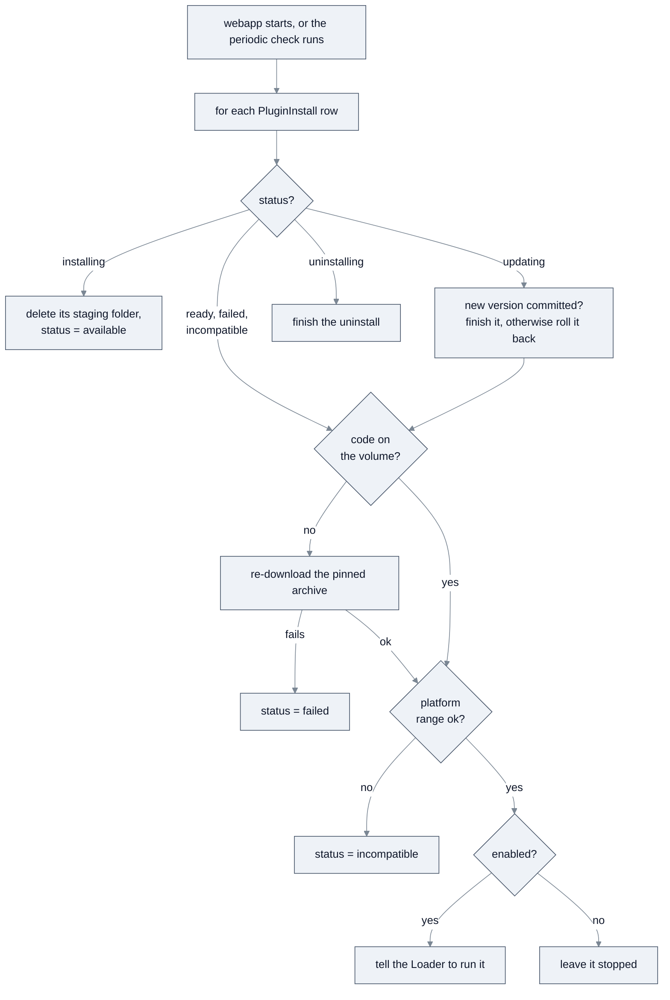

- **Crash recovery.** A crash in the middle of an operation leaves a row in `installing`,
  `updating` or `uninstalling`. The first reconciliation after restart rolls back the install,
  finishes or rolls back the update, or finishes the uninstall. It takes over a row only once
  that row's lease has expired (§9.3), so it never races an operation that is still running.
- **Clean-up.** After the loop, the Manager deletes any version or staging folder that no
  row references, such as a folder left behind by a crash just before its database commit.
- **Base updates.** The plugins volume and the plugin tables live outside the images, so
  `./redamon.sh update` and image rebuilds do not touch installed plugins. If a base update
  moves the platform outside a plugin's `platform` range, the plugin becomes `incompatible`:
  it is inert, its overrides stop qualifying, and the Plugins page explains why. It becomes
  `ready` again when the base moves back into range or an admin installs a compatible release.
  A base **downgrade** to an image that predates the plugin tables deletes them with their rows
  (§11.5).
- **A lost volume** heals from the catalog, because the checksum pins the exact archive. If the
  release is gone or the host is offline, the plugin becomes `failed` with the reason.
- **Offline installs.** An admin can upload an archive by hand, together with a catalog and
  signature that cover it. It goes through exactly the same checks as a download.
- **The Runner's view.** When the Runner starts, its Loader asks the Manager for the run list
  (§7.2), so a Runner restart never needs database access.

**As built.** The recon orchestrator asks for a reconcile every `PLUGIN_RECONCILE_INTERVAL`
(300 s by default), in the background of its reaper so a slow webapp never delays it (TD-20).
Only a 404 (a webapp image without the route) makes it stop asking, until the orchestrator
restarts; any other failure is retried at the next interval.

- **One reconcile at a time**, under a platform-wide lease; a second answers `skipped: busy`.
  Each run does bounded work: at most one heal download and a 20-second budget.
- **An operation is recovered only once its lease has expired** (ten minutes), and is claimed
  first, so a slow request and a reconcile never work on one plugin together. An interrupted
  install goes back to available, deleting any copy of kept data it was migrating; an
  interrupted update or rollback is finished when its
  target version is on the volume and moves no data, and undone otherwise (the database write
  is the commit, and a migrating update switches version and data in one transaction); an
  interrupted uninstall is finished, honouring a purge.
- **Clean-up** removes version and staging folders nothing references, never one younger
  than 15 minutes (an install may not have written its row yet).
- **Revocation** sets `revokedReason` from a catalog that verified, never `enabled`, and
  clears it when the catalog lifts it. **Stale versions**: every active skill version is
  compared with the agent's part registry; a removed part or a changed factory text makes the
  whole version stale. When the agent cannot be asked, nothing is guessed.
- A failed plugin is retried; expired data rows are deleted; a job past its deadline is
  failed with `timeout`.

### 9.8 Install, upgrade and roll back: the operator's checklist

**Installing or upgrading RedAmon**

1. Check that `docker version --format '{{.Server.Version}}'` reports 28.0.0 or newer. An older
   engine stops `install` and `update` before they build anything (`update` before its
   `git pull`).
2. `./redamon.sh install`, or `./redamon.sh update` on an existing install. Either writes
   `PLUGIN_RUNNER_KEY` and `PLUGIN_CALL_TOKEN_SECRET` into `.env` when they are missing or
   empty (and removes a leftover `PLUGINS_ENABLED` line), builds the runner image, and starts
   `plugin-runner` and `plugin-gateway` after the core services. When the plugin preflight
   fails, the command stops and names the cause (§5.4); `./redamon.sh status` repeats it. When
   an update stops after its `git pull`, fix the cause and run `./redamon.sh update` again: it
   finishes the stopped update.
3. As an admin: **Plugins** → the plugin's card → **Install**, and accept its permissions.
4. Each user who runs a plugin that calls a model: Global Settings → LLM Providers → Models by
   feature → the plugin's tile → choose a model.
5. For Skiller: in a finished chat, gear menu → **Improve skill from this session**; review;
   approve.

On a single-host deploy, `./deploy.sh init`, `harden` and `update` upgrade Docker to 28.0.0 or
newer when it is older (`update` before its pull), and the secrets gate refuses a weak plugin
secret. The server needs outbound HTTPS to
the catalog and release hosts (§6.2).

**Rolling back**

- One skill: **Skill versions** (or Versions in project settings) → **Reset to factory**. It
  works whatever state the plugin is in.
- One plugin: **Roll back** to its previous version (§9.5), **Disable** (code and data stay) or
  **Uninstall** (keep the data, or export then purge, §9.6). A disabled or uninstalled plugin's
  overrides stop applying from the agent's next turn (a run in progress keeps the text it
  started with).
- **Before running an older RedAmon image on this database**, export: each plugin's Details →
  Export data, or `docker compose exec postgres pg_dump -U redamon -d redamon -t 'plugin_*' >
  plugins-backup.sql`. The older image's `prisma db push --accept-data-loss` drops the plugin
  tables with their rows (§11.5).

---

## 10. Trust and security model

Plugin code is downloaded from another repository and executed inside a security tool, so the
trust boundaries are explicit.

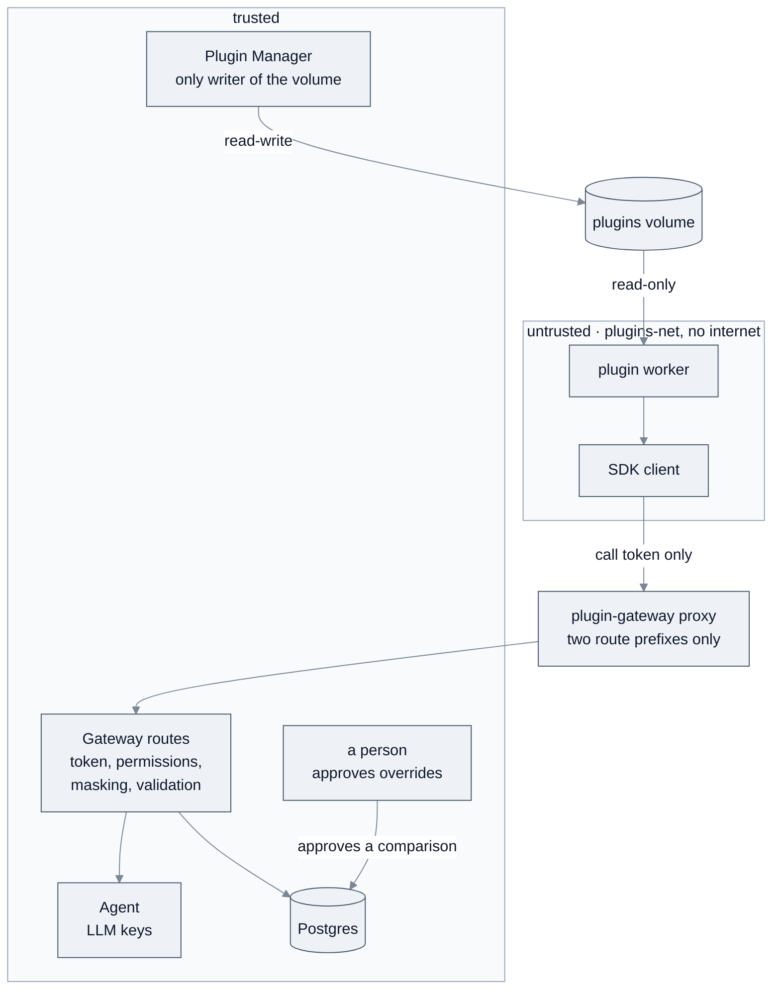

| Threat | Control |
|---|---|
| A tampered archive | SHA-256 from the signed catalog; signature checked against the keyring in the base repo |
| An old catalog that hides a revocation | catalog `serial` must not go backwards: this stops a rollback; a freeze (the same old catalog served on by whoever controls the connection) is not covered, because catalogs do not expire (§6.2) |
| A catalog entry that points the webapp at an internal address | archive URLs must be `https` on an allowlisted host |
| An archive that writes outside its folder | unpack rejects absolute paths, `..`, links and oversize archives |
| A plugin that skips the SDK | permissions are enforced in the Gateway, not in the SDK client |
| A plugin that reads secrets | workers get a clean environment, their own UID, and only per-call tokens; no DB credentials, LLM keys or runner key |
| A plugin that reads another user's data | every call token is bound to (plugin, acting user, project, session) and checked on every call |
| A plugin that reaches other webapp routes or services | workers are alone on `plugins-net` with the `plugin-gateway` proxy, which passes only `/api/plugin-gateway/v1/*` and `/api/plugin-runner/v1/*` to the webapp and never joins `redamon`; `gateway_mode_ipv4: isolated` removes the bridge's address on the host; `tests/plugins_isolation_live.sh` probes every one of these from inside |
| A cross-site request that drives a plugin route | plugin routes accept only same-origin JSON requests, checked against `PLUGINS_ALLOWED_ORIGIN` behind a reverse proxy (the single-host deploy sets it: nginx drops the port from `Host`) |
| A plugin that sends data out of the host | the plugins network has no internet egress; screens cannot load remote images and run under a strict Content Security Policy |
| A plugin that spoofs core UI | plugin contributions always carry a plugin badge; icons come from an allowlist |
| A plugin that changes how the agent behaves | proposals change nothing until a person approves them in core UI; every active override is visible and resettable |
| An override that breaks or hides factory text | validated on propose and again on read; Stale when its factory part changes |
| A plugin that modifies its own code or another plugin's | the volume is read-only to workers; only the Manager writes it |
| A plugin that crashes, hangs or floods | per-worker kill on timeout, memory, CPU and process limits, concurrency caps, data quotas, a separate LLM budget |
| An update that quietly asks for more access | new permissions require the admin to approve again |
| A malicious catalog | only the official `redamon-plugins` catalog by default; a custom catalog is an explicit admin opt-in (`PLUGINS_EXTRA_TRUSTED_KEYS`, §6.4) with a warning |
| Actions that leave no trace | every lifecycle operation and override decision is written to the audit log |

**What a plugin can and cannot change.** A plugin reaches the base only through four
channels, and all of them are data:

| Channel | What it changes | Bound |
|---|---|---|
| `sdk.data.*` | its own rows in `PluginData` | its namespace and quotas |
| `sdk.override.propose` | the text of a skill part, as a proposal | nothing applies until a person approves; it cannot switch a part on; reset at any time |
| UI contributions | entries and screens at the declared points | drawn by core code, with a plugin badge |
| `sdk.llm.invoke` | LLM calls the agent makes for it | the user's chosen model and a separate budget |

It can never change RedAmon's code or images, the database schema or any other table (users,
projects, findings, settings, the audit log), the Neo4j graph (the SDK has no graph call),
project settings, scope or Rules of Engagement, `.env` or the compose files, its own granted
permissions, or another plugin's code or data. When a plugin needs more, the platform grows
generically in a RedAmon release (§11.4).

**Why approval matters so much.** RedAmon's scope guardrail is itself part of the agent's
instructions
([think_node.py:590](../../agentic/orchestrator_helpers/nodes/think_node.py#L590)), and
the instructions are what `skill.text` changes. So an override is the most powerful thing a
plugin can produce, and its consent text says so plainly: it can rewrite the instructions the
agent follows. The platform treats every proposal as untrusted input until a person approves
it (principle 5).

**Known limits of the first platform version.**

- All plugins share one Runner container and are separated by process and UID, not by
  container. If stronger isolation is needed, the next step is one container per plugin. That
  changes nothing in the plugin contract.
- Plugin code sees target data in the transcripts it is allowed to read (§7.3). Its
  containment relies on the trusted catalog and the absence of any way out, not on
  anonymisation.
- No per-process CPU-rate limit exists for an unprivileged worker inside the container: workers
  run at `nice 10`, and the container's `cpus:` cap (`PLUGIN_RUNNER_CPUS`) is the hard bound.
- Several webapp copies (a documented ECS layout, not shipped) need the plugins volume on a
  shared read-write filesystem, or only one copy may run the Manager. Leases, compare-and-swap
  updates and database counters make the rest safe to share.
- A `project.skills.row` action receives the project but not the skill whose row was clicked,
  runs as a plain action (no model gate, no job window) and does not open the review window from
  its result; Skiller does not use this point. An action's own `resultScreen` is accepted and
  checked at install but opened by no point (a form's `resultScreen` is). Both are candidates for
  a minor platform release.
- A plugin page the route refuses shows the not-found screen with HTTP status 200 (§7.5).

---

## 11. Versioning and the platform contract

### 11.1 Three version lines

- **Platform version** (semver): the version of the SDK, the Gateway API, the extension points,
  the UI primitives and the manifest and screen schemas that base RedAmon exposes. This is a
  **public API**.
- **Plugin version** (semver): each plugin's own release line in `redamon-plugins`, which
  declares the `platform` range it supports.
- **Plugin data version** (an integer): the shape of a plugin's rows in `PluginData`, stored in
  `PluginInstall.dataVersion` and moved by the plugin's numbered migrations (§9.5).

The rules:

- **Adding** an SDK call, an extension point, a UI primitive or an optional manifest field is a
  **minor** platform bump, compatible with existing plugins.
- **Changing or removing** any of them is a **major** bump. Every plugin targeting the old major
  becomes `incompatible` until it publishes a new release (§9.7).
- A plugin may only use what its declared `platform` range guarantees. The Manager enforces
  this at install, at update and at every reconciliation.

### 11.2 Where the platform version lives

The platform version is `PLUGIN_PLATFORM_VERSION` (1.1.0) in
[platformVersion.ts](../../webapp/src/lib/plugins/platformVersion.ts), with copies in the
Runner (`platform_version.py`), the SDK and its contract cases that
`platformVersion.parity.test.ts` holds equal. The Runner image reports the platform version it
was built with. If the two differ, for example after a partial rebuild, the Runner reports
itself out of date and runs no worker until they match. All range checks use one semver
evaluator, in the webapp ([semver.ts](../../webapp/src/lib/semver.ts)); `redamon-plugins` has a
second one for its CI (`tools/semver.py`), held equal by shared cases.

**1.1.0** (minor) added the `user_skill.text` behaviour point and its permission
`override:user_skill.text`, the optional `pick: "session.skill"` of a chat action, the `adopted`
change-set status, and the platform meta keys of §7.6. A plugin written for 1.0.0 runs unchanged;
a plugin that needs these declares `>=1.1.0`, and the catalog keeps its 1.0.0 release for
instances that are not there yet. An update that adds a permission needs the admin's consent to
the new set, so an instance stays on the old version until an admin accepts it.

**Downgrading RedAmon below 1.1.0** drops the lineage, provenance and quarantine columns of
`user_attack_skills` through `db push --accept-data-loss`: skills, names and texts stay, but
version badges, family numbering and quarantine marks are lost, and no export holds them.
Check first that no skill is quarantined (the banner in Global Settings). An older image keeps
the newer status CHECK (`plugin_overrides_status_ck2`, lower numbers only are dropped), so
`adopted` rows do not block its start.

### 11.3 Libraries available to plugins

The Python version (3.11) is **part of the platform contract**. The libraries of the Runner
image are not: workers start with `python -I -S`, so plugin code sees only the standard
library, the SDK and its own `vendor/` folder, never the supervisor's packages. A plugin may
bundle pure-Python dependencies in `vendor/`. Anything that needs a compiled or system library
requires a platform change and a new Runner image, which is a RedAmon release.

### 11.4 Growing the platform

When a plugin needs something the platform does not offer, such as a new UI primitive or a new
extension point, the platform grows **generically** first and ships it in a minor release. Then
the plugin is released against that minor. The base repo gains capability; it never absorbs a
plugin's feature code.

### 11.5 The database schema

The schema changes only with a RedAmon release. At every start, the webapp's entrypoint applies
the `prisma/schema.prisma` baked into its image with `prisma db push`, then the platform's
constraint script ([Dockerfile:123](../../webapp/Dockerfile#L123)). The four plugin tables were
added this way, once. A plugin archive has no route to the schema: its files land on the
plugins volume, the webapp only reads JSON from them, and its migrations transform the rows
the platform hands them, with no Gateway access (§9.5).

The push runs with `--accept-data-loss`, so the base can delete plugin data: **starting an
older RedAmon image whose schema predates the plugin tables drops all four tables with their
rows** (installs, plugin data, approved skill versions, catalog and counter state). Export
first: Plugins page → the plugin's details → Export data, or

```bash
docker compose exec postgres pg_dump -U redamon -d redamon -t 'plugin_*' > plugins-backup.sql
```

---

## 12. What ships where

| Concern | Base repo (`redamon`): the platform, ships once | Plugin repo (`redamon-plugins`): per plugin |
|---|---|---|
| Hosting | Plugin Manager, Runner (supervisor, Loader, workers) | — |
| Contract | SDK client, Gateway, manifest and screen schemas | depends on a pinned platform version |
| Storage | `PluginInstall`, `PluginData`, `PluginOverride`, `PluginPlatformState` tables | rows of its own data |
| UI | UI host, primitives, extension slots, override review screens | screen descriptions (JSON) |
| Behaviour | generic seams at behaviour points, inert when empty | `sdk.override.propose` calls |
| Distribution | catalog fetch, keyring (public keys), signature and checksum checks | catalog generation, signed releases; the signing key as an environment secret (§6.4) |
| Feature logic | **none** | all of it (`engine/`) |
| Feature documentation | **none** | the plugin's own `README.md` |

The one-time cost in the base repo is the components of §7, the four tables, and the seam of
§8.2. After that, `skiller` and every plugin after it adds **no plugin-specific code** to the
base repo. The base repo grows only when the platform itself gains a generic capability.

---

## 13. Further reading, and where the build departs from the first design

This document fixes the architecture. The rest lives here:

- [README.PLUGIN_SDK.md](README.PLUGIN_SDK.md): the plugin author's contract, with the full `ctx`,
  every SDK call and refusal, action results, the screen schema and binding rules, migrations,
  the runner environment, testing with `FakeSdk`, local development and where logs go.
- The plugin repository's [README](https://github.com/samugit83/redamon-plugins#readme):
  releasing, revoking and re-signing, adding a plugin, and developing one against a local
  RedAmon; each plugin's own `README.md` for what it does.
- [README.WEBAPP.md](README.WEBAPP.md) "Plugin platform API" for every route, and
  [README.DEV.md](README.DEV.md) §6.6 for adding an extension point.
- The wiki's Plugins page for administrators and users.

The design was written before the code. These are the places where the build differs, each
already reflected in the sections above:

| First design | As built |
|---|---|
| The Gateway on its own port of the webapp | Webapp routes under `/api/plugin-gateway/v1/`, reached only through the `plugin-gateway` proxy on `plugins-net` and `plugins-edge` (§4, §7.3). A Next.js server listens on one port. |
| Three tables | Four: `PluginPlatformState` holds the catalog serial marks, the never-lowered version counters and the reconcile lease (§7.4). |
| A navigation entry in `NavigationBar.tsx`; `nav` as a top-level entry | One Plugins button in `GlobalHeader.tsx`; `nav` is an Open entry on `/plugins` and a page at `/plugins/<id>` (§7.6.1). |
| Plugin model calls through `_build_llm_with_model_for_user` | The newer `_build_feature_llm`, behind the agent's `/plugins/llm/invoke` (§5.1). |
| Approval in project settings | The same core review window opens from the chat and from project settings (§7.6). |
| Overrides per project | A user scope (applies to every project the user owns; Skiller's default) and a project scope, resolved per skill (§7.6). |
| `override.get(point, target)`, `propose(point, target, value, note)`, `withdraw(proposalId)` | Change sets: `get(point, target_group)`, `propose(point, target_group, parts, *, note, meta, scope)`, `withdraw(change_set_id)`, plus `jobs.progress` (§7.3). |
| Approving replaces the active override of one target | It replaces the scope's whole active version of that skill, a snapshot, so parts of two versions never run together (§7.6). |
| The override state machine | Adds deleting any non-active version, staleness of a whole version (`factory_changed`, `part_removed`), and re-approval of a `factory_changed` version without a new number (§7.6). |
| Staleness detected in the delivery path | Detected by reconciliation every `PLUGIN_RECONCILE_INTERVAL`, plus the agent's own per-skill check at use; in between, the factory text is used anyway (§8.2, §9.7). |
| Migrations with a migration token through `sdk.data.*` | Per-row `migrate_row` functions, applied by the platform to every owner's rows, with no token (§9.5). |
| Per-worker CPU limits | `nice 10` per worker and the container's `cpus:` cap as the hard bound (§10). |
| A strict Content Security Policy on plugin content | On `/plugins` pages; plugin text in the chat drawer and project settings is React-escaped or image-free Markdown (§7.5). |
| The Runner image's libraries are part of the contract | Workers start with `python -I -S`: the contract is the standard library, the SDK and `vendor/` (§11.3). |
| One semver evaluator, in the webapp | A second one in `redamon-plugins` for CI, held equal by shared cases (§11.2). |
| No plugin-specific code in the base repository | Skiller appears in the base only as test data: `pluginsSkiller.spec.ts` and its fixtures (§6.5). |
| A dev mode that loads a plugin folder | An offline install of a catalog signed with a development key trusted through `PLUGINS_EXTRA_TRUSTED_KEYS` (§9.7). |
| A revoked plugin is disabled automatically | Revocation sets the system-written `revokedReason`; the admin's `enabled` is untouched; every serving check is false while it is set (§6.2, §9.7). |
| Uninstalling returns to Available | Keeping data returns to Available; a purge deletes the row with its data (§9.6). |
| The action endpoint `/plugins/{id}/actions/{action}`; a field `approvedBy` | `/runner/v1/plugins/{id}/actions/{action}` (§7.2); `decidedBy`, which covers approval and rejection (§7.4). |
| A catalog with an expiry date, re-signed on a schedule | No expiry: freshness is the serial alone, and the catalog is re-signed by hand only to rotate a key (§6.2, §6.4). |

---

## 14. Glossary

- **Platform**: the generic plugin-hosting machinery in the base repo. It knows nothing about
  any specific plugin.
- **Platform version / range**: the version of the platform API; a plugin declares the range
  of platform versions it supports.
- **Plugin**: an optional feature that lives in `redamon-plugins` and is installed on demand.
- **Catalog**: the signed `catalog.json` in `redamon-plugins`, listing plugins and their
  releases.
- **Manifest**: a plugin's `plugin.json`, its full contract (identity, compatibility,
  permissions, contributions).
- **Plugin Manager**: the webapp component that runs the lifecycle and reconciliation, and is
  the only writer of the plugins volume.
- **Plugin Runner**: the isolated container that runs plugin code. It holds no database
  credentials or LLM keys.
- **Supervisor / Loader**: the Runner's main process, which takes requests from the webapp and
  starts and stops workers from the Manager's run list.
- **Worker**: one process running one version of one plugin.
- **Staging**: the per-operation folder where downloads land before they are checked.
- **SDK client / Gateway**: the library a plugin calls, and the trusted webapp routes that serve
  it and enforce permissions, reached only through the `plugin-gateway` proxy.
- **Call token**: a short-lived credential for one action invocation, bound to (plugin, user,
  project, session).
- **Namespace**: `live`, or `migrating:<operationId>` for the copy of a plugin's `PluginData`
  rows a data migration works on.
- **Data version**: the integer shape version of a plugin's stored data.
- **Extension point**: a named UI or behaviour slot where a plugin may contribute.
- **UI primitive / screen description**: a building block the UI host can draw, and the JSON a
  plugin uses to arrange primitives into a screen.
- **Part**: one of the pieces a built-in skill's text is assembled from; the unit a `skill.text`
  override targets.
- **Factory text**: the text a part has in the base repo, used whenever no approved override
  qualifies.
- **Override**: a value a plugin proposes at a behaviour extension point. It changes nothing
  until a person approves it.
- **Stale**: an approved override whose factory part has changed since approval.
- **Incompatible**: an installed plugin whose platform range no longer includes the running
  platform.
- **Action path**: user-triggered plugin work. It may be slow and writes its results as data.
- **Behaviour path**: the agent's use of approved override data at each turn. It never blocks
  and always falls back to factory text.
- **Factory behaviour**: how RedAmon behaves with no plugin enabled, the guaranteed fallback.
- **Detached signature**: `catalog.json.sig`, a signature kept in its own file over the exact
  bytes of `catalog.json`.
- **Keyring**: the public keys the platform trusts to sign the catalog, compiled into the
  webapp image; each has a key id.
- **Lease**: the claim a lifecycle operation holds on a `PluginInstall` row until it ends or
  the lease expires; it replaces a database lock.
- **Scope**: who an override applies to: a user (every project that user owns) or one project.
- **Change set / version**: the override rows proposed together for one skill; an approved
  change set is a version with a revision number.
