# RedAmon Reconnaissance Module

**Unmask the hidden before the world does.**

An automated OSINT reconnaissance and vulnerability scanning framework combining multiple security tools for comprehensive target assessment.

---

## Table of Contents

- [Quick Start](#-docker-quick-start-recommended)
- [Architecture](#-docker-in-docker-architecture)
- [Pipeline Overview](#-scanning-pipeline-overview)
- [How a Run Ends](#-how-a-run-ends-prune-and-mute-rules)
- [Targeting Modes](#-targeting-modes)
- [Scan Modules](#-scan-modules-explained)
- [Tool Comparison](#-complete-tool-comparison)
- [Configuration](#-key-configuration-parameters)
- [Prerequisites](#-prerequisites)
- [Project Structure](#-project-structure)
- [Output Format](#-output-format)
- [Test Targets](#-test-targets)

---

## 🐳 Docker Quick Start (Recommended)

The recon module is fully containerized. All tools run inside Docker containers.

### Option 1: Start from Webapp (Recommended)

The easiest way to run recon is through the webapp UI, which provides:
- Real-time log streaming
- Phase progress tracking
- Project-specific settings from PostgreSQL
- Automatic Neo4j graph updates

```bash
# 1. Start all services
cd services/postgres_db && docker-compose up -d
cd ../graph_db && docker-compose up -d
cd ../recon_orchestrator && docker-compose up -d
cd ../webapp && npm run dev

# 2. Open http://localhost:3000/graph
# 3. Click "Start Recon" button
```

### Option 2: CLI with Environment Variables

For standalone CLI usage without the webapp:

```bash
# 1. Build the container (first time only)
cd recon/
docker-compose build

# 2. Run a scan with target specified via environment variable
TARGET_DOMAIN=testphp.vulnweb.com docker-compose run --rm recon python /app/recon/main.py
```

### Docker Environment Variables

Override default settings via environment variables:

```bash
# Run with custom target
TARGET_DOMAIN=example.com docker-compose run --rm recon python /app/recon/main.py

# Run specific modules only
SCAN_MODULES="domain_discovery,port_scan,http_probe" docker-compose run --rm recon python /app/recon/main.py
```

### When to Rebuild

| Change Type | Action Required |
|-------------|-----------------|
| Python code (*.py) changes | `docker-compose build` |
| `requirements.txt` changes | `docker-compose build --no-cache` |
| `Dockerfile` changes | `docker-compose build --no-cache` |
| `.env` file changes | No rebuild needed (mounted as volume) |

> **Pinned build artifacts (STRIDE T17).** The recon image build no longer pulls tools from moving refs: `recon/Dockerfile` pins ffuf (`@v2.1.0`), subjack/jsluice/masscan (commits), the SecLists + jhaddix wordlists (a commit / gist revision), and `recon/requirements.txt` pins knock + paramspider to commits. A moved or removed pinned artifact now **fails the build loudly** (a caught supply-chain change, not a silent runtime compromise). To bump a pin, edit the tag/commit in `recon/Dockerfile` or `recon/requirements.txt` and rebuild. (The auto-pulled sibling *tool containers* - naabu/httpx/nuclei/katana/gau/amass - are runtime images, out of T17 scope, and keep their `:latest` tags.)

---

## 🔗 Recon Orchestrator Integration

When started from the webapp, the recon module is managed by the **Recon Orchestrator** service, which provides:

- **Container Lifecycle Management** - Start/stop/monitor recon containers
- **Real-time Log Streaming** - SSE-based log streaming to the frontend
- **Phase Detection** - Automatic detection of scan phases from log output
- **Status Tracking** - Track running/completed/error states per project

### Configuration Hierarchy

Settings are resolved in the following order of precedence:

1. **Webapp API (Primary)** - When `PROJECT_ID` and `WEBAPP_API_URL` environment variables are set:
   ```bash
   # Set by recon orchestrator when starting container
   PROJECT_ID=cml6xov4q0002h58pln96n20d
   WEBAPP_API_URL=http://localhost:3000
   ```
   The recon module fetches every project setting (each one is described in `recon_settings/registry.yaml`) from:
   ```
   GET /api/projects/{projectId}
   ```

2. **Environment Variables** - Override individual settings:
   ```bash
   TARGET_DOMAIN=example.com docker-compose run --rm recon python /app/recon/main.py
   ```

3. **DEFAULT_SETTINGS (Fallback)** - Built-in defaults in `project_settings.py` for CLI usage without webapp

### project_settings.py

The `project_settings.py` module handles settings resolution:

```python
from recon.project_settings import get_settings

# Returns dict with all settings from API or DEFAULT_SETTINGS fallback
settings = get_settings()

TARGET_DOMAIN = settings['TARGET_DOMAIN']
SUBDOMAIN_LIST = settings['SUBDOMAIN_LIST']
SCAN_MODULES = settings['SCAN_MODULES']
# ... and every other setting
```

### Orchestrator Communication Flow

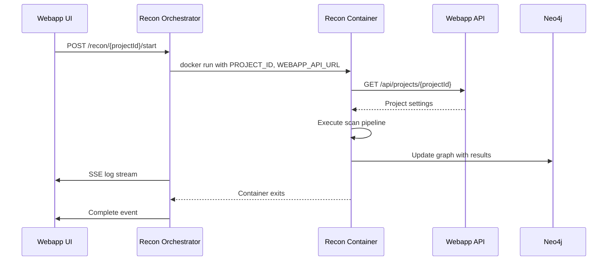

---

## 🏗 Docker-in-Docker Architecture

The recon module uses a **Docker-in-Docker (DinD)** pattern where the main recon container orchestrates sibling containers for each scanning tool.

### How It Works

The recon container reaches the host's Docker daemon through a **filtering broker** rather than the raw socket. The broker validates every container-creation request — permitting only the known tool images, with mounts restricted to the shared scratch / output directories — and forwards the approved ones to the host daemon. All tool containers are therefore **siblings** managed by the same host daemon, while the recon container itself cannot create a container that mounts the host filesystem, runs privileged, or uses an unapproved image.

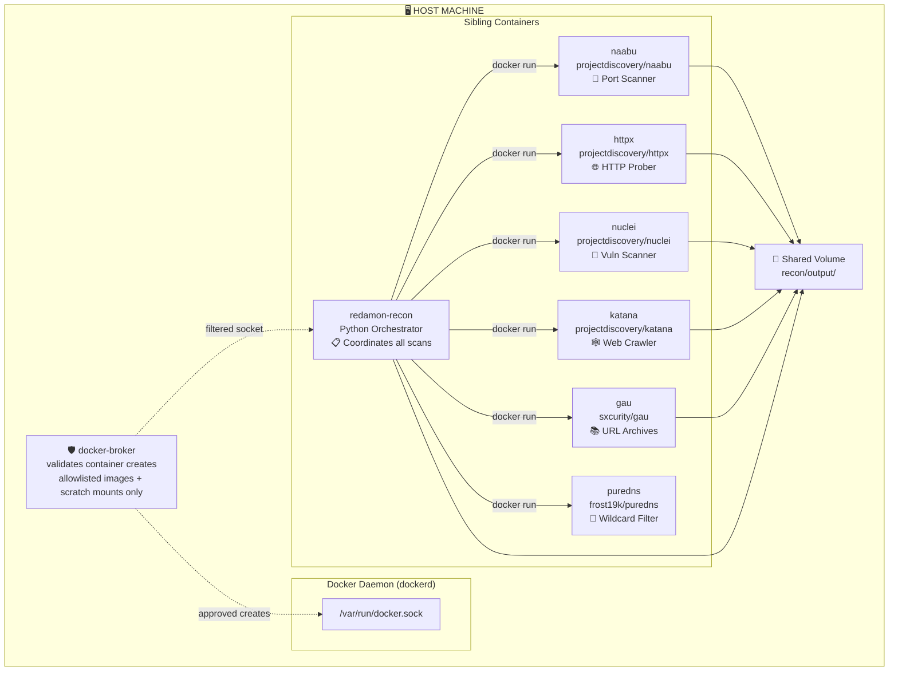

### Container Execution Flow (Parallelized)

The pipeline uses a **fan-out / fan-in** pattern with `ThreadPoolExecutor` to run independent modules concurrently, significantly reducing total scan time while respecting data dependencies between groups.

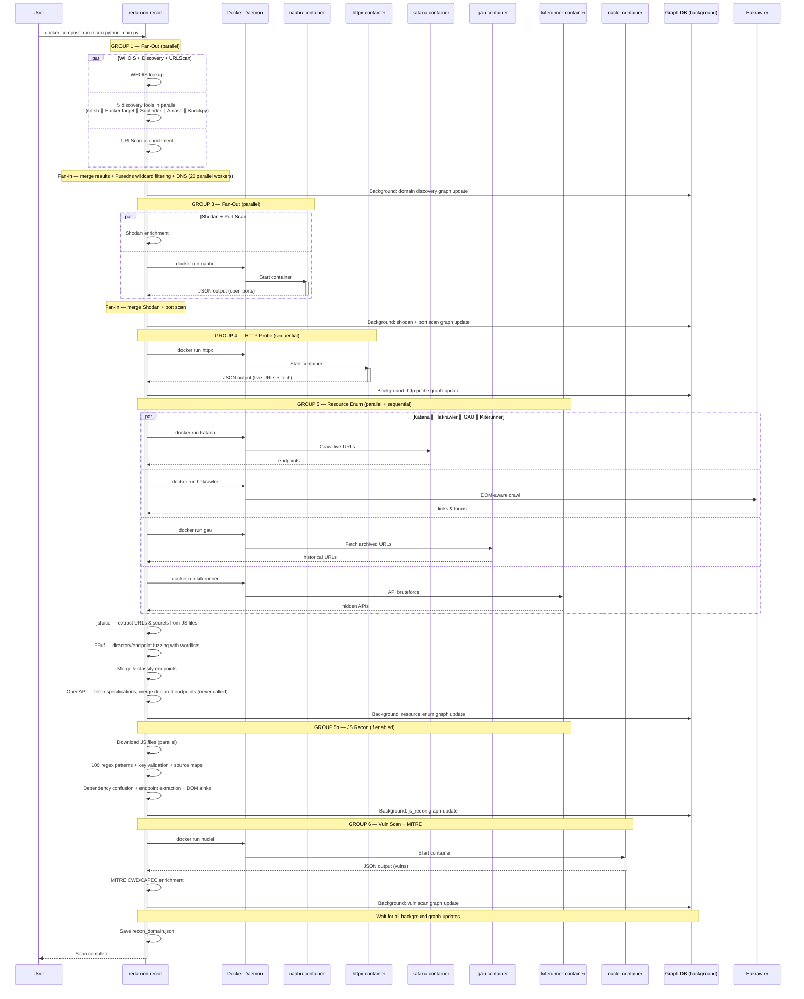

### Why Docker-in-Docker?

| Benefit | Description |
|---------|-------------|
| **Isolation** | Each tool runs in its own container with minimal dependencies |
| **Consistency** | Same tool versions regardless of host OS |
| **No host pollution** | Go binaries (naabu, httpx, nuclei) don't need to be installed on host |
| **Easy updates** | Just pull new Docker images to update tools |
| **Portability** | Works on any system with Docker installed |

---

## 🔄 Scanning Pipeline Overview

RedAmon executes scans in a **parallelized pipeline** using a fan-out / fan-in pattern. Independent modules within each group run concurrently via `ThreadPoolExecutor`, while groups that depend on prior results run sequentially. Graph DB updates happen in a dedicated background thread so the main pipeline is never blocked.

### High-Level Pipeline

```mermaid
flowchart LR
    subgraph Input["📥 Input"]
        Domain[🌐 Target Domain]
    end

    subgraph G1["GROUP 1 — parallel fan-out"]
        DD[WHOIS]
        SUB[Subdomain Discovery<br/>5 tools in parallel]
        URLSCAN[URLScan.io]
    end

    subgraph G3["GROUP 3 — parallel fan-out"]
        SHODAN[Shodan Enrichment]
        PS[Port Scan — Naabu]
    end

    subgraph G4["GROUP 4 — sequential"]
        HP[HTTP Probe<br/>Httpx + Wappalyzer]
    end

    subgraph G5["GROUP 5 — parallel + sequential"]
        RE[Resource Enum<br/>Katana ∥ Hakrawler ∥ GAU ∥ ParamSpider ∥ Kiterunner<br/>then jsluice → FFuf → Arjun → OpenAPI]
    end

    subgraph G6["GROUP 6 Phase A — parallel (4-way fan-out)"]
        VS[Vuln Scan — Nuclei]
        GQL[GraphQL Security<br/>Introspection + graphql-cop]
        TKO[Subdomain Takeover<br/>Subjack + Nuclei + BadDNS]
        VHOST[VHost & SNI Enum<br/>L7 Host header + L4 SNI probing]
    end

    subgraph G6B["GROUP 6 Phase B — sequential"]
        MIT[MITRE Enrichment<br/>CWE + CAPEC]
    end

    subgraph Output["📤 Output"]
        JSON[(recon_domain.json)]
        Graph[(Neo4j Graph<br/>background updates)]
    end

    Domain --> G1
    G1 -->|fan-in: merge + puredns filter| G3
    G3 -->|fan-in: merge| G4
    G4 --> G5
    G5 --> G6
    G6 --> G6B
    G6B --> JSON
    JSON --> Graph
```

### Detailed Module Flow (Parallelized)

The pipeline uses **fan-out / fan-in** concurrency: modules within each group run in parallel threads, and results are merged before the next group starts. Graph DB writes happen in a single-writer background thread that never blocks the main pipeline.

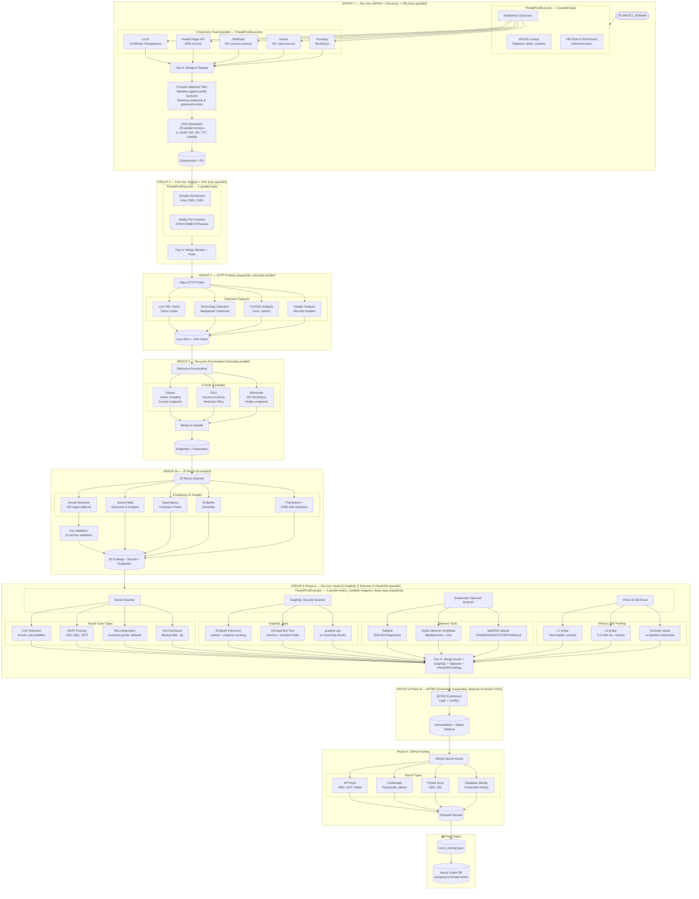

### Data Enrichment Flow

```mermaid
flowchart LR
    subgraph Discovery["Discovery Phase"]
        Sub[Subdomains] --> IP[IP Addresses]
        IP --> Port[Open Ports]
        Port --> Service[Services]
    end

    subgraph Analysis["Analysis Phase"]
        Service --> URL[Live URLs]
        URL --> Tech[Technologies]
        Tech --> Endpoint[Endpoints]
    end

    subgraph Assessment["Assessment Phase"]
        Endpoint --> Vuln[Vulnerabilities]
        Vuln --> CVE[CVE IDs]
        CVE --> CWE[CWE Weaknesses]
        CWE --> CAPEC[CAPEC Attacks]
    end

    subgraph Graph["Graph Storage"]
        CAPEC --> Neo4j[(Neo4j)]
    end
```

---

## ⚡ Parallelization Architecture

The recon pipeline uses a **fan-out / fan-in** pattern with Python's `concurrent.futures.ThreadPoolExecutor` to run independent modules concurrently, significantly reducing total scan time while respecting data dependencies.

### Execution Groups

| Group | Modules | Parallelism | Dependencies |
|-------|---------|-------------|--------------|
| **GROUP 1** | WHOIS + Subdomain Discovery + URLScan | 3 parallel tasks | Only needs `root_domain` |
| *Discovery* | crt.sh + HackerTarget + Subfinder + Amass + Knockpy | 5 parallel tools | Part of GROUP 1 |
| *Puredns* | Wildcard filtering (validates against public resolvers) | Sequential | After discovery fan-in, before DNS |
| *DNS* | DNS resolution for all subdomains | 20 parallel workers | After puredns filtering |
| **GROUP 2b** | Uncover Target Expansion (13 search engines) | Sequential | Needs domain from GROUP 1; runs before GROUP 3 |
| **GROUP 3** | Shodan Enrichment + Port Scan (Naabu) | 2 parallel tasks | Needs IPs from GROUP 1 + GROUP 2b |
| **GROUP 3b** | OSINT Enrichment (Censys + FOFA + OTX + Netlas + VirusTotal + ZoomEye + CriminalIP) | 7 parallel tasks | Needs IPs/domains from GROUP 1; runs concurrently with GROUP 3 |
| **GROUP 4** | HTTP Probe (httpx) | Sequential (internally parallel) | Needs ports from GROUP 3 |
| *IP attribution* | Tags every IP `shared_edge` / `dedicated` / `unknown` (`main_recon_modules/ip_attribution.py`), then writes the Shodan CVEs and the Netlas data GROUP 3/3b held back | Sequential; the TLS handshakes without SNI in a small pool, paced at the RoE ceiling | After GROUP 4 and the certificate SAN feedback; before GROUP 5 and 6. Runs if `IP_ATTRIBUTION_ENABLED` |
| **GROUP 5** | Resource Enum (Katana + GAU + Kiterunner, then OpenAPI) | 3 tools internally parallel | Needs live URLs from GROUP 4 |
| **GROUP 5b** | JS Recon Scanner (100 regex patterns, key validation, source maps, dependency confusion, endpoint extraction, DOM sinks) | 5 analyzers parallel per file | Needs JS files from GROUP 5; runs if `JS_RECON_ENABLED` |
| **GROUP 5.5** | Supply-Chain Recon (black-box package harvest + offline OSV verdict, retire.js over served JS, optional GuardDog; then incident enrichment, malicious-host correlation and typosquat detection) | Sequential; dispatches the DIRTY analyzer | Needs JS files from GROUP 5b; runs if `SUPPLY_CHAIN_RECON_ENABLED` |
| **GROUP 6 Phase A** | Vuln Scan (Nuclei) ∥ GraphQL Security Testing ∥ Subdomain Takeover ∥ VHost & SNI Enumeration ∥ Web Cache Poisoning ∥ Origin Discovery ∥ Route Exposure | Up to 7 parallel tasks (ThreadPoolExecutor, `_isolated` wrappers), each only when enabled | Needs endpoints from GROUP 5/5b |
| **GROUP 6 Phase B** | MITRE Enrichment (CWE + CAPEC) | Sequential | Needs CVEs from Phase A (Nuclei) |

### IP attribution

`run_ip_attribution` labels every IP of the run once, so the modules that ask
"is this IP the target's?" stop guessing on their own. The rule
(`ownership_tag`, pure):

- `shared_edge`: `cdn_ranges.classify_ip` fires on a published edge prefix,
  an edge-only CDN name naabu, tlsx or httpx reported, or an edge's response
  header; or on an edge-only ASN (`CDN_ASNS`) while the default certificate
  does not cover a target domain;
- `dedicated`: the certificate the IP presents to a TLS client that sends no
  SNI covers a target domain (the org of every project root; IP mode has none);
- `unknown`: otherwise. Never "not ours": a cloud label is no signal.

Its one active check is that handshake (`recon/helpers/peer_cert.py`, shared
with origin discovery), only where :443 was found open. It skips RoE-excluded,
loopback and link-local addresses and hosts `host_health` marks down, is paced
at `min(10 rps, ROE_GLOBAL_MAX_RPS)`, and is capped per run by
`IP_ATTRIBUTION_TLS_MAX_PROBES` (stealth sets 0). A failed handshake is never
evidence: the reasons say "default certificate not checked (<why>)". The step
never raises; an IP it could not attribute is `unknown` with the reason.

Output: `combined_result["ip_attribution"]["by_ip"]`, written by
`update_graph_from_ip_attribution` to the existing IP (`ownership`,
`ownership_reasons`, `default_cert_names`, `current_dns_names`, plus the CDN
tag on a shared edge). Consumers read it through `shared_edge_ips()`:
vhost/SNI (`_shared_edge_ips`, plan 07's CDN check as the fallback for an
untagged IP), origin discovery (`_cdn_flagged_ips`), the Shodan CVE write
(`_write_shodan_cves`) and the Netlas write (`_write_netlas`, both held back
until the step runs), and the Priority Board (`ip_ownership` fact). A partial
run loads the graph's tag with `attach_graph_ownership`. The step writes no
finding, so it has nothing for the prune to keep.

### Background Graph DB Updates

All Neo4j graph updates run in a **dedicated single-writer background thread** (`ThreadPoolExecutor(max_workers=1)`). The main pipeline submits deep-copy snapshots of recon data and continues immediately. A final `_graph_wait_all()` ensures all updates complete before the pipeline exits.

### Structured Logging

All log messages use a consistent `[level][Module]` prefix format (e.g., `[+][crt.sh] Found 42 subdomains`) for clarity when multiple tools produce interleaved output from concurrent threads.

### Thread Safety

Each parallelized tool function is thread-safe:
- Discovery tools (`query_crtsh`, `query_hackertarget`, etc.) create their own `requests.Session` instances
- Module `_isolated` variants (e.g., `run_port_scan_isolated`, `run_shodan_enrichment_isolated`) accept a read-only snapshot of `combined_result` and return only their data section
- The main thread handles all merging — no shared mutable state between workers

---

## 🧹 How a Run Ends: Prune and Mute Rules

Outside the modules themselves, a full run touches the project's findings in
three places, all in `recon/main.py`:

1. **Clear, at the start** (`_clear_recon_graph`). It removes the project's
   previous recon *assets* and records the run's start time. Findings are NOT
   cleared up front: the operator's mutes, verdicts and fix items hang off them.
2. **Prune, after a successful run** (`_prune_recon_findings`, which calls
   `prune_unseen_findings`). It deletes the findings from recon's own sources
   (`RECON_FINDING_SOURCES` in `recon/helpers/finding_sources.py`) that this run
   did not write again. A finding a person muted, or one with a human verdict,
   is kept and stamped `stale_since` instead. A Mute Rules mute is not a
   judgement of the finding, so it is pruned like any other. A run that failed,
   or whose clear did not run, prunes nothing.
3. **The Mute Rules sweep, whatever happened** (`_apply_node_filters`, in
   `main()`'s `finally`). If the project's
   [Mute Rules](../../redamon.wiki/Mute-Rules.md) are *active on new scans*
   (Apply → New scans only, or Both), the run applies them once, to what it
   wrote: findings stamped after the run started, from recon's own sources. It
   mutes what the rules match and releases rule mutes no rule matches any more.
   It never touches a person's mute, a guarded finding (a human verdict, a
   confirmed or proven finding, one a `ChainFinding` CONFIRMS) or one an
   operator unmuted (an exemption). The rules are re-read at sweep time, so a
   save made during the scan applies. The sweep never raises and never changes
   the exit code; its counts are written to the output file's
   `metadata.node_filter`. It runs once per run, a Domain batch included.

What follows from that:

- **Some kinds are never swept by a scan.** The supply-chain findings (OSV
  advisories, malicious packages) come from sources outside
  `RECON_FINDING_SOURCES`, so only "apply to current graph" reaches them. GVM
  findings cannot be filtered yet.
- **Passive CVEs are recon sources.** `shodan_api`, `internetdb`, `netlas` and
  `criminalip` (plus `shodan` and `shodan_host_lookup`, the Shodan writer's
  create-only fallbacks) are in `RECON_FINDING_SOURCES`, grouped per enricher
  in `PASSIVE_CVE_SOURCES`, which also feeds `_PHASE_FINDING_SOURCES`: an
  enricher that raises, in its module or at the fan-in, keeps its findings.
- **Switched off vs degraded.** A source switched off by configuration (the
  module disabled, no API key) notes nothing, so its old findings are pruned
  like any other's; muted and judged ones are kept as stale, as the nmap rule in
  `_note_nmap_without_port_data` does. A source that was meant to run and could
  not check everything is degraded instead, through
  `note_cve_coverage` in `recon/helpers/passive_cve_coverage.py`: each lookup records
  which IPs got an answer ("no data" included), the IPs it could not ask about
  are kept by host (`target_ip`, source-only), and a lookup that reached
  nothing (a refused key, a crash, no IP at all) keeps its whole source.
  A Netlas answer cut short by its row cap keeps that IP; one that reached the
  provider never degrades the whole source, or its stale findings would never
  be pruned. The provider names one coverage gap: `note_degraded(aliases=...)`
  cuts its other source values with it.
- **Older passive CVEs get their host first.** `backfill_passive_cve_hosts`
  sets `target_ip` from the id (`shodan-<cve>-<ip>`, `criminalip-<cve>-<ip>`)
  on rows written before the writers stored it, so the by-host keep can match
  them. If it fails, passive sources are left out of that run's prune.
- **Passive CVEs are checked against the port scan.** `_reachcheck_shodan_cves`
  runs after the CDN drop in both pipelines and sets `port_confirmed` from
  `recon/helpers/port_coverage.py`: open, looked at and not open, or unknown.
  What a scan looked at comes from its recorded `ports_config`: a custom list
  or `top-full` is known; naabu's and masscan's top-100/1000 lists are not
  shipped here, so they can confirm an open port but never call one closed;
  naabu passive mode confirms nothing; masscan with an exclusion list never
  says closed. Partial recon reads `active_open_ports` from the graph and only
  confirms.
- **Netlas findings are per IP and port.** `netlas-<cve>-<ip>-<port>`, under
  the IP. Rows from earlier releases were keyed on the bare CVE id;
  `tooling/scripts/netlas_finding_rekey.py` (dry run by default; `--apply`
  with the services stopped, before the first scan on the new release) moves
  their mutes, layers, proof edges and Postgres references.
- **A JS Recon Secret's id is a hash of its pattern, match and file**
  (`_make_finding_id` in `recon/helpers/js_recon/patterns.py`). The keyword
  gap of about 70 patterns is now `[^\n]{0,120}?` (the nearest value, at most
  120 characters away) instead of `.*`, so a match that ran to the last
  candidate on a minified line is shorter and gets a new id.
  `tooling/scripts/js_secret_rekey.py` finds the pattern that produced each
  stored id, re-runs its current regex over the stored match, and moves the
  mute, layers, CONFIRMS edges and Postgres references to the id the scanner
  now writes (dry run by default; `--apply` with the services stopped, before
  the first scan on the new release). A match the new pattern rejects (the old
  Azure AD false positives) is left for the prune. A hit re-read under another
  name (`_refine`: an Algolia key labelled as the search key, a Supabase JWT by
  its `role`) keeps the id of the pattern that matched it, so it needs no
  re-key.
- **Secret validation states.** `validators.py` returns an explicit `state`
  (`valid`, `rejected`, `unknown`, `format_invalid`); js_recon stores
  `validated`, `rejected`, `unknown`, `format_invalid`, `format_validated`,
  `incomplete`, `unvalidated` (no validator) or `skipped`. Only a `401` or a
  provider's own "invalid key" answer is `rejected`; a timeout, `429`, `5xx`,
  breaker skip or `403` is `unknown`. The node-filter catalog keeps the legacy
  `invalid` as an alias (`aliases: {invalid: [rejected, format_invalid]}` on the
  field, expanded in `graph_db/node_filters/evaluate.py`), so saved rules keep
  matching.
- **Public client keys.** `PUBLIC_CLIENT_KEY_NAMES` in `patterns.py` is written
  at severity info with `public_client_key`. The same names, lowercased, live in
  `score_model.PUBLIC_CLIENT_KEY_TYPES`, `triage_mixin._PUBLIC_CLIENT_KEY_TYPES`,
  `graph_db/node_filters/normalize.py` and `webapp/src/lib/secrets/publicClientKeys.ts`;
  tests pin all five equal. Readers decide on the flag OR the name, for nodes
  written before the flag.
- **The legacy path (domain discovery off) keeps what it does not run.**
  `_run_pipeline` clears the graph, then `run_domain_group`'s legacy branch
  reloads the previous run's file and re-runs only HTTP probing, resource
  enumeration, AI Surface, JS Recon and vuln_scan on it. Every other recon
  source (Shodan, InternetDB, Netlas, Criminal IP, nmap NSE, GraphQL,
  takeover, VHost/SNI, cache poisoning, WCVS, origin discovery, serialized
  scan) is noted degraded first (`_note_legacy_unrun_sources`), so the prune
  keeps its findings. The branch rebuilds the Domain and Subdomain nodes from
  the file (`_write_legacy_domain_nodes`, synchronous, after the RoE filter,
  which covers `subdomains`, `subdomain_status_map` and `dns.subdomains`),
  resets the graph writer so its background writes land, and drains it before
  the coverage record. The file can carry the previous run's
  `technology_cves` when the CVE lookup does not run this time, and IP
  attribution is not re-run on this path.
- **A stopped scan runs step 3, never step 2.** Python is PID 1 in the recon
  container, so it installs its own SIGTERM handler before anything else
  (`recon/helpers/shutdown.py`, from the top of `main.py` and
  `partial_recon.py`). The handler raises nothing (a `SystemExit` would wait on
  every `with ThreadPoolExecutor`, and partial recon catches it per root); it
  sets a flag and wakes a stopper thread, which signals the run's own processes,
  waits for the queued graph writes (`_drain_graph_writes`) until a deadline
  inside `RECON_STOP_GRACE_S`, runs the sweep once (`sweep_once`, which the
  normal `finally` shares) and exits 143. Once the flag is up,
  `subprocess.Popen` refuses (no new tool), `_graph_update_bg` queues nothing,
  `save_recon_file` parks the thread instead of starting the next phase, a
  batch or a per-root partial loop starts no further group or root, and
  `_prune_recon_findings` refuses: the killed tools returned empty results,
  which would read as "gone".
- **One graph writer at a time, drained before it is read.** `_graph_reset`
  drains a writer still live from a group that raised, and `main()`'s `finally`
  drains before it sweeps, so the sweep sees every write of the run.
- **Scans and applies exclude each other.** A full scan cannot start while an
  "apply to current graph" runs (`describeScanWriters`), and an apply to the
  current graph cannot start while a scan runs. Arming the rules for new scans
  is allowed at any time.

### Per-host coverage stamps (what each host got)

The coverage record above is per run and per org, and lists what was CUT. It
cannot say whether "no Secret on `app.example.com`" means analyzed and clean, JS
Recon off, no JS from the crawler, or the file cap. So the modules that work
per web host also report, for every host they *considered*, one row
`{status, inputs, outputs, reason}`, and their graph writers stamp it on the
matching `BaseURL` as `<module>_at` / `_status` / `_inputs` / `_outputs` /
`_reason` (declared in `graph_db/schema_sections.md`).

| Piece | Where |
|---|---|
| Row vocabulary, `base_url_key` (`https://x` and `https://x:443` are one host) | `recon/helpers/coverage_stamps.py` |
| JS Recon rows | `_js_coverage` in `recon/main_recon_modules/js_recon.py`, in `scan_metadata.coverage` |
| Nuclei rows | `_nuclei_coverage` in `recon/main_recon_modules/vuln_scan.py`, in `vuln_scan.scan_metadata.coverage` |
| The stamp (MATCH only, tenant-scoped, module name from an allowlist) | `stamp_base_url_coverage` in `graph_db/coverage_stamps.py`, called by `update_graph_from_js_recon` and `update_graph_from_vuln_scan` |
| The per-module counts readers use | `COVERAGE_SUMMARY_CYPHER` / `coverage_summary` in the same file: the agent's `/graph/exec` summary op (MCP `graph_summary`) and the in-app `graph_summary` |
| Webapp copy of the vocabulary | `webapp/src/lib/coverageStamps.ts` (node drawer, report, MCP); `tests/test_coverage_stamps_parity.py` holds the three lists equal |

- **Considered.** JS Recon: every host http_probe got a live (< 500) answer
  from, every host it was handed pages on (`resource_enum` URLs, which is how
  partial runs pass their targets), and every host serving a JS candidate; a
  host the RoE exclude is never considered. Nuclei: every host a pass targeted;
  when Nuclei was meant to run but could not start, every live host.
- **Status.** `complete`; `no_input` (no candidate, or every candidate turned
  out not to be JavaScript); `partial` with the reasons (`file cap`, `host
  unreachable`, `analyzer failed or timed out`; `runtime cap`, `nuclei exited
  <code>`); `failed` (all lost, a fatal error, or Nuclei unavailable). A Nuclei
  pass stopped at `NUCLEI_MAX_RUNTIME` leaves all its hosts partial: the run
  never says which targets it reached.
- **Absence.** A module switched off stamps nothing. Readers say "not scanned"
  for a live BaseURL without a module's stamp only when some BaseURL of the
  project carries it, and "coverage not recorded" otherwise (a graph written
  before the stamps, or a module that never ran). A full run rebuilds every
  BaseURL, so stamps describe the latest full run plus partial JS Recon and
  Nuclei runs since; partial JS Recon writes even when it found nothing.
- **Recon Delta.** Every stamp is in `VOLATILE_PROPERTIES`.
- **Follow-ups.** Only JS Recon and Nuclei stamp. `resource_enum`, the security
  checks and the GraphQL, cache and vhost scanners are the obvious next modules,
  and Subdomain / IP nodes the place for host-level modules.

---

## 🎯 Targeting Modes

A project picks one of three targeting modes at creation. The mode is locked
afterwards, and all three run the **same** pipeline.

| Mode | Target | What differs |
| --- | --- | --- |
| **Single Domain** | one root domain plus optional subdomain prefixes | the default; full OSINT and subdomain discovery are available |
| **IP / CIDR** | a list of addresses or ranges | skips domain ownership, subdomain enumeration and domain WHOIS; runs reverse DNS and IP WHOIS instead |
| **Domain batch** | a list of hostnames spanning several domains | groups them by registrable domain and scans each group in turn, in one run; a `*.example.com` entry enumerates that domain instead of scanning it literally |

### Domain batch

Paste or upload a flat hostname list. RedAmon groups it and scans the groups one
after another.

**The grouping rule is the registrable domain**, read from the Public Suffix
List with its private section (`tldts` in the webapp, `publicsuffixlist` in
recon; both pinned and bumped together, README.DEV.md 5.8).
`suba.sub3.domain3.com` belongs to `domain3.com`, `foo.example.co.uk` to
`example.co.uk`, `alice.github.io` to itself. The webapp derives the project's
**scope groups** from the stored hostname list on every read
(`webapp/src/lib/domainBatch.ts` + `scopeGroups.ts`, returned as `scopeGroups`
by `GET /api/projects/[id]`); they are never stored. Each group is
`{scanRoot, orgDomain, mode: exact|enumerate, includeRoot, exactHosts}`: an EXACT
group scans exactly its listed hosts (and its scan root only when listed), an
ENUMERATE group runs subdomain discovery under its scan root. A single-domain
project is one such group, whose scan root is the typed target at any depth.

**Scan root vs registrable domain.** A wildcard may sit below its registrable
domain: `*.api.example.com` is an ENUMERATE group with scan root
`api.example.com` and org `example.com`. A wildcard under another wildcard
collapses into the broader one (`*.v1.api.example.com` beside
`*.api.example.com`; the preview notes "covered by"), and a plain line under a
wildcard is seeded into its group. Plain lines of one org that no wildcard
covers form that org's EXACT group, so one org can have several groups
(`*.api.example.com` and `www.example.com` are two groups of `example.com`).

**A `*` entry enumerates that domain.** `*.example.com` (or `*example.com`) is
the one way to run subdomain discovery inside a batch: that group takes the same
FULL DISCOVERY path a single-domain project takes, and every other group in the
same run still scans exactly the hostnames it was given. A plain line under a
wildcard is seeded into its group. The settings toggle can only say whether
enumeration is permitted at all; the per-group decision is the group's `mode`.

**What is refused**, with a reason per line: a public suffix (`co.uk`), a wildcard
on one (`*.co.uk`, `*.github.io`), an IP literal (use IP mode), a malformed
wildcard (`a*.example.com`) and a name that is not a hostname.

**Recon re-validates, and fails closed.** `fetch_project_settings` reads
`scopeGroups` into `SCOPE_GROUPS` (`recon/project_settings.py`,
`_parse_scope_groups`): each name is re-checked against the hostname charset,
and each scan root against recon's own Public Suffix List
(`recon/helpers/public_suffix.py`); a suffix root or a malformed group is
dropped. A batch with no usable group, a single-domain target that is a public
suffix or not a hostname, or a suffix list that fails to import raises
`ScopeRefused` before any tool starts. When the two suffix lists disagree on a
name's org (one is newer), the webapp's org is kept and a warning is logged.
`DOMAIN_BATCH_GROUPS` (the legacy `{rootDomain, prefixes}` shape) is derived from
`SCOPE_GROUPS` for the readers that have not moved; only a webapp that sends no
`scopeGroups` makes recon fall back to the stored record. Each run logs:

```
[*][PSL] publicsuffixlist <pinned version>
[*][Scope] acme.co.uk org=acme.co.uk mode=enumerate root=true exact=0
[*][Scope] example.com org=example.com mode=exact root=false exact=2
```

A wildcard group discovers hosts the list never names, so `MAX_BATCH_HOSTS` and
`MAX_BATCH_GROUPS` stop bounding the run's length. The preview badges the group,
the form warns, and the start-scan dialog repeats the count.

```
sub1.domain1.com          Group 1  domain1.com      sub1
sub2.domain2.it      ->   Group 2  domain2.it       sub2
sub3.domain3.com          Group 3  domain3.com      sub3, suba.sub3
suba.sub3.domain3.com
```

**A batch is ONE scan, not many.** It takes a single slot in the scan queue, one
memory reservation, one container and one run id. It is not a new scan kind:
it is what a full recon does when the project is in batch mode, so the queue,
the scheduler, the stop button, run history and the traffic view all treat it
exactly like any other full recon.

**The graph fills progressively.** Previous recon data is cleared **once**, before
the first group. Each group then completes its whole pipeline and writes its
results before the next one starts, so all groups accumulate into a single graph
and the run produces **one** new version covering every domain. Re-running works
the same way it does in the other two modes.

**Only the hostnames you list are scanned**, except in a wildcard group.
Subdomain discovery is forced off when no group enumerates, including for a
group that is just a bare root domain. An EXACT group stays exact all the way
through: names a certificate, JS bundle or uncover reveals under its scan root
are never injected as targets (`merge_discovered_hostnames` takes the group's
scope from the recon metadata), uncover adds no IPs for it, and VHost/SNI
fabricates no `{word}.<root>` candidates.

**Root is honoured everywhere.** Without Include Root (a `*.example.com` line
with Root unticked) the scan root itself is no target: it is removed from the
merged host list, `dns.domain` is blanked (it is still resolved, only as the
resolver canary), and port scan, masscan, HTTP probe, TLS/header checks, VHost
and takeover never add it or its addresses.

**Ownership** (when Verify Domain Ownership is on) accepts the token at
`<prefix>.<scan root>` **or** `<prefix>.<registrable domain>`; RoE is checked
first, each name is asked once per run, and a resolver failure fails the group
closed with the resolver's message instead of reading as "no record". The
preview lists both accepted record names per group.

**The DNS resolver latch is per group, not per process**
(`_ResolverBreaker` in `domain_recon.py`). One transient failure that a
re-probe of the canary (the most recent root that answered) confirms opens it,
and the open latch skips this module's lookups, the ownership TXT lookup,
reverse DNS and the certificate-name check. `recheck()` runs at the start of
every `run_domain_group` and of every partial root (`run_per_root`): one
canary probe closes a recovered latch (`[+][DNS] Resolver answering again:
lookups resumed`) or keeps it open and records the DNS gap again for this group
(`[!][DNS] Resolver still down: skipping this group's lookups`). Inside a
group an open latch is probed again after 120 s, doubling up to 1800 s, by one
thread. Each hostname whose lookup is skipped is recorded with
`note_degraded("domain_recon", hosts=[...], host_source="dns")`, so its
findings are kept for every source; and a certificate name that cannot be
resolved is recorded, never injected unchecked (`_resolves_to_routable` fails
closed). Do not call `reset()` per group: it also drops the canary, and with a
dead resolver every lookup would then wait out dnspython's 5 s timeout.

**Org-level work runs once per registrable domain per run** (`recon/helpers/org_work.py`):
WHOIS, Shodan domain DNS, OTX/VirusTotal/Criminal IP domain reports and FOFA
`domain=` are asked for the org by the org's first group that passed RoE and
ownership, and its other groups get a copy (`[*][...] <org>: answered earlier
this run, reused`). SPF/DMARC/DNSSEC run on the org once, inside vuln_scan, for
the first group of that org that reaches it; when no group of an org reached
them, `security_check` is marked degraded so the prune keeps the old findings.
Origin discovery keys its candidate sources on the org only when the org is in
scope (some group's scan root is the org, or ownership was proven at the org),
else on the scan root (`[*][Origin] candidate key: <root> (org not in scope)`).
crt.name asks the org once and keeps names under the scan root; uncover's
`ssl:"<registrant>"` query runs only for a group whose scan root is its org.

**A failing group does not stop the batch.** One unresolvable domain should not
cost you the other nineteen: failures are reported at the end, and the run only
fails outright if every group failed.

**Output.** Each group writes `recon_<project_id>__<scan root>.json`, and the
canonical `recon_<project_id>.json` is rebuilt as the union of them after every
group. Everything downstream (GVM, the project export, the report) reads the
canonical file and sees the whole batch, and a batch stopped part way still
leaves a file that parses. Every recon file (single-domain and IP mode too)
states its scope: `metadata.org_domain`, `metadata.scope_mode` (`exact` |
`enumerate`), `metadata.include_root_domain` (always stamped; a file without
`scope_mode` is an older one and keeps the old default, root included), plus
top-level `scope_groups` (every group of the project, snake-case keys) and
`all_project_roots`. The merged canonical file drops the per-group scalars
(`scope_mode`, `org_domain`, `include_root_domain`, `filtered_mode`,
`wildcard_mode`, `subdomain_filter`) and carries `metadata.org_domains` and
`metadata.scope_groups` instead. A run that skips discovery reads each group's
previous file as its input, so only the files of removed roots are cleared.

**Graph.** One `Domain` per registrable domain: every in-scope host is a
`Subdomain` of its org, a deeper scan root that is a target is
`Subdomain {is_scan_root: true}`, and a host under no scan root is an
`ExternalDomain` even when it shares the org. Each group stamps the coverage
record on its org Domain, merged across the run's groups of that org
(`recon_coverage_roots`). A graph built before this model (a `Domain` named
after an old scan root) refuses partial recon, GVM and AI-attack starts until a
full recon rebuilds it.

**Limits.** 500 hostnames and 50 domain groups per project. A batch holds the
project's single scan slot for as long as it runs, so a very long list is a very
long scan.

Implementation: `_batch_groups()` / `run_domain_batch()` / `run_domain_group(group)` in
`recon/main.py` (a batch group runs on `target_info_from_group`,
`recon/helpers/batch_groups.py`; ownership in `_group_ownership`), grouping in
`webapp/src/lib/domainBatch.ts`, output handling in `recon/helpers/output_paths.py`,
graph scope in `graph_db/mixins/recon/scope.py` (`scan_root_for_host`,
`org_for_scan_root`).

### Authenticated scans: where the session goes

An Authenticated Session profile's headers attach only to hosts in the auth
scope (`recon/helpers/auth_profile.py`, `default_scope_hosts`), built from the
scope groups: an ENUMERATE group gives `*.<scan root>` (its strict subdomains),
an EXACT group gives exactly its listed hosts, and either gives its scan root
only when `includeRoot` is set. A listed single-domain project therefore never
authorises `*.<target>`. RoE exclusions are removed, and a tool that sends one
header set for a whole target file gets no session at all if any host in it is
out of scope.

An explicit `scopeHosts` on the profile only **narrows** that scope
(`resolve_scope_hosts` intersects the two, then applies RoE): `*.example.com` on
a project listing only `www.example.com` resolves to `www.example.com`, and a host
the project does not cover resolves to nothing. The agent's replay and curl and
the webapp's recording default use the same rule (`agentic/scope_groups.py`,
`webapp/src/lib/scopeGroups.ts` `authScopePatterns`).

---

## 🎯 Partial Recon

Partial Recon lets you run any single tool from the pipeline independently, without triggering a full scan. From the Workflow View or section headers, click the play button on any tool to open a modal that shows existing graph data (subdomains, IPs, ports, BaseURLs, endpoints), accepts custom targets, and launches the tool in isolation. Results are merged into the existing Neo4j graph via `MERGE` -- no duplicates. All 23 pipeline tools are supported (including `graphql_scan` -- custom URLs are validated against project scope and injected via `GRAPHQL_ENDPOINTS` -- and `vhost_sni` -- custom subdomains and IPs are validated and injected before probing). The tool runs with the project's saved settings (timeouts, wordlists, API keys). Custom inputs are validated in real time (scope checks, IP/CIDR format, port ranges). See `recon/partial_recon.py` for the implementation.

A partial run applies the Mute Rules that are active on new scans to what it wrote, in a `finally` and with its own start time, exactly as a full run does ([How a Run Ends](#-how-a-run-ends-prune-and-mute-rules)). It prunes nothing. The webapp refuses to start one while an "apply to current graph" is running.

> **[Wiki: Recon Pipeline Workflow -- Partial Recon](https://github.com/samugit83/redamon/wiki/Recon-Pipeline-Workflow#partial-recon)**

---

## 📋 Scan Modules Explained

### Configure Which Modules to Run

Configure via the webapp project settings or environment variables:

```bash
# Run all modules (recommended for full assessment)
SCAN_MODULES="domain_discovery,port_scan,http_probe,resource_enum,vuln_scan"

# Quick recon only (no vulnerability scanning)
SCAN_MODULES="domain_discovery"

# Port scan + HTTP probing (skip vulnerability scanning)
SCAN_MODULES="domain_discovery,port_scan,http_probe"
```

### Module 1: `domain_discovery`

All 5 subdomain discovery tools run **concurrently** via `ThreadPoolExecutor(max_workers=5)`. Each tool is a thread-safe function with its own HTTP session. After merging, **Puredns** validates the combined list against public DNS resolvers to remove wildcard and DNS-poisoned entries. DNS resolution is then parallelized with **20 concurrent workers**. WHOIS and URLScan run in a separate parallel group alongside discovery.

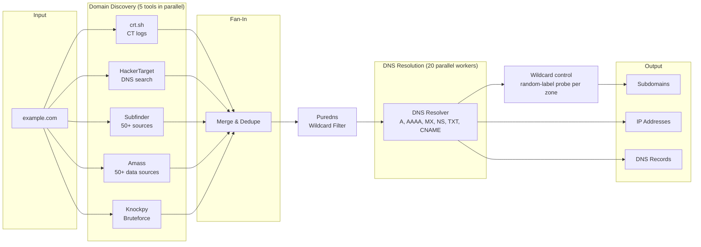

| What It Does | Output |
|--------------|--------|
| **WHOIS lookup** | Registrar, creation date, owner info |
| **Subdomain discovery** | Finds subdomains via 5 parallel sources (crt.sh, HackerTarget, Subfinder, Amass, Knockpy) |
| **Wildcard filtering** | Puredns validates subdomains against public DNS resolvers, removes wildcards and DNS-poisoned entries |
| **DNS enumeration** | A, AAAA, MX, NS, TXT, CNAME records (20 parallel workers) |
| **Wildcard control** | RedAmon's own check after DNS: drops names that answer only through their zone's wildcard DNS, and stamps the zone |
| **IP resolution** | Maps all discovered hostnames to IPs |

**Puredns can be skipped.** `run_puredns_resolve` returns `(names, status)`:
`"filtered"`, or `"skipped:<reason>"` with the list unchanged. Discovery stores the
status as `metadata.wildcard_filter`. `disabled` (the setting, or Stealth Mode) and
`no_input` are not cuts; `breaker_open`, `no_resolvers`, `no_output`, `timeout`,
`docker_missing` and `error` record a coverage gap (source `puredns`, no prune
effect, shown in the report's Coverage Limitations).

**The wildcard control** (`recon/helpers/wildcard_control.py`) runs whatever
puredns did, so it stands in when puredns was skipped:

- **Zones.** The scan root, plus each deeper parent with at least 5 direct
  candidates; a candidate is checked against its nearest probed zone. Each zone is
  probed with up to 3 random labels (`rdm-<uuid12>.<zone>`) through dnspython and the
  shared `resolver_breaker`; answers mean a wildcard zone, and their union is its
  `wildcard_ips`. Cached per run (`circuit_breaker.run_cache`).
- **The rule.** A candidate is dropped when its own A/AAAA set is non-empty and a
  subset of `wildcard_ips`, unless a non-guessing source listed it AND it has a
  CNAME that is not the wildcard's own. Guessing sources: knockpy with brute force,
  amass with `-brute` (`_guessing_sources`). A name with no address is unresolved,
  not a wildcard match, and is kept. The scan root is never checked.
- **Two entry points.** `filter_discovered` reads discovery's own `resolve_all_dns`
  answers (no extra lookups); `filter_late_names` serves the names added after
  puredns and looks up A/AAAA/CNAME only for names under a wildcard zone:
  `merge_discovered_hostnames` (certificate SANs, tlsx, JS recon, Uncover) and
  `run_tlsx_enrichment`, which lists the dropped SANs as `tlsx.wildcard_dropped` so
  the tlsx writer links no `COVERS_HOST` Subdomain to them (full and partial tlsx).
- **Limits.** At most 3 labels per zone and 50 zones per run; probes one at a time,
  paced to `ROE_GLOBAL_MAX_RPS` when RoE is on (the capper's own rule); an
  RoE-excluded zone is never queried. With `DNS_ENABLED` off the control does not
  run. Stealth Mode keeps DNS on and turns puredns off, so the control is what
  filters there.
- **Never evidence on failure.** A failed probe leaves the zone unknown: nothing
  under it is dropped, and a `wildcard_control` coverage gap is recorded, as for
  the zone cap and for DNS off when puredns did not filter either.
- **The graph.** Probed zones travel as `wildcard_zones` (`{zone: {is_wildcard,
  ips}}`, definite answers only). `update_graph_wildcard_zones` (Domain mixin)
  stamps `is_wildcard_zone` / `wildcard_ips` with MATCH and SET only: the org
  Domain for an org zone, the Subdomain of that name for a deeper one. The domain
  and partial discovery writers call it, and `main._stamp_wildcard_zones` once
  more at the end of each domain group for zones the late names added.

**DNS skipped.** With `resolve=False`, discovery writes every candidate's status as
`"unverified"`, the value uncover and the passive-DNS writers use for names nobody
resolved. `Subdomain.status` is shared with http_probe, which later writes
`"no_http"` or the HTTP code; the readers count "resolved" by a `RESOLVES_TO` edge
(report, Insights) or by `status = 'resolved'` (http_probe's `no_http` demotion),
so an unverified name never counts as resolved.

📖 **Key Parameters:**
```python
TARGET_DOMAIN = "example.com"           # Root domain
SUBDOMAIN_LIST = []                     # Empty = discover ALL
USE_BRUTEFORCE_FOR_SUBDOMAINS = False   # Brute force mode
```

---

### Module 2: `port_scan`

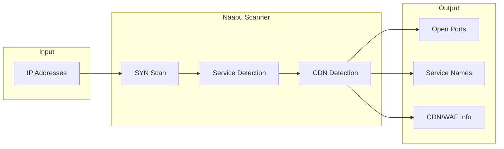

| What It Finds | Examples |
|---------------|----------|
| **Open ports** | 22/SSH, 80/HTTP, 443/HTTPS, 3306/MySQL |
| **CDN detection** | Cloudflare, Akamai, Fastly |
| **Service hints** | Common service identification |

📖 **Key Parameters:**
```python
NAABU_TOP_PORTS = "1000"        # Number of top ports
NAABU_RATE_LIMIT = 1000         # Packets per second
NAABU_SCAN_TYPE = "s"           # SYN scan
```

📖 **Detailed documentation:** [docs/readmes/README.PORT_SCAN.md](README.PORT_SCAN.md)

---

### Module 3: `http_probe`

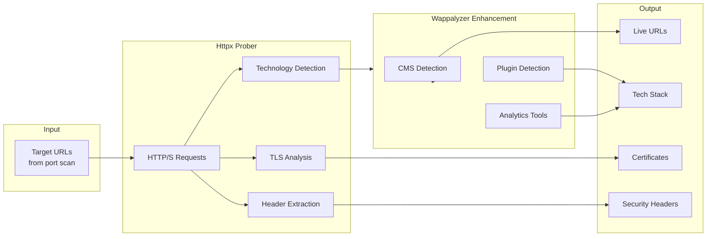

| What It Finds | Examples |
|---------------|----------|
| **Live URLs** | Which endpoints are responding |
| **Technologies** | WordPress, nginx, PHP, React |
| **CMS Plugins** | Yoast SEO, WooCommerce (via Wappalyzer) |
| **TLS certificates** | Issuer, expiry, SANs |

📖 **Detailed documentation:** [docs/readmes/README.HTTP_PROBE.md](README.HTTP_PROBE.md)

---

### Module 4: `resource_enum`

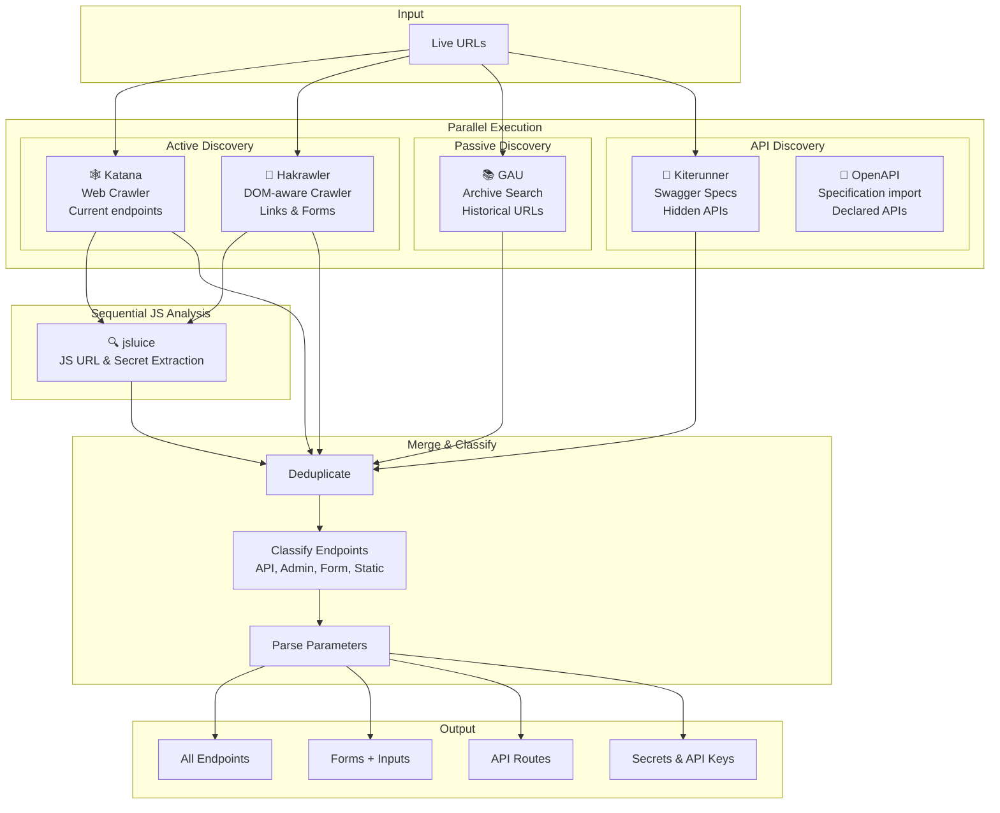

| Tool | Method | What It Finds |
|------|--------|---------------|
| **Katana** | Active crawling | Current live endpoints |
| **Hakrawler** | Active crawling | Links, forms, DOM-discovered URLs |
| **GAU** | Passive archives | Historical/deleted pages |
| **Kiterunner** | API bruteforce | Hidden API routes |
| **OpenAPI** | Specification import (never calls a declared operation) | Endpoints and parameters declared in OpenAPI/Swagger documents |
| **jsluice** | JS analysis (active download) | URLs, endpoints, and secrets from JS files |

📖 **Detailed documentation:** [docs/readmes/README.RESOURCE_ENUM.md](README.RESOURCE_ENUM.md)

---

### Module 4.5: `ai_surface_recon`

The **detection / fingerprinting half** of the adversarial-AI pipeline. Runs as
**Phase 4.5** (after `resource_enum`, before `vuln_scan`), gated on
`AI_SURFACE_RECON_ENABLED` (not on `SCAN_MODULES`). It sends **benign,
protocol-aware shape-probes** to confirm and characterize AI/LLM infrastructure
that generic web recon can't see — and writes the results onto the graph as
`ai_*` property annotations plus MCP tool-poisoning `Vulnerability` nodes. It
never jailbreaks, injects, or fuzzes, and never presents credentials.

Seven workloads run per host (hosts in parallel, workloads sequential within a host):

| # | Workload | Confirms / extracts |
|---|----------|---------------------|
| 1 | Chat-shape probe | LLM chat endpoint, dialect, streaming, p50 latency |
| 2 | MCP handshake + `tools/list` + YARA | MCP server, tools, capabilities, tool-poisoning findings |
| 3 | OpenAPI / manifest / model listing | tool/vision/streaming support, model ids + family, cached spec |
| 4 | Julius probe pack (YAML) | confirmed AI `Technology` (vLLM, Ollama, …) |
| 5 | Vector-DB confirmation reads | qdrant / chroma / weaviate / milvus, unauthenticated read exposure |
| 6 / 7 | latency baseline + summary glue | counters, merged model family |

**Input:** `resource_enum.by_base_url` (classified endpoints), `http_probe.by_url`
(AI flags), `port_scan.by_host` (AI + vector-DB ports).
**Output:** `combined_result["ai_surface_recon"]` → graph via
`update_graph_from_ai_surface_recon` (enriches `Endpoint` / `Parameter` /
`Technology`, adds `Vulnerability` nodes). Heavy deps (`mcp`, `yara`, `prance`,
`jq`, `PyYAML`) are lazy-imported, so a missing dep degrades one workload, not the job.

📖 **Detailed documentation:** [docs/readmes/AI_SURFACE_RECON_MODULE.md](AI_SURFACE_RECON_MODULE.md)

---

### Module 5: `vuln_scan`

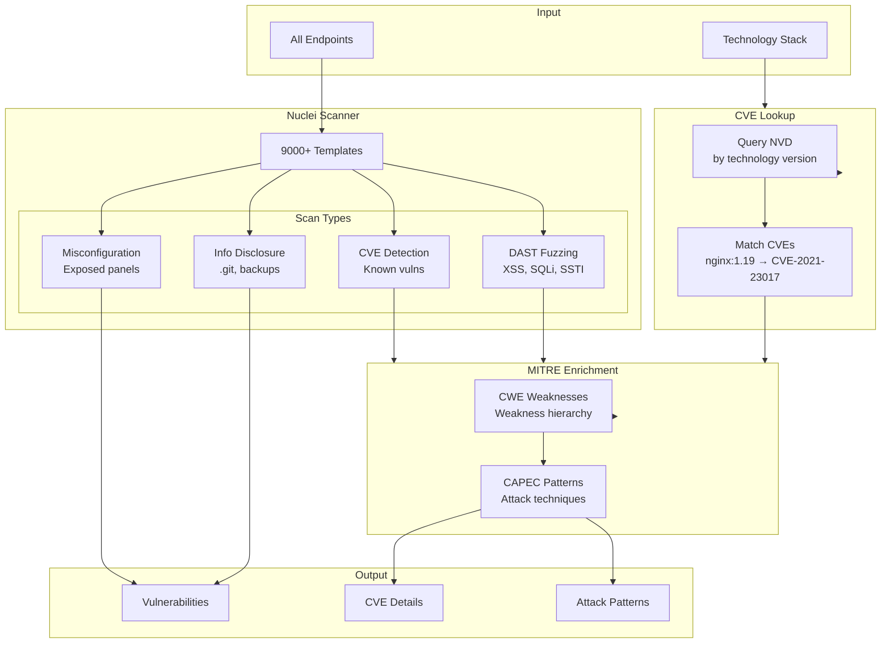

| What It Finds | Examples |
|---------------|----------|
| **Web CVEs** | Log4Shell, Spring4Shell |
| **Injection flaws** | SQL injection, XSS |
| **Misconfigurations** | Exposed admin panels |
| **CWE Weaknesses** | Weakness hierarchy |
| **CAPEC Attacks** | Attack techniques |

📖 **Detailed documentation:** [docs/readmes/README.VULN_SCAN.md](README.VULN_SCAN.md) | [docs/readmes/README.MITRE.md](README.MITRE.md)

---

### Module 5b: `graphql_scan`

Dedicated GraphQL security scanner -- runs as **GROUP 6 Phase A in parallel with Nuclei, Subdomain Takeover, and VHost & SNI Enumeration** because all four scanners consume `BaseURL` / `Endpoint` / `Technology` / `Subdomain` / `IP` and emit `Vulnerability` nodes but have zero data dependency on each other. Each phase-A tool is wrapped in an `_isolated` variant that deep-copies `combined_result` so the four threads never race on the shared dict.

Toggle: `GRAPHQL_SECURITY_ENABLED` (default: `false`, opt-in).

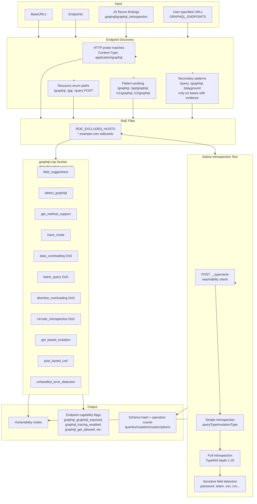

**Capabilities:**

| Layer | What It Does |
|-------|--------------|
| **Endpoint discovery** | Merges user-specified URLs, HTTP probe matches (`Content-Type: application/graphql`), resource-enum endpoints (paths containing `graphql`/`gql`/`query` via POST, or with `query`/`mutation`/`variables`/`operationName` parameters), JS Recon findings (`graphql` / `graphql_introspection` types), and pattern probes (primary `/graphql`, `/api/graphql`, `/v1/graphql`, `/v2/graphql`; secondary `/query`, `/gql`, `/graphiql`, `/playground` only on bases with prior evidence). |
| **RoE filtering** | Drops endpoints matching `ROE_EXCLUDED_HOSTS` (wildcards supported). Skipped count exposed in `summary.endpoints_skipped`. |
| **Native introspection test** | 3-step probe per endpoint: `POST { __typename }` reachability, simple introspection, full introspection at configurable TypeRef depth (1-20, default 10). Extracts schema hash (16-char SHA256), query/mutation/subscription counts, and sensitive-field list (`password`, `secret`, `token`, `key`, `api`, `private`, `credential`, `auth`, `ssn`, `credit`, `card`, `payment`, `bank`, `account`, `pin`, `cvv`, `salary`, `medical`). Response larger than 10 MB falls back to simple result. |
| **graphql-cop (opt-in)** | Docker-in-Docker wrapper around `dolevf/graphql-cop:1.14`. Runs 12 checks per endpoint: field suggestions, GraphiQL/Playground detection, trace mode, GET-method queries/mutations, POST url-encoded CSRF, alias overloading (DoS), batch query (DoS), directive overloading (DoS), circular introspection (DoS), unhandled errors. Per-test toggles are applied post-execution because the `1.14` image does not honor the `-e` flag. |
| **Authentication** | 5 modes: `bearer`, `cookie`, `header` (custom name), `basic` (base64), `apikey`. Values masked in logs. Same headers propagate to graphql-cop via `-H '{"K":"V"}'` JSON args. |
| **Rate limiting + retries** | Global RPS cap (`GRAPHQL_RATE_LIMIT`, 0-100), retry on `429`/`5xx` with exponential backoff (`GRAPHQL_RETRY_COUNT`, `GRAPHQL_RETRY_BACKOFF`), concurrency clamp (1-20). Sequential mode at `concurrency=1`. |
| **Endpoint enrichment** | Updates existing `Endpoint` nodes with capability flags (`graphql_graphiql_exposed`, `graphql_tracing_enabled`, `graphql_get_allowed`, `graphql_field_suggestions_enabled`, `graphql_batching_enabled`, `graphql_cop_ran`) — recorded even on negative results so the graph captures server state explicitly. |

**Stealth overrides:** `GRAPHQL_RATE_LIMIT=2`, `GRAPHQL_CONCURRENCY=1`, `GRAPHQL_TIMEOUT=60`, and the four DoS-class graphql-cop tests (alias / batch / directive / circular) forced off.

**Schema contract:** `KNOWN_VULN_KEYS` + `KNOWN_ENDPOINT_INFO_KEYS` in [graph_db/mixins/graphql_mixin.py](../../graph_db/mixins/graphql_mixin.py) pin every field the scanner may emit. Adding a new key without updating the mixin triggers a warning at graph-ingest time — no silent drops.

**Source layout:**

```
recon/graphql_scan/
├── __init__.py           # Package entry point
├── scanner.py            # Orchestration (run_graphql_scan, run_graphql_scan_isolated, test_single_endpoint)
├── discovery.py          # Endpoint discovery from 5 sources + RoE filtering
├── introspection.py      # Configurable-depth introspection query + schema operations
├── misconfig.py          # graphql-cop Docker-in-Docker wrapper (12 tests)
├── normalizers.py        # Finding normalization + severity aggregation
└── auth.py               # 5 auth modes (bearer/cookie/header/basic/apikey) with masked logs
```

📖 **Detailed documentation:** [graph_db/schema_sections.md — GraphQL-specific Endpoint & Vulnerability properties](../../graph_db/schema_sections.md) | **[Wiki: GraphQL Security Testing](https://github.com/samugit83/redamon/wiki/GraphQL-Security-Testing)**

---

### Module 5d: `vhost_sni_enum`

Hidden-virtual-host discovery scanner -- runs as the **fourth GROUP 6 Phase A sibling** alongside Nuclei, GraphQL Scan, and Subdomain Takeover. Probes every target IP twice per candidate hostname: an **L7** test that overrides the HTTP `Host` header and an **L4** test that pins TLS SNI via curl `--resolve`. Each probe is compared against a per-port baseline raw-IP request; a status-code change OR a body-size delta beyond `VHOST_SNI_BASELINE_SIZE_TOLERANCE` (default 50 bytes) flags an anomaly. L4 catches modern reverse proxies (NGINX ingress, Traefik, Cloudflare, k8s) that route at the TLS handshake before reading any HTTP header; L7 catches classic Apache / Nginx vhost routing.

Toggle: `VHOST_SNI_ENABLED` (default: `false`, opt-in). Zero new binaries -- relies on `curl` already in the recon image.

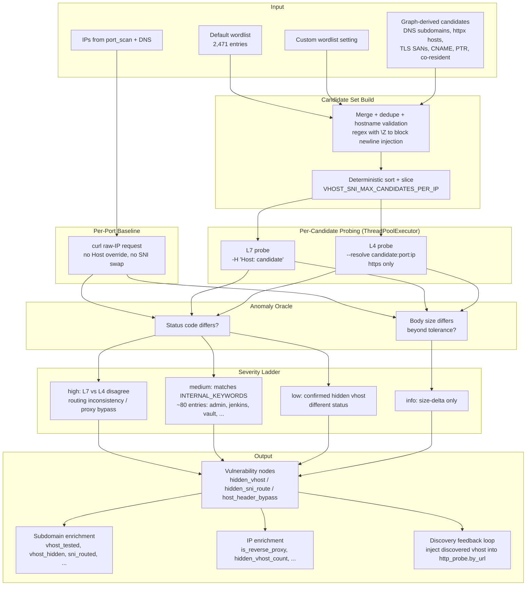

**Capabilities:**

| Layer | What It Does |
|-------|--------------|
| **IP target collection** | Merges (no fallback) every available IP source: `port_scan.by_host` (authoritative ports + per-port scheme overrides), then `dns.subdomains[*].ips.ipv4` and `dns.domain.ips.ipv4` get default 80/443 added. Per-IP port list deduped on `(port, scheme)`. |
| **Candidate set build** | Six sources merged: default wordlist (2,471 entries shipped in-image), custom wordlist setting, DNS subdomains resolving to the IP, httpx-known hosts on the IP, TLS SAN list per-URL, and CNAME/PTR/co-resident external domains. UTF-8 BOM auto-handled for Windows-edited overrides. Hostname validation uses `\Z` to block newline-injected hostnames from corrupting `--resolve` syntax. |
| **Per-port baseline** | One raw-IP curl request per port. Status `0` (curl couldn't connect) is dropped as no-data instead of being recorded as a real probe. |
| **L7 probing** | `-H "Host: <candidate>"` against `https://<ip>:<port>/`. Catches classic Apache / Nginx vhost routing. |
| **L4 probing** | `--resolve <candidate>:<port>:<ip>` so the TLS handshake carries the candidate as SNI. Catches modern reverse proxies (NGINX ingress, Traefik, Cloudflare, k8s) that route at the TLS layer. Skipped when scheme is `http` (no SNI to set). |
| **Anomaly detection** | Per-(candidate, layer) probe compared to baseline. Anomaly if status differs OR body size deviates beyond `VHOST_SNI_BASELINE_SIZE_TOLERANCE` (default 50 bytes). |
| **Severity ladder** | `high` when L7 and L4 disagree on the same hostname (proxy bypass primitive); `medium` when discovered vhost matches `INTERNAL_KEYWORDS` (~80 entries: `admin`, `jenkins`, `vault`, `keycloak`, `argocd`, `kibana`, `grafana`, ...); `low` for any anomaly with a different status code; `info` for size-delta-only anomalies. Compound names like `admin-portal` matched via longest-keyword-wins with lexicographic tie-break. |
| **Discovery feedback loop** | When `VHOST_SNI_INJECT_DISCOVERED=true` (default), discovered hidden vhosts are folded into `combined_result["http_probe"]["by_url"]` as fresh BaseURLs with `discovery_source="vhost_sni_enum"`, so downstream graph methods and follow-up partial-recon runs see them as real targets. |
| **Concurrency + safety** | All candidates per IP fanned out via internal `ThreadPoolExecutor(max_workers=VHOST_SNI_CONCURRENCY)` (default 20). Each curl invocation has a `--connect-timeout` + `--max-time = 3 * timeout`, plus a subprocess `timeout * 3 + 2` belt-and-braces guard. Per-IP candidate cap (default 2,000) is deterministic across reruns. |

**Stealth overrides:** `VHOST_SNI_ENABLED=false` outright. Bare-IP curl probes plus per-candidate retries are too noisy for stealth profiles.

**Three vulnerability shapes:**
- `host_header_bypass` (layer = `both`, attached to BOTH the Subdomain AND the IP node since the IP itself is the bypass surface)
- `hidden_sni_route` (layer = `L4`, attached to the Subdomain)
- `hidden_vhost` (layer = `L7`, attached to the Subdomain)

Each finding carries a deterministic id `vhost_sni_<host>_<ip>_<port>_<layer>` so rescans MERGE on the same Vulnerability node in Neo4j (no duplicates).

**Source layout:**

```
recon/main_recon_modules/vhost_sni_enum.py   # The full module (run_vhost_sni_enrichment, run_vhost_sni_enrichment_isolated, _build_candidate_set, _collect_ip_targets, _is_anomaly, _classify_severity, _inject_into_http_probe, _is_valid_hostname)
recon/wordlists/vhost-common.txt             # 2,471-entry default wordlist (shipped in-image)
graph_db/mixins/recon/vhost_sni_mixin.py     # Neo4jClient.update_graph_from_vhost_sni()
```

📖 **Detailed documentation:** [graph_db/schema_sections.md -- VHost/SNI Vulnerability properties + Subdomain/IP enrichment](../../graph_db/schema_sections.md) | **[Wiki: VHost & SNI Enumeration](https://github.com/samugit83/redamon/wiki/VHost-and-SNI-Enumeration)**

---

### Module 5e: `route_exposure`

Requests the routes recon found, and routes it generates, without credentials, and again
logged in where the project's authentication profile covers the host. Runs in GROUP 6
Phase A beside Nuclei and the other active scanners, after resource_enum and JS Recon have
landed. Toggle: `ROUTE_EXPOSURE_ENABLED` (default `false`). Code: `recon/route_exposure/`.

| Stage | What it does |
| --- | --- |
| Harvest | One route per (base URL, path, GET) from resource_enum (with its OpenAPI security, tags and declared-only flag and a discovery tool's 401/403), JS Recon's endpoints and http_probe's pages. Templated, static, auth-flow and state-changing paths (`logout`, `delete`, `reset`, ... as whole tokens) are never kept; a POST-only route is skipped. |
| Generate | Seed paths (internal, admin and debug, 60 per host), `.git`/`.svn`/`.hg`/`.env`/`web.config` at each base and top-level folder (30), backup variants of server-side files plus root archives and dumps (40, read with HEAD then `Range: bytes=0-1023`), older API versions (3 per route). Each has its own setting. |
| Rank | A deterministic prior score whose reasons are the `auth_expected_by` hints; the floor (score 5 or more, every VCS/env guess) goes first; per-host and total budgets, hosts round-robin. |
| Probe | One process-wide locked pacer (`ROUTE_EXPOSURE_MAX_RPS`, under the RoE ceiling), per-worker sessions that keep no cookie, `verify=False` with the TLS warning silenced, bodies capped at 256 KiB, no redirect followed, the host breaker, the stop flag, capture routing (logged-in requests only for bearer, basic and cookie profiles). One guard for every request and control: the run's own hosts follow the pipeline's address rule, a host seen only in a bundle must pass the probe scope and the attacker-URL rule. |
| Assess | Signatures first (a debug page answers 500), then the logged-in GET whatever the anonymous answer was, then the drops (denied, empty, catch-all by a control request sent exactly like the hit, login wall by the page-type prefilter) and the content signals (PII kinds and one count, sensitive key names, secret detector names). A second pass adds `siblings_locked` (same content kind as the locked neighbours), `version_locked` and `vary_auth`. |

Output: `combined_result["route_exposure"]` (summary, findings, endpoint_status,
new_endpoints) and, through `update_graph_from_route_exposure`, `Endpoint.anon_status`,
new Endpoints for generated routes that answered with content (never an artifact) and one
`:Vulnerability {source:'route_exposure'}` per finding: leads with
`needs_agent_confirmation` at severity info, findings with their signature's severity. A
failure is noted degraded so the prune keeps last run's findings. Logs are counts only.

---

### Module 6: `github`

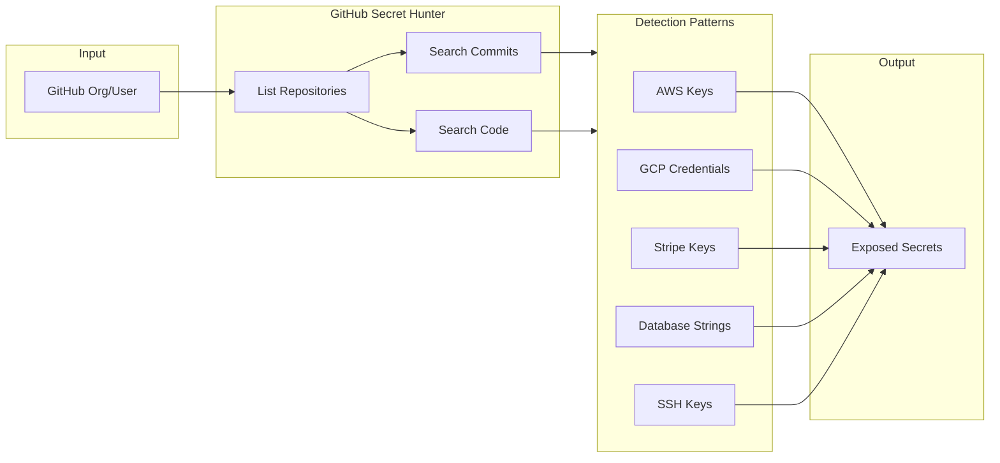

---

### Module 7: `trufflehog`

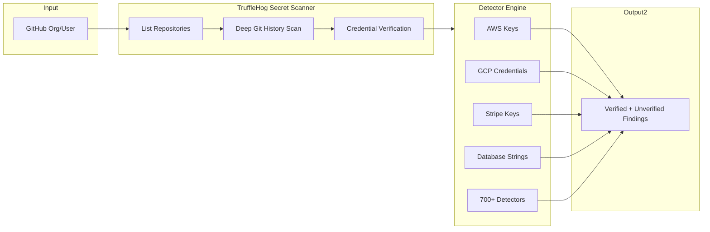

TruffleHog provides deep credential detection by scanning the full git history of all repositories belonging to the target GitHub organization or user. Unlike the built-in GitHub Secret Hunter (regex + entropy), TruffleHog uses a detector-based engine with 700+ credential detectors and can **verify** whether discovered credentials are still active.

| Feature | GitHub Secret Hunter | TruffleHog |
|---------|---------------------|------------|
| Detection method | 40+ regex patterns + Shannon entropy | 700+ detector-based engine |
| Verification | No | Yes (active credential checking) |
| Git history depth | Commit + code search API | Full local clone history |
| Output | Secrets + Sensitive files | Verified + Unverified findings |

The `scanners/trufflehog_scan/` directory contains the scanner wrapper and its docker-compose service definition.

---

## 🆚 Complete Tool Comparison

### Overview Matrix

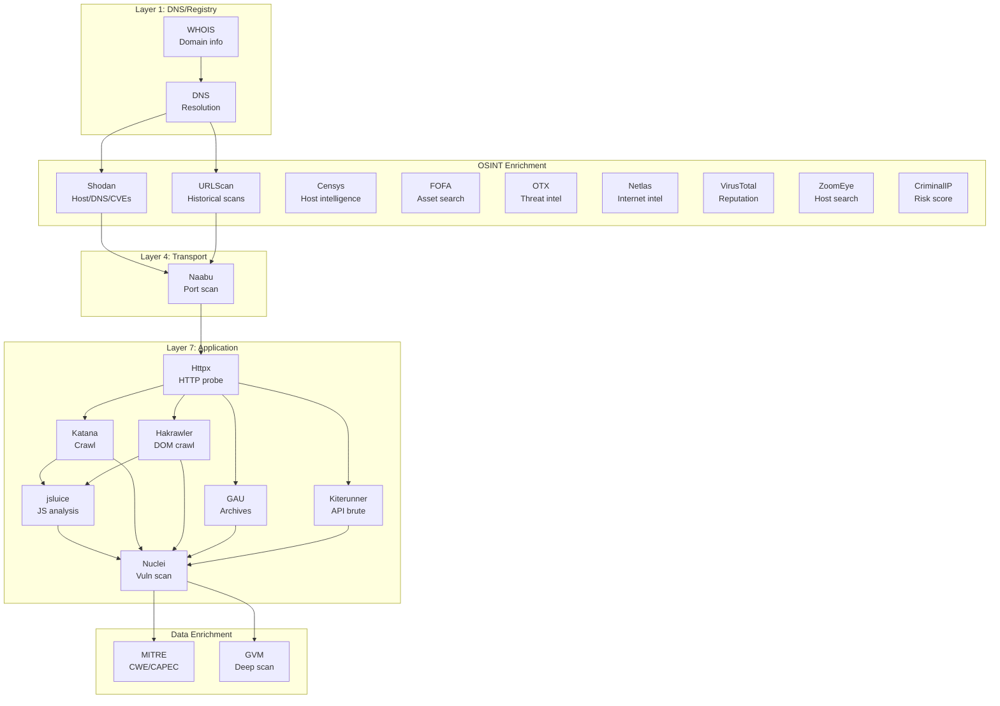

### Feature Comparison

| Feature | WHOIS | DNS | Shodan | URLScan | Censys | FOFA | OTX | Netlas | VirusTotal | ZoomEye | CriminalIP | Masscan | Naabu | httpx | Katana | Hakrawler | GAU | Kiterunner | OpenAPI | jsluice | Nuclei | GVM |
|---------|-------|-----|--------|---------|--------|------|-----|--------|------------|---------|------------|---------|-------|-------|--------|-----------|-----|------------|---------|---------|--------|-----|
| **Domain Info** | ✅ | ⚠️ | ❌ | ❌ | ❌ | ⚠️ | ⚠️ | ⚠️ | ❌ | ⚠️ | ❌ | ❌ | ❌ | ❌ | ❌ | ❌ | ❌ | ❌ | ❌ | ❌ | ❌ | ❌ |
| **IP Resolution** | ❌ | ✅ | ⚠️ | ⚠️ | ⚠️ | ⚠️ | ⚠️ | ⚠️ | ⚠️ | ⚠️ | ⚠️ | ❌ | ⚠️ | ✅ | ❌ | ❌ | ❌ | ❌ | ❌ | ❌ | ❌ | ❌ |
| **Subdomain Discovery** | ❌ | ❌ | ⚠️ | ✅ | ❌ | ⚠️ | ❌ | ⚠️ | ❌ | ❌ | ❌ | ❌ | ❌ | ❌ | ❌ | ❌ | ❌ | ❌ | ❌ | ❌ | ❌ | ❌ |
| **Port / Service Data** | ❌ | ❌ | ⚠️ | ❌ | ✅ | ✅ | ❌ | ✅ | ✅ | ✅ | ⚠️ | ✅ | ✅ | ❌ | ❌ | ❌ | ❌ | ❌ | ❌ | ❌ | ❌ | ✅ |
| **Live URL Check** | ❌ | ❌ | ❌ | ❌ | ❌ | ❌ | ❌ | ❌ | ❌ | ❌ | ❌ | ❌ | ❌ | ✅ | ❌ | ❌ | ❌ | ❌ | ❌ | ❌ | ❌ | ❌ |
| **Tech Detection** | ❌ | ❌ | ⚠️ | ⚠️ | ⚠️ | ⚠️ | ❌ | ⚠️ | ⚠️ | ⚠️ | ❌ | ❌ | ❌ | ✅ | ❌ | ❌ | ❌ | ❌ | ❌ | ❌ | ⚠️ | ⚠️ |
| **Endpoint Discovery** | ❌ | ❌ | ❌ | ⚠️ | ❌ | ❌ | ❌ | ❌ | ❌ | ❌ | ❌ | ❌ | ❌ | ❌ | ✅ | ✅ | ✅ | ✅ | ✅ | ⚠️ | ❌ | ❌ |
| **Historical URLs** | ❌ | ❌ | ❌ | ✅ | ❌ | ❌ | ⚠️ | ❌ | ❌ | ❌ | ❌ | ❌ | ❌ | ❌ | ❌ | ❌ | ✅ | ❌ | ❌ | ❌ | ❌ | ❌ |
| **Threat Reputation** | ❌ | ❌ | ❌ | ❌ | ❌ | ❌ | ✅ | ❌ | ✅ | ❌ | ✅ | ❌ | ❌ | ❌ | ❌ | ❌ | ❌ | ❌ | ❌ | ❌ | ❌ | ❌ |
| **Passive DNS** | ❌ | ❌ | ⚠️ | ❌ | ❌ | ❌ | ✅ | ✅ | ❌ | ❌ | ❌ | ❌ | ❌ | ❌ | ❌ | ❌ | ❌ | ❌ | ❌ | ❌ | ❌ | ❌ |
| **Malware / CVE Intel** | ❌ | ❌ | ✅ | ❌ | ❌ | ❌ | ✅ | ❌ | ✅ | ❌ | ✅ | ❌ | ❌ | ❌ | ❌ | ❌ | ❌ | ❌ | ❌ | ❌ | ✅ | ✅ |
| **TLS / Certificate** | ❌ | ❌ | ⚠️ | ⚠️ | ✅ | ✅ | ❌ | ✅ | ❌ | ✅ | ⚠️ | ❌ | ❌ | ✅ | ❌ | ❌ | ❌ | ❌ | ❌ | ❌ | ❌ | ❌ |
| **Geolocation / ASN** | ❌ | ❌ | ✅ | ⚠️ | ✅ | ✅ | ⚠️ | ✅ | ⚠️ | ✅ | ✅ | ❌ | ❌ | ⚠️ | ❌ | ❌ | ❌ | ❌ | ❌ | ❌ | ❌ | ❌ |
| **API Discovery** | ❌ | ❌ | ❌ | ❌ | ❌ | ❌ | ❌ | ❌ | ❌ | ❌ | ❌ | ❌ | ❌ | ❌ | ❌ | ❌ | ❌ | ✅ | ✅ | ❌ | ❌ | ❌ |
| **XSS/SQLi Testing** | ❌ | ❌ | ❌ | ❌ | ❌ | ❌ | ❌ | ❌ | ❌ | ❌ | ❌ | ❌ | ❌ | ❌ | ❌ | ❌ | ❌ | ❌ | ❌ | ❌ | ✅ | ⚠️ |
| **Secret Detection** | ❌ | ❌ | ❌ | ❌ | ❌ | ❌ | ❌ | ❌ | ❌ | ❌ | ❌ | ❌ | ❌ | ❌ | ❌ | ❌ | ❌ | ❌ | ❌ | ✅ | ❌ | ❌ |

**Legend:** ✅ Primary | ⚠️ Limited | ❌ Not supported

### Timing Comparison

| Tool | Typical Duration | Notes |
|------|------------------|-------|
| WHOIS | <1 second | Instant |
| DNS | <1 second | Instant |
| Shodan | 5-15 seconds | Passive, per-IP queries |
| URLScan | 5-20 seconds | Passive, API rate-limited |
| Censys | 5-30 seconds | Passive, per-IP queries, 429 detection |
| FOFA | 5-30 seconds | Passive, domain/IP query, max 10,000 results |
| OTX | 5-60 seconds | Passive, per-IP + per-domain queries |
| Netlas | 5-30 seconds | Passive, per-IP/domain queries, max 1,000 results |
| VirusTotal | 1-5 minutes | Free tier: 4 req/min; 65s wait on rate limit |
| ZoomEye | 5-30 seconds | Passive, per-IP/domain queries, max 1,000 results |
| CriminalIP | 5-30 seconds | Passive, per-IP + per-domain queries |
| Amass | 1-10 minutes | Passive; longer with active/brute |
| Puredns | 30-90 seconds | Depends on subdomain count |
| Masscan | 1-30 seconds | Fastest for large CIDR ranges |
| Naabu | 5-10 seconds | 1000 ports |
| httpx | 10-30 seconds | All options |
| Katana | 1-5 minutes | Crawl depth 3 |
| Hakrawler | 30-120 seconds | Active crawling, depth 2 |
| GAU | 10-30 seconds | Passive |
| jsluice | 10-60 seconds | Active JS download + analysis |
| Nuclei | 1-30 minutes | Depends on templates |
| GVM | 30 min - 2+ hours | Full scan |

---

## ⚙ Key Configuration Parameters

### Essential Settings

All settings are managed through the webapp project form or via environment variables. Key defaults are defined in `project_settings.py`:

| Setting | Default | Description |
|---------|---------|-------------|
| `TARGET_DOMAIN` | — | Root domain to scan |
| `SUBDOMAIN_LIST` | `[]` | Empty = discover all |
| `SCAN_MODULES` | all 5 modules | Modules to run |
| `NAABU_TOP_PORTS` | `"1000"` | Top-N ports to scan |
| `NAABU_SCAN_TYPE` | `"s"` | SYN scan |
| `MASSCAN_RATE` | `1000` | Masscan packets/sec |
| `OTX_ENABLED` | `true` | OTX threat intel enrichment (anonymous by default) |
| `VIRUSTOTAL_RATE_LIMIT` | `4` | VirusTotal requests per minute (free tier) |
| `VIRUSTOTAL_MAX_TARGETS` | `20` | Max IPs+domains to query with VirusTotal |
| `FOFA_MAX_RESULTS` | `1000` | FOFA results per query (max 10,000) |
| `NETLAS_MAX_RESULTS` | `1000` | Netlas results per query (max 1,000) |
| `ZOOMEYE_MAX_RESULTS` | `1000` | ZoomEye results per query |
| `NUCLEI_DAST_MODE` | `true` | Active fuzzing |
| `NUCLEI_SEVERITY` | critical, high, medium, low | Severity filter |
| `WAPPALYZER_ENABLED` | `true` | Technology detection |
| `MITRE_INCLUDE_CWE` | `true` | CWE enrichment |
| `MITRE_INCLUDE_CAPEC` | `true` | CAPEC enrichment |

---

## 🔧 Prerequisites

### Docker Mode (Recommended)

- **Docker** with Docker Compose
- **Docker daemon access via the filtering broker** for nested (sibling) container execution

```bash
# Verify Docker is running
docker info

# Build and run
cd recon/
docker-compose build
docker-compose run --rm recon python /app/recon/main.py
```

### Tool Containers (auto-pulled)

| Tool | Docker Image | Purpose |
|------|--------------|---------|
| Masscan | Built from source (native binary) | High-speed SYN port scanning |
| Naabu | `projectdiscovery/naabu:latest` | Port scanning |
| httpx | `projectdiscovery/httpx:latest` | HTTP probing |
| Nuclei | `projectdiscovery/nuclei:latest` | Vuln scanning |
| Katana | `projectdiscovery/katana:latest` | Web crawling |
| GAU | `sxcurity/gau:latest` | URL discovery |
| Amass | `caffix/amass:latest` | Subdomain enumeration |
| Puredns | `frost19k/puredns:latest` | Wildcard filtering |

---

## 📁 Project Structure

```
recon/
├── Dockerfile                # Container build (the redamon-recon image)
├── docker-compose.yml        # Standalone compose (the root docker-compose.yml runs the stack)
├── entrypoint.sh             # Container entrypoint
├── project_settings.py       # 🔗 Settings fetcher (API or built-in defaults)
├── settings_registry.py      # Reads the recon settings registry (recon_settings/registry.json)
├── main.py                   # 🚀 Full-pipeline entry point
├── partial_recon.py          # Partial recon: one tool on demand, inputs from the graph
├── main_recon_modules/       # One module per pipeline tool
│   ├── domain_recon.py       #   Subdomain discovery
│   ├── whois_recon.py        #   WHOIS lookup
│   ├── urlscan_enrich.py     #   URLScan.io OSINT enrichment
│   ├── shodan_enrich.py      #   Shodan / InternetDB enrichment
│   ├── censys_enrich.py      #   Censys, and fofa_, otx_, netlas_, virustotal_, zoomeye_,
│   │                         #   criminalip_, uncover_enrich.py beside it
│   ├── port_scan.py          #   Port scanning (Naabu); masscan_scan.py, nmap_scan.py beside it
│   ├── http_probe.py         #   HTTP probing (+ Wappalyzer); tls_scan.py beside it
│   ├── resource_enum.py      #   Endpoint discovery
│   ├── js_recon.py           #   JavaScript analysis
│   ├── ai_surface_recon.py   #   AI/LLM/MCP/vector-DB surface fingerprinting (Phase 4.5)
│   ├── vuln_scan.py          #   Vulnerability scanning (Nuclei)
│   ├── add_mitre.py          #   MITRE enrichment
│   ├── subdomain_takeover.py, vhost_sni_enum.py, origin_discovery.py,
│   │   supply_chain_recon.py, sca_intel_correlate.py, ip_filter.py
│   └── data/                 #   📦 Cached databases
│       ├── mitre_db/         #     CVE2CAPEC database (CVE year files downloaded at scan time)
│       └── wappalyzer_cache/ #     Technology rules, refreshed by http_probe.py
├── partial_recon_modules/    # Per-tool modules for partial recon
├── helpers/                  # Tool helpers (ai_planner/, js_recon/, openapi/, resource_enum/, supply_chain/)
├── graphql_scan/             # GraphQL probe
├── cache_scan/               # Web cache poisoning probe
├── serialized_scan/          # Serialized-object probe
├── route_exposure/           # Route exposure scan (anonymous vs logged-in routes, exposed files)
├── data/                     # Static data (IANA services, popular npm names)
├── wordlists/                # vhost wordlist
├── tests/                    # pytest suite (runs in the redamon-recon image)
└── output/                   # 📄 Scan results (JSON)
```

The GitHub secret hunt and TruffleHog run in their own images, from
`scanners/github_secret_hunt/` and `scanners/trufflehog_scan/`; the module docs
are in `docs/readmes/` (this folder).

---

## 📊 Output Format

All modules write to: `recon/output/recon_<domain>.json`

```mermaid
flowchart TB
    subgraph JSON["recon_domain.json"]
        Meta[metadata<br/>scan info, timestamps]
        WHOIS[whois<br/>registrar, dates]
        Subs[subdomains<br/>discovered hosts]
        DNSData[dns<br/>A, MX, TXT records]
        Ports[port_scan<br/>open ports, services]
        HTTP[http_probe<br/>live URLs, tech stack]
        Resources[resource_enum<br/>endpoints, forms]
        AISurface[ai_surface_recon<br/>AI/LLM/MCP/vector-DB]
        Vulns[vuln_scan<br/>CVEs, misconfigs]
        TechCVE[technology_cves<br/>version-based CVEs]
    end

    Meta --> WHOIS
    WHOIS --> Subs
    Subs --> DNSData
    DNSData --> Ports
    Ports --> HTTP
    HTTP --> Resources
    Resources --> AISurface
    AISurface --> Vulns
    Vulns --> TechCVE
```

---

## 🧪 Test Targets

Safe, **legal** targets for security testing:

| Target | Technology | Vulnerabilities |
|--------|------------|-----------------|
| `testphp.vulnweb.com` | PHP + MySQL | SQLi, XSS, LFI |
| `testhtml5.vulnweb.com` | HTML5 | DOM XSS |
| `testasp.vulnweb.com` | ASP.NET | SQLi, XSS |
| `scanme.nmap.org` | N/A | Port scanning only |

```python
# Example configuration
TARGET_DOMAIN = "vulnweb.com"
SUBDOMAIN_LIST = ["testphp."]
NUCLEI_DAST_MODE = True
```

---

## ⚠️ Legal Disclaimer

**Only scan systems you own or have explicit written permission to test.**

Unauthorized scanning is illegal. RedAmon is intended for:
- Penetration testers with proper authorization
- Security researchers on approved targets
- Bug bounty hunters within program scope
- System administrators testing their infrastructure

---

## 📖 Detailed Documentation

| Module | Documentation |
|--------|---------------|
| Port Scan | [docs/readmes/README.PORT_SCAN.md](README.PORT_SCAN.md) |
| HTTP Probe | [docs/readmes/README.HTTP_PROBE.md](README.HTTP_PROBE.md) |
| Vuln Scan | [docs/readmes/README.VULN_SCAN.md](README.VULN_SCAN.md) |
| MITRE CWE/CAPEC | [docs/readmes/README.MITRE.md](README.MITRE.md) |
| GVM/OpenVAS | [README.GVM.md](README.GVM.md) |
